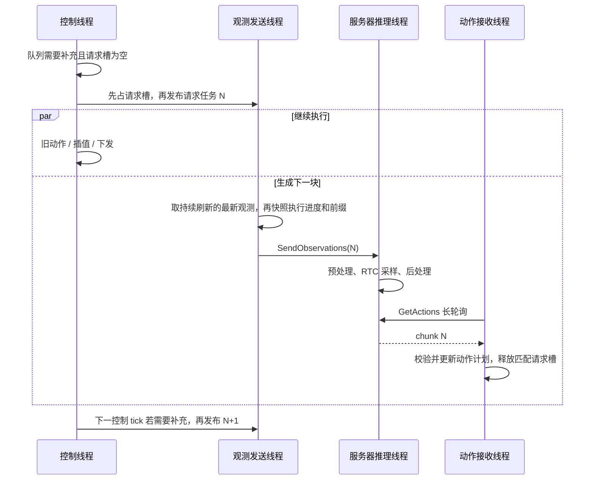
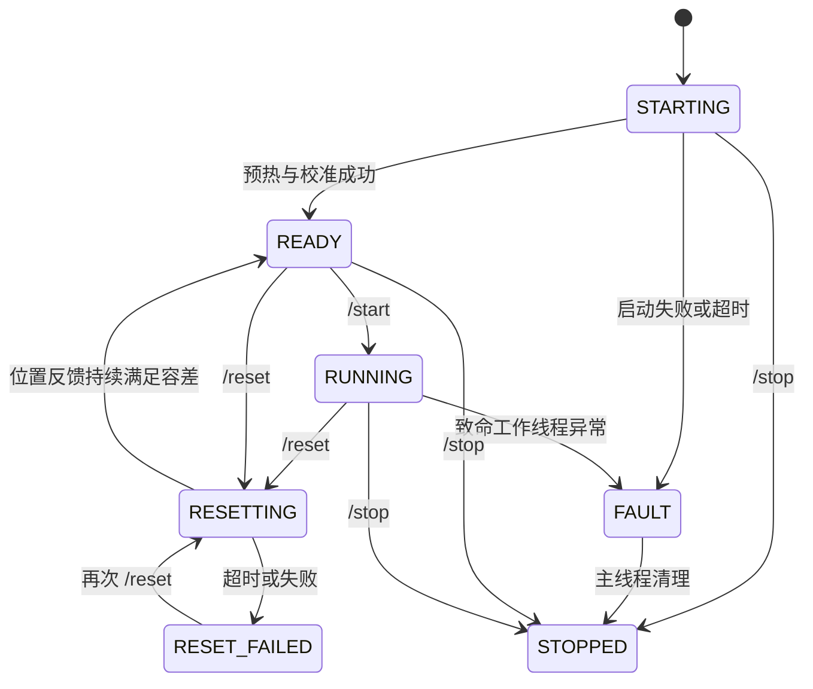

# 远程部署架构：请求调度、RTC 与动作执行

[文档首页](../README.md) · [架构索引](README.md) · [真机部署指令](../workflows/deployment/README.md) · [故障排查](../troubleshooting/deployment.md)

本文保留请求、线程、动作计划和复位的实现说明。原说明基线为 2026-10-15，目录边界于 2026-10-17 更新；后续功能与验证日期在各专题内保留。双端目录见 [异步推理模块](async-inference.md)，人工接管见 [DAgger 架构](dagger.md)。

图像输入、精度档位与预热独立放在 [PI05 推理架构](pi05-inference.md)；延迟试验及历史测量放在 [PI05 性能排查](../troubleshooting/pi05-performance.md)。

## 本页阅读路线

- [文件职责](#2-从哪些文件读起)、[线程与请求](#3-线程队列与一次正常请求)、[执行步与请求编号](#4-动作步插值占用与请求-id)。
- [Guided RTC](#5-guided-rtc什么时候请求如何生成如何合并)、[插值和驱动平滑](#6-线性插值与-piper-ema)、[Trained 训练条件](#7-trained-rtc训练端到底改变了什么)与[远端执行](#8-trained-rtc远程部署的独立路径)。
- [复位与重试](#10-重试复位和故障)、[双端参数职责](#11-参数应放在哪一端)、[连续观测](#16-持续采集发请求时选择最新快照)。

<a id="1-系统解决什么问题"></a>

## 系统解决什么问题

模型一次预测 `actions_per_chunk` 个未来动作。机器人执行旧动作时，后台采集观测、上传到服务器、生成下一块动作，再将仍有效的部分接入执行计划。

四件事分工不同：

| 机制 | 解决的问题 | 发生位置 |
| --- | --- | --- |
| 异步客户端/服务器 | 采集、网络和推理较慢时，控制线程仍能执行已有动作 | deployment 基础设施 |
| Guided RTC | 生成下一块时参考旧轨迹，改善跨块衔接 | 服务器的去噪过程 |
| Trained RTC | 训练模型在已知干净动作前缀下预测后续动作，推理时固定前缀 | Pi05 训练代码 + 独立部署 runtime |
| 线性插值 | 在两个 policy endpoint 之间增加下发命令 | 客户端 `ActionInterpolator` |

单请求在途和异步执行可以同时成立：**只有一个仍有效的推理请求，但机器人与该请求的采集、传输、推理并行工作。** `SendObservations` 上传成功仅表示服务器收到了请求，不表示动作已生成。

<a id="2-从哪些文件读起"></a>

## 从哪些文件读起

| 文件 | 主要职责 / 推荐定位符 |
| --- | --- |
| [robot_client_deployment.py](../../src/lerobot/async_inference/client/robot_client_deployment.py) | `RobotClientDeployment` 生命周期、单请求门控、观测快照；`_InterpolatedClient` 插值下发；`_InterpolatedActionSchedule` guided 动作计划 |
| [policy_server_deployment.py](../../src/lerobot/async_inference/server/policy_server_deployment.py) | `PolicyServerDeployment` 握手/模型缓存/代际切换；`_RTCServer` 推理工作线程和 guided RTC |
| [rtc_trained.py](../../src/lerobot/async_inference/shared/rtc_trained.py) | `TrainedRTCClientRuntime`、`TrainedRTCServerRuntime`、`TrainedActionSchedule` |
| [rtc_remote.py](../../src/lerobot/async_inference/shared/rtc_remote.py) | 请求、动作块、重试响应、动作引用、协议版本，以及 rollout generation / 请求序号的编解码 |
| [configs.py](../../src/lerobot/async_inference/shared/configs.py) | 公共配置与旧异步入口专用配置的拆分 |
| [action_interpolator.py](../../src/lerobot/utils/action_interpolator.py) / [cycle_timer.py](../../src/lerobot/utils/cycle_timer.py) | 线性插值与控制节拍 |
| [modeling_rtc.py](../../src/lerobot/policies/rtc/modeling_rtc.py) / [relative.py](../../src/lerobot/policies/rtc/relative.py) | guided 权重、引导修正，以及相对动作前缀重新锚定 |
| [modeling_pi05.py](../../src/lerobot/policies/pi05/modeling_pi05.py) / [flow_matching.py](../../src/lerobot/policies/common/flow_matching.py) | trained RTC 的训练输入、loss、硬前缀去噪 |

实际客户端继承关系为：

```text
_RTCClient
  └─ _InterpolatedClient
       └─ RobotClientDeployment
```

实际服务器继承关系为：

```text
_BasePolicyServer
  └─ _RTCServer
       └─ PolicyServerDeployment
```

入口没有继承历史 `robot_client_rtc*` / `policy_server_rtc*` 文件。旧实现已删除，研究当前行为时应沿上面的类层次阅读。

<a id="3-线程队列与一次正常请求"></a>

## 线程、队列与一次正常请求

<a id="31-谁在并行运行"></a>

### 谁在并行运行

| 执行者 | 主要工作 | 等待/通信对象 |
| --- | --- | --- |
| 客户端主线程及 prompt 辅助线程 | `/start`、`/reset`、`/stop`，监控退出并清理硬件 | 生命周期条件变量、退出事件 |
| `control_loop` | 消耗动作、插值、下发命令，并判断是否需要新观测 | 本地 action schedule |
| `rtc-observation-collector` | 自主运行期间持续采集，只保留最新完整观测 | 单份 `_latest_observation`，与 RPC 独立 |
| `observation_sender` | 收到请求任务后取最新有效观测、构造当前前缀、上传请求 | 单槽 `_request_mailbox` |
| `receive_actions` | 持续调用 `GetActions` 长轮询，接收动作或 retry | 服务器 `_action_mailbox` |
| 服务器 gRPC 处理线程 | 接收完整观测，校验 ID，发布到单槽邮箱 | `_observation_mailbox` |
| 服务器 `RemoteRTCInference` 线程 | 串行处理最新待推理观测，运行预处理/模型/后处理 | 模型和 processor |

三个原有客户端工作线程通过 barrier 启动，发送线程负责启动独立采集线程；连接完成后处于 `READY`，需要 `/start` 才采集 rollout 观测。gRPC 可以有多个处理线程，但正常模型推理由一个后台工作线程串行执行。



图中箭头简化了 gRPC 接收线程和服务端邮箱，模型不会在上传 RPC 里同步完成。

<a id="32-请求槽为何要在发布请求任务之前占用"></a>

### 请求槽为何要在发布请求任务之前占用

`RobotClientDeployment._request_observation_if_ready()` 按以下顺序执行：

1. 确认当前为 `RUNNING`，处理已有请求超时。
2. 如果 `_inflight_request_id` 非空，直接返回，连队列扫描都跳过。
3. 查询剩余连续动作数和触发阈值；无需补充时返回。
4. 构造 ID，设置 `_inflight_request_id`、请求起始时间，再写入请求邮箱。

请求槽覆盖 **邮箱等待 → 选择/等待新鲜观测 → 序列化 → 上传 → 推理 → 动作返回及处理**。采集线程可在此期间持续更新缓存，但不会自行发请求。邮箱只有一个位置本身不足以实现这个约束；真正的约束是请求槽。

正常情况下，下一次请求基于上一结果处理后的计划产生。这避免“上一请求未返回，队列已接近耗尽，又用极短旧前缀发出另一请求；随后前一个结果改写了实际执行路径”的时序问题。它不保证网络足够快，也不保证永不缺动作。

<a id="33-触发时刻和采集快照时刻不同"></a>

### 触发时刻和采集快照时刻不同

控制线程发布请求任务时，并没有立即固定 action prefix。默认发送线程选择后台最新完成、满足新鲜度要求的观测，然后取得当前执行快照。关闭 `continuous_observation` 时，才恢复请求触发后调用 `robot.get_observation()` 的方式：

```text
触发时 executed = 100
等待发送线程/新鲜观测期间机器人继续执行
快照时 executed = 103
请求的 chunk_start / observation.timestep = 104
前缀也从快照时的实际剩余计划取
```

`_snapshot_execution_state()` 将动作进度和动作前缀配对，缓存只保存传感器值。相机调用和上传 RPC 放在 lifecycle 锁之外，采集前后重新检查 generation，避免慢相机/网络阻塞动作下发和代际切换；实际复位运动仍与正在进行的硬件采集互斥。

这是**调度元数据的一致快照**，不代表关节、各相机曝光、网络时钟具备硬件级同步。缓存存在有限的传感器滞后，通过 `observation_max_age_s` 限制并单独记录；详见[持续采集，发请求时选择最新快照](deployment.md#16-持续采集发请求时选择最新快照)。

<a id="4-动作步插值占用与请求-id"></a>

## 动作步、插值占用与请求 ID

有两个不同的 “in-flight”，不能混淆：

| 状态 | 含义 | 何时释放 |
| --- | --- | --- |
| `_inflight_request_id` | 一个仍有效的观测/推理请求 | 结果处理、失败、超时或生命周期失效 |
| `action_schedule._inflight` | 插值器已经取走、正在向其运动的 policy endpoint | 该 endpoint 的最后一个插值命令成功下发 |

guided schedule 把“可替换未来动作”和“插值器占用的 endpoint”分开。`consume_next()` 将下一个 endpoint 从未来字典移入 `_inflight`；后来的 chunk 不能修改它。`qsize()` 和 prefix 快照仍包含这个 endpoint，因为它还没下发完。

`latest_action` 表示最后一个完成命令下发的 policy endpoint 索引，不是已由位置传感器验证到位的索引。`first_mutable_step()` 越过已下发和正在插值的 endpoint，给出真正允许新 chunk 改写的第一步。

请求 ID 使用：

```text
observation_id = (rollout_generation << 32) | request_sequence
```

开始新 rollout、复位、停止，以及 DAgger 暂停都会更新 generation。旧请求即使晚到，也不能修改新一轮计划。同一 generation 内的超时请求另有 `_retired_request_id` 防止其晚到结果生效。

<a id="5-guided-rtc什么时候请求如何生成如何合并"></a>

## Guided RTC：什么时候请求、如何生成、如何合并

<a id="51-客户端触发阈值"></a>

### 客户端触发阈值

记 `C = actions_per_chunk`，`q = 剩余连续 policy endpoint 数`，`m = rtt_trigger_margin_steps`。

固定阈值为 `q0 = floor(C * chunk_size_threshold)`。默认 `chunk_size_threshold=0.5`。

当 `adaptive_rtt_trigger=true` 且已有请求延迟估计时：

```text
R = ceil(平滑后的“触发请求到动作返回”延迟步数)
latency_guard    = R + m
continuous_refill = C - R + m
threshold = min(C - 1, max(q0, latency_guard, continuous_refill))
```

`q <= threshold` 且请求槽为空时允许补充；`_force_fresh_snapshot` 可跳过队列阈值，但仍不能越过请求槽。

默认自适应模式在匹配请求的结果到达后，会设置 `_force_fresh_snapshot`，在**下一个控制 tick** 允许采集新的观测。即使这次返回比历史估计快、队列仍很长，也不会为了等到阈值而延后重规划。关闭 `adaptive_rtt_trigger` 可恢复 guided 固定阈值触发。

`latency_guard` 为下一次等待保留动作；`continuous_refill` 让已返回的块在剩余动作不多时能尽快接续下一请求。较慢延迟样本立即抬高估计，较快样本以 `0.2` 的比例逐步降低估计。请求槽占用期间，阈值再高也不会发出第二个有效请求。

这一估计使用单调时钟，包含采集前的邮箱等待及采集时间。它和服务器用于去噪的 delay buffer 是两套用途不同的量。代码还会对 `2 * 本次延迟步数 + m >= C` 的持续容量不足给出警告；警告不会自动增大 chunk 或降低 fps。

<a id="52-前缀用引用传输"></a>

### 前缀用引用传输

guided 请求主要包含：

```text
RemoteRTCObservation
  observation                  观测、任务、时间戳、起始步
  observation_id               generation + 请求序号
  executed_action_step         已消耗到的 policy step
  action_refs                  未来连续动作的来源引用
  latency_feedback_*           上一有效结果的延迟反馈
```

普通引用 `RTCActionRef(source_observation_id, action_index)` 指向服务器缓存中某块的某一行。服务器同时缓存模型空间动作和后处理后的可执行动作，默认保留 10 块。

`_reconstruct_prefix()` 最多重建 `rtc.execution_horizon` 步。若引用丢失，返回 `prefix_unavailable` 重试响应，要求客户端重新采集；不会静默把“无法重建前缀”解释为“可以不使用动作前缀”。

若 checkpoint 使用相对动作，旧块相对的是旧观测状态。服务器用缓存的**绝对动作**和**本次观测状态**重新做相对化、归一化，避免直接沿用旧坐标原点。

<a id="53-服务器生成下一块"></a>

### 服务器生成下一块

主调用链是：

```text
_predict_remote_chunk()
  → raw_observation_to_observation()
  → preprocessor：观测预处理，并保存本次相对动作参考状态
  → _reconstruct_prefix() / reanchor_relative_rtc_prefix()
  → 计算 conditioned_delay
  → policy.predict_action_chunk(...)
  → 对整块调用 postprocessor
  → 缓存原始/可执行动作，返回 RemoteRTCActionChunk
```

服务器默认保留最近 10 个不同请求的客户端 RTT，使用 nearest-rank P90，再加 1 个 policy step 的余量。RTT 用客户端单调时钟计算，起点为执行前缀快照，终点为结果到达。服务端自身处理耗时存入独立窗口，仅在尚无客户端 RTT 时作为启动估计；同一请求不再以“服务器耗时 + 客户端 RTT”计入两次。

`rtc_delay_quantile=1.0` 可选择窗口最大值。P90 在不足 10 个样本时仍取最大值，满 10 个样本后可以排除一个尾部值。预算还取 P90 与快升慢降保护值的较大者：真实慢样本立即抬高估计，较快样本以 0.2 系数逐步降低。保护值不超过当前窗口的最大 RTT，旧尖峰退出窗口后不再留下额外拖尾。只排除明确标记的启动预热，不丢弃正常请求的慢样本；迟到接纳检查仍然必要。

例如，保护值原为 400 ms，收到 800 ms 的真实请求后立即变为 800 ms；随后连续收到 400 ms，保护值依次降到 720、656、604.8 ms。guided 预算取 `max(P90, 保护值)`，换算为步数后再加 margin，并受前缀/执行窗口约束。两者不相加，也不会让服务器额外等待；代价是短期内更保守、更多沿用旧动作前缀。客户端另有包含采集/等待时间的触发估计，用于提前发起下一次请求，不能把它与服务器 RTT 直接累加。

设真实重建长度为 `P`，估计延迟为 `d_est`，实际引导起始长度为：

```text
P > 0：d = min(d_est + rtc_delay_margin_steps, P, C - 1)
P = 0：d = 0，无旧动作引导
有效 mask 终点 E = min(rtc.execution_horizon, 传入的真实前缀长度)
```

默认 deployment 使用指数衰减权重：前 `d` 步权重为 1，`d` 到 `E` 之间逐渐衰减，`E` 之后为 0。**guided 的权重 1 也不等于硬拷贝这些动作。** 它是去噪修正，与 trained 的硬前缀不同。

服务器保留真实前缀长度；`RTCProcessor` 先裁定有效引导范围，再为张量形状补零。不能先把短前缀补成长前缀，再把补的值当真实轨迹施加非零 guidance。

部署使用轻量 guided 引导，不在模型 forward 前开启输入梯度。2026-10-16 已移除本地完整 VJP 扩展及其开关；旧启动命令中的 `--rtc_full_vjp=...` 和离线脚本的 `--rtc-full-vjp` 都应删除。轻量路径保留前缀约束及权重，不应描述为与论文完整 VJP 数值等价。

<a id="54-返回时检查真实执行进度"></a>

### 返回时检查真实执行进度

客户端先处理 generation、废弃请求、模式以及重复/乱序块，再计算：

```text
execution_delay = max(0, first_mutable_step - chunk_start_step)
wall_delay      = ceil(观测到结果的墙钟时间 * fps)
```

接纳依据使用动作进度。队列耗尽时墙钟继续走，但 policy step 不会凭空前进。

guided 默认仍使用本地的 `execution_delay > conditioned_delay + 3` 拒收规则。配置 `guided_late_action_tolerances` 后，超出这 3 步的结果会进入轨迹相容性检查，而不是直接丢弃：

- 按绝对步号比较本次块起点至已冻结 endpoint 的**每一行**，包含已执行的目标和正在插值的目标，防止中途走了不同轨迹、最后又碰巧回到同一锚点。guided 的强约束区也接受检查，因为它不是硬拷贝。
- 比较第一个可执行新动作与同一步的旧目标；队列耗尽时，与最后一个已承诺目标比较。
- 所有特征误差均在各自容差内才立即合并。历史缺失、没有可执行后缀或误差超限仍拒收并重新采集。

容差字典必须完整覆盖机器人 `action_features`，单位与动作一致，例如 Piper 的关节为弧度、夹爪为米。空字典保留原规则。检查使用的是已承诺的**目标轨迹**，并不验证 EMA 后的实发命令、真实关节状态、接触状态或任务语义；不能将通过检查等同于消除了回退。`RTC GUIDED LATE` 会记录接纳原因和最大归一化误差，`max_error_ratio <= 1` 表示满足容差。

有效块按**绝对动作步**合并：

- 已下发或正在插值的 endpoint 保持不变。
- 可变未来区域内，较新请求 ID 的动作覆盖较旧动作，即逐步 LWW。
- 不把 `conditioned_delay` 当成客户端必须保留旧队列的硬所有权边界。
- 被跳过的旧行保留为合并过程的上下文，日志区分 `stale / inserted / replaced`。

<a id="6-线性插值与-piper-ema"></a>

## 线性插值与 Piper EMA

<a id="61-线性插值"></a>

### 线性插值

`interpolation_multiplier=N` 时，对相邻 endpoint `A`、`B` 下发：

```text
A + (B - A) / N, A + 2(B - A) / N, ..., B
```

例如 `fps=30, N=2`：policy/RTC 仍按 30 Hz、50 步等单位工作，常规命令按 60 Hz 下发。RTC 延迟、前缀长度和队列阈值都不乘 2。最后一项直接拷贝 `B`，避免浮点插值误差改变 endpoint。

普通 deployment 第一项没有前一动作作插值起点，会直接下发第一项；之后开始 N 倍插值。DAgger 在启动时显式用当前姿态播种插值器，细节见其文档。

只有 `emitted_policy_action=true` 且命令已成功下发后，才 `commit_inflight()` 并更新 `latest_action`。提高插值倍数不会提高模型推理频率，也不会自动缩小模型生成的跨块跳变。

<a id="62-动作插值与驱动平滑"></a>

### 动作插值与驱动平滑

| 层 | 是否改动 policy endpoint | 作用范围 / 默认值 |
| --- | --- | --- |
| `ActionInterpolator` | 保留 endpoint，插入中间命令 | guided 和 trained；倍数默认 1 |
| Piper EMA | 改变实际发给驱动的命令目标 | 取决于机器人/控制器配置；不属于 RTC 算法 |

将跨块偏差分摊到后续若干 endpoint 的拼接桥接已经删除。未来动作保留新模型输出，已进入插值的 endpoint 保持不可改写；`RTCActionRef` 只记录动作来源与行号。旧命令必须移除 `--active_splice_bridge_steps`，即使其值为 0。正常线性插值与双臂 CAN 通信桥保留。

普通 Piper `send_action()` 还可能执行 `cmd = alpha * target + (1-alpha) * previous_cmd`。机器人 dataclass 默认关节 `alpha=0.25`、夹爪 `alpha=0.5`；本机部署 JSON 将两者显式设为 `1`。`alpha=1` 跳过该低通。这可能使实际下发值落后于插值目标。开启 `--debug_rtc_diagnostics=true` 后，命令日志会记录 requested/sent 的差异；`latest_action` 仍是序列进度，不代表测量位置已到位。相关代码：[Piper 驱动](../../src/lerobot/robots/piper_follower/piper_follower_PyAgxArm.py)。

普通 `send_action()` 经可选 EMA 后通过 `write_js()` / SDK `move_js()` 连续下发。复位使用独立的 planned 路径，不复用这层 streaming EMA。

命令跳变、反向和跟踪误差阈值仅在 `debug_rtc_diagnostics=true` 时用于**诊断告警**，不自动限速、裁剪或改变模型动作。

<a id="7-trained-rtc训练端到底改变了什么"></a>

## Trained RTC：训练端到底改变了什么

当前独立 deployment trained 路径限定 Pi05。训练算法在 `PI05Policy.forward()` 内，部署文件本身不执行训练。

设训练动作块为 `A`，长度 `H=policy.chunk_size`，最大训练前缀长度为 `D=policy.rtc_training_max_delay`：

1. 每个样本独立均匀采样 `d ∈ {0, 1, ..., D}`；`D=0` 时关闭此训练分支。
2. 前 `d` 个动作直接使用数据集中的干净真值，对应 flow timestep 设为 0。
3. 后缀按普通 flow matching 加噪：`x_t = t * noise + (1-t) * A`，目标速度为 `noise - A`。
4. 模型接收每个动作位置的 timestep，学习根据观测和已知动作前缀生成后缀。
5. flow MSE 只对后缀求平均，排除已知前缀；loss 先截到真实动作维度，避免模型补齐维度进入实际动作 loss。

```text
训练样本： [A0 A1 A2 A3 A4 A5 ...]
采样 d=3： [干净前缀   ][加噪后缀 ...]
时间输入： [0  0  0   ][t  t  t  ...]
loss：     [不计入     ][预测误差 ...]
```

约束为 `0 <= D < H`。训练前缀来自数据集，不是在线 deployment 上传的远程前缀。两者的联系是：训练让模型学会这一条件形式，部署时用当前已经计划好的动作替换干净前缀。

训练配置片段（加入你已有的 Pi05 训练命令）：

```bash
--policy.rtc_training_max_delay=10
```

需要在这个配置下实际训练/微调并保存 checkpoint。给一个普通 checkpoint 手改同名配置值，并不等于已经学会 trained RTC。

推理时 `PI05Pytorch.sample_actions()` 准备硬前缀，`euler_integrate()` 在**每次去噪前后**恢复该前缀，并把前缀位置的时间保持为 0；后缀正常去噪。该分支不执行 guided VJP。

<a id="8-trained-rtc远程部署的独立路径"></a>

## Trained RTC：远程部署的独立路径

<a id="81-显式动作前缀与固定预算"></a>

### 显式动作前缀与固定预算

`rtc_trained.py` 不导入 deployment 或历史 guided 客户端类。deployment 只提供共用的采集、RPC、代际隔离、插值下发和复位。

客户端通过 `TrainedActionSchedule.snapshot_prefix()` 发送显式的 **CPU 绝对动作张量** `trained_prefix`，包含正在插值的 endpoint 和连续未来动作。此时 `action_refs` 为空。空张量表示队列确实为空；`None` 表示缺少必要传输状态，不能当作“无需动作前缀”。无论是否有动作前缀，模型仍使用当前观测和任务条件。

服务器先处理本次观测，再把绝对动作转换到该 checkpoint 的模型空间：有相对动作时按本次 state 重新锚定，然后应用保存的归一化。

设固定预算 `B=trained.delay_steps`，训练最大值 `D`，客户端固定触发阈值 `Q=trained.queue_threshold`，请求块长 `C`：

```text
B 默认使用 checkpoint 的 D
Q 默认 floor(C / 2)
0 < B <= D
2 * B <= C <= policy.chunk_size
B <= Q < C
本次硬前缀长度 d = min(B, 本次真实前缀长度 P)
```

这些是当前部署 runtime 的固定调度选择。`B`、`Q` 不从 guided RTT 历史或自适应阈值计算。

`trained.replan_on_result=true` 为默认值：接纳本次结果后，下一个控制 tick 即允许新的观测采集，保持单请求在途。它不改变硬前缀 `B`，也不延后早到结果的合并。设为 `false` 可恢复仅按固定 `Q` 触发；`Q` 仍作为启动/回退阈值及握手预算校验的一部分。

<a id="82-结果接纳"></a>

### 结果接纳

服务器 `predict()` 的耗时若满足 `d > 0` 且 `ceil(服务端本次处理秒数 * fps) > d`，返回 `delay_exceeded`，让客户端采集新快照。

客户端 `accept()` 还会校验：请求存在、模式/起始步/块长/步号/维度匹配，动作有限，返回的前 `d` 步与请求的绝对前缀在容差内相等。然后计算包含冻结 endpoint 的实际消耗：

```text
consumed = max(0, first_mutable_step - chunk_start_step)
P > 0 且 consumed > d → 拒绝
consumed >= 返回块长度 → 拒绝
否则 → 保留冻结 endpoint，整体替换可变后缀
```

服务器检查自身处理时间，客户端检查实际执行进度，二者覆盖不同风险。连续 RTC 接纳拒绝达到默认 5 次会使客户端停止；普通 RPC 超时走传输恢复，不计入这个硬前缀拒绝计数。

<a id="83-模式差异"></a>

### 模式差异

| 行为 | Guided | Trained |
| --- | --- | --- |
| checkpoint 要求 | 模型支持 RTC 去噪接口 | 当前限实际完成 trained RTC 训练的 Pi05 |
| 前缀传输 | 缓存引用 `action_refs` | 显式绝对张量 `trained_prefix` |
| 模型约束 | 加权去噪修正 | 每步去噪固定前 `d` 步 |
| 请求触发 | 默认结果到达即允许下一次采集，另有自适应阈值 | 默认结果到达即允许下一次采集，可退回固定 `Q` |
| 延迟预算 | 滚动延迟估计 | 固定 `B`，本次再受 `P` 限制 |
| 返回计划 | 逐步 LWW 合并 | 整体替换可变后缀 |
| 迟到容忍 | 默认 `conditioned_delay + 3`；可配置逐特征轨迹相容性检查 | `consumed <= d`，无 guided 的 3 步容忍 |
| 完整 VJP | 不使用，本地扩展已移除 | 不使用 |
| 单请求、generation、插值、复位 | 共用 | 共用 |

因此，**trained RTC 可以与异步远程执行、线性插值同时使用；当前 `rtc.mode` 选择 guided/trained 之一，不会在同一次采样里叠加两套 RTC 算法。**

<a id="9-模型与传输层的性能处理"></a>

## 模型与传输层的性能处理

| 实现 | 实际收益及边界 |
| --- | --- |
| 一次请求传整个 chunk | 控制 tick 不发逐动作 RPC；服务端整块后处理 |
| 动作块的紧凑序列化 | 动作块将动作打包为一个稠密张量，并保存时间戳/步号，避免逐行 view 重复序列化大块底层 storage；不是网络压缩或零拷贝 |
| 单槽 latest 邮箱 | 避免堆积等待中的旧任务；运行中的模型计算不会被新邮箱内容自动取消 |
| 模型保持加载 | 普通 rollout 复位只清缓存/历史，不反复加载权重 |
| `reuse_last_policy=true` | deployment 默认跨客户端重连复用匹配的模型；键含模型类型、checkpoint 引用、device，不是文件内容哈希 |
| processor 单独缓存 | 特征/rename map 改变时可重建处理器，同时复用匹配权重 |
| Pi05 观测 token KV cache | 同一次动作生成中，观测/语言前缀编码结果供各去噪步复用；不要与 RTC 的动作前缀混淆 |
| `num_inference_steps` / `compile_model` / dtype | 属于 checkpoint/模型配置；影响采样成本或计算方式，不是 deployment 自动延迟调节器 |
| 默认关闭 verbose 诊断 | 跳过不需要的 guided tensor 快照、合并前后扫描；RTC 日志尽量在释放控制/生命周期锁后输出 |
| 可选有界队列历史 | 只有开启 `debug_visualize_queue_size` 才逐 tick 采集；最多 100,000 条，跨复位保存并在退出断开硬件后绘图 |

`inference_latency` 是服务端每次处理的最短目标时长，当前 deployment / DAgger / RECAP 默认 `0`，不增加人为等待；显式设为正值时，处理较快的请求会 sleep 补足，较慢时不额外等待。它不是 measured RTT，也不是超时阈值。

客户端默认 `log_rtc_timing=false`。需要分析时开启 `--log_rtc_timing=true`：每次动作块返回在 INFO 输出一条 `RTC RPC PHASES`，不需要打开逐 tick 的 verbose 诊断。它包含接纳结果、采集/上传阶段、`server_inference_ms`、`snapshot_to_result_ms`、实际消耗及剩余步数。`outside_server_ms` 是快照到返回减去服务端处理时间，包含序列化、传输、排队及交付等待，不能直接当成纯网络延迟；各阶段可能重叠，不能全部相加。`live_steps` 是接纳后还可执行的返回行数，不等于这些行已经完全脱离旧前缀的影响。

Pi05 另有训练侧的 `gradient_checkpointing`（显存与重计算交换）、`freeze_vision_encoder`、`train_expert_only` 等选项。这些控制训练资源/可训练参数范围，与 `rtc_training_max_delay` 所改变的条件生成任务不同。相关定义在 [configuration_pi05.py](../../src/lerobot/policies/pi05/configuration_pi05.py)，不应把它们当成 deployment 顶层参数传给服务器。

<a id="10-重试复位和故障"></a>

## 重试、复位和故障

<a id="101-重试必须重新采集"></a>

### 重试必须重新采集

服务器缓存引用缺失、推理错误或 trained 处理超预算时，返回 `RemoteRTCRetry` 并结束本次请求。客户端只释放匹配 ID 的请求槽，并标记强制新快照。下一控制 tick 重新读传感器和剩余计划，不复用旧 observation/prefix 原地循环推理。

运行期上传和取动作 RPC 使用 `request_timeout_s`，客户端也用它限制从请求创建开始的生命周期。超时会作废旧请求并允许新请求；旧上传、旧采集、旧结果即使后来完成，也不能清除或覆盖新请求的状态。这里保证一个**有效逻辑请求**，不声称旧网络流量或 GPU 工作已被立即取消。

服务器连续普通推理异常达到 10 次会标记 worker 失败并停止。客户端本地控制线程逃出的致命异常会进入 `FAULT`，通知主线程断开硬件，入口最终以非零错误退出。

<a id="102-复位有位置反馈门槛"></a>

### 复位有位置反馈门槛



复位先推进 generation、停止 rollout 动作并清理执行历史，再按 `reset_duration_s` / `reset_fps` 生成插值航点，经 `send_action_planned()` → `write()` → `move_j()` 下发，随后持续下发目标并读取位置反馈。回位、稳定验证和张爪阶段均使用此 planned 路径，绕过 streaming EMA，并同步后续 streaming 的命令状态。Piper 默认分两阶段复位：回位时保持 reset 开始时**实测的夹爪开度**，手臂到位并稳定后才张开夹爪。开始回位前也会用实测姿态重置底层命令平滑状态，避免上一次闭合指令继续夹紧物体。

默认回到启动时采集的关节姿态，也可用 `reset_pose` 指定。Piper 默认 `reset_open_gripper=true`、`reset_gripper_open_position=0.07`（70 毫米）；启用释放时，夹爪不使用启动姿态或 `reset_pose` 中的闭合目标。可用 `--reset_gripper_open_position=0.05` 等值调整最终开度，应按实际夹爪行程和物体尺寸设置。其他机器人只有显式设置 `reset_gripper_open_position` 才启用此流程，数值使用各自的动作单位。`--reset_open_gripper=false` 恢复原来的夹爪复位行为。

若 `reset_to_initial_position=false` 且没有显式目标，则先保持当前关节姿态并验证稳定，再按上述配置释放夹爪。启动姿态获取失败时，不会假装已回到一个未知目标。启用分阶段释放时，**回位阶段仅以手臂关节到位为准**，仍持续下发原来的夹爪保持目标，但夹持物体造成的夹爪位置偏差不阻止后续张开；夹爪反馈仍必须存在且为有限值。**张开阶段同时检查关节和夹爪到位**，夹爪仍使用 `reset_gripper_tolerance`（默认 1 毫米）。两个阶段各自要求相应位置在容差内保持 `reset_settle_s`，各自受 `reset_verify_timeout_s` 限制。回位失败不会提前释放物体；夹爪张开失败也会进入 `RESET_FAILED`，错误会标明 `reset gripper release`，修复原因后可再次 `/reset`。未启用分阶段释放时，仍检查复位目标中的所有关节和夹爪。

`STARTING`、`RESETTING`、`RESET_FAILED` 都不能 `/start`。复位完成只表示机器人位置条件满足，任务环境中的物块等仍需操作者恢复。`/reset` 保留进程和连接，`/stop` 才结束进程并断开硬件。

服务器直到收到新 generation 的观测，才在**推理工作线程**上执行 `_begin_rollout_generation()`：清动作缓存和 processor/policy 的 episode 状态，保留权重及仍有效的延迟统计。客户端同样清除动作、请求和反馈 ID，保留有效的补充请求预算；两端默认 `latency_history_ttl_s=300`，统计空闲超时则失效，重连也会清空。旧 generation 的观测、反馈及动作仍被拒绝。不会在 RPC 接收线程并发清理正在推理的模型状态。

<a id="11-参数应放在哪一端"></a>

## 参数应放在哪一端

| 参数 | 配置位置 | 当前默认 / 含义 |
| --- | --- | --- |
| `rtc_mode` | 客户端 | `guided`；必须与服务器一致 |
| `rtc.mode` | 服务器 | `guided` |
| `fps` | 两端 | 30，必须一致；单位是 policy endpoint/s |
| `actions_per_chunk` | 客户端，握手传给服务器 | 必填，实际请求块长 |
| `chunk_size_threshold` | 客户端 | 0.5，仅 guided 触发下限 |
| `adaptive_rtt_trigger` / `rtt_trigger_margin_steps` | 客户端 | `true` / 5，仅 guided |
| `rtc.execution_horizon` | 服务器 | 10；guided 前缀重建与权重终点上限，需小于 `actions_per_chunk` |
| `rtc.prefix_attention_schedule` / `rtc.max_guidance_weight` | 服务器 | deployment 覆盖为 `EXP` / 5.0；共享 `RTCConfig` 自身默认值不同 |
| `rtc_delay_buffer_size` / `action_cache_size` | 服务器 | 10 / 10，主要服务 guided |
| `rtc_delay_quantile` / `rtc_delay_margin_steps` | 服务器 | 0.9 / 1，仅 guided；1.0 / 0 可使用窗口最大 RTT、无额外余量 |
| `guided_late_action_tolerances` | 客户端 | `{}`；完整逐特征容差开启 guided 迟到相容性检查 |
| `trained.delay_steps` | 服务器 | `None`，实际取训练最大值 |
| `trained.queue_threshold` | 客户端 | `None`，实际取 `actions_per_chunk // 2` |
| `trained.replan_on_result` | 客户端 | `true`；返回后尽快重新采集，硬前缀预算保持不变 |
| `trained.max_consecutive_rejections` | 客户端 | 5 |
| `interpolation_multiplier` | 客户端 | 1 |
| `request_timeout_s` | 客户端 | 30 秒，运行期 RPC 与请求生命周期 |
| `action_wait_timeout` | 服务器 | 5 秒，动作长轮询等待，不是整次推理超时 |
| `debug_rtc_diagnostics` | 两端分别设置 | `false`；详细日志为 DEBUG 级别 |
| `log_rtc_timing` | 客户端 | `false`；开启后收集请求细分耗时、图像上传大小并输出 INFO 时序摘要 |
| `resize_images_on_client` | 客户端 | `true`；协商 π0.5 本地图像处理；关闭后上传原图 |
| `image_transport_mode` | 客户端 | `lerobot_float32`；可选 `openpi_uint8`，见[π0.5 图像上传：float32 无损压缩 / OpenPI uint8 可选](pi05-inference.md#15-π05-图像上传float32-无损压缩--openpi-uint8-可选) |
| `continuous_observation` | 客户端 | `true`；自主运行期间持续采集，上传/推理期间继续更新最新快照 |
| `observation_capture_fps` | 客户端 | `None`，跟随策略 `fps`；独立于插值下发频率 |
| `observation_max_age_s` | 客户端 | 0.1 秒；选择观测时允许的最大采集/本地相机帧年龄 |
| `debug_visualize_queue_size` | 客户端 | `false`；图横轴实际为已保存的控制 tick 样本序号 |
| `reset_duration_s` / `reset_fps` | 客户端 | 3 秒 / 50 Hz |
| `reset_open_gripper` / `reset_gripper_open_position` | 客户端 | `true` / Piper 默认 0.07 米；回位时保持实测开度，到位后张开 |
| `reset_verify_timeout_s` / `reset_settle_s` | 客户端 | 5 秒 / 0.1 秒 |
| `reset_joint_tolerance` / `reset_gripper_tolerance` | 客户端 | 0.02 / 0.001；Piper 对应弧度/米 |
| `policy.rtc_training_max_delay` | **训练配置** | 0 关闭；部署读取保存到 checkpoint 的值 |

以下选项已从当前 deployment / DAgger 入口删除：客户端 `observation_similarity_atol`、`cooldown_margin_steps`、`aggregate_fn_name`；服务器 `obs_queue_timeout`。旧命令/配置必须移除它们。当前单请求路径没有相似度筛选和额外 cooldown；历史普通异步入口的有效聚合/观测队列配置仍单独保留。

<a id="12-用命令片段对应代码路径"></a>

<a id="12-启动入口与协议边界"></a>

## 启动入口与协议边界

完整启动命令、参数替换和运行顺序见 [真机部署流程](../workflows/deployment/README.md)。`pretrained_name_or_path` 由客户端发送，模型权重在服务器端加载。

两端使用同一部署协议版本，当前为 **5**；新增独立的启动校准消息，需要一起更新并重启客户端和服务端。历史 `*_rtc*` 入口使用独立协议，不能与 deployment 入口混用。

<a id="16-持续采集发请求时选择最新快照"></a>

## 持续采集，发请求时选择最新快照

默认已启用，可在原客户端命令中显式写出：

```bash
--continuous_observation=true --observation_capture_fps=30 --observation_max_age_s=0.1
```

`observation_capture_fps` 不填时跟随 `fps`。策略 30 Hz、插值 2 倍时，默认采集 30 Hz，命令下发仍为 60 Hz。采集线程不依赖上传或云端推理完成，也不会增加推理请求数量。每次完成采集覆盖一份缓存，旧快照不排队；上传使用独立持有的图像/状态数据，后续采集不能修改已经选中的内容。

Piper 的新采集接口先读取各相机最新缓冲帧，再读取关节反馈；OpenCV、RealSense RGB、ZMQ 支持将帧与其本地时间戳一起读取，不等待下一帧、不清除录制使用的新帧事件。普通录制接口保持原有行为。其他机器人或不支持时间戳读取的相机回退到后台 `get_observation()`，只能检查本次采集起始时间，无法额外判断相机内部帧的年龄。

发送线程选择最新完成且未用于前一次请求的有效快照，并在同一生命周期锁内重新读取当前执行步、guided 引用或 trained 前缀。**动作前缀不随观测缓存**，因此不会把采集时尚未更新的旧计划带入下一次请求。`observation_max_age_s` 默认 100 ms 是拒用旧观测的上限，不是固定等待；有新鲜数据就立即使用。若数据过旧、相机断流或还未产生首帧，发送线程等待更新，控制线程继续按既有动作队列运行。

复位、人工暂停/接管会清空缓存并切换 generation；跨越边界才完成的采集会丢弃。DAgger / RECAP 的推理采集只在自主阶段运行，人工纠正期间由原有 recorder 负责采集。请求超时或上传失败也使旧缓存失效，下一次请求等待边界后的新观测。进程停止时唤醒并回收采集线程。

开启 `--log_rtc_timing=true` 或 `--debug_rtc_diagnostics=true` 后，每次请求输出日志：

```text
RTC OBS SNAPSHOT obs=... continuous=True sample=... sensor_age_ms=... cache_age_ms=... camera_age_ms=... capture_ms=...
```

- `cache_age_ms`：完整采集完成到构建请求快照的间隔。
- `camera_age_ms`：最旧一路图像从本地相机读取线程发布到请求快照的间隔；无法获取时为 `None`。重复读取同一帧不会刷新这个时间。
- `sensor_age_ms`：从采集开始时间与最旧本地图像时间中较早者计算，用于新鲜度上限；慢采集不会在结束时重新变成“新鲜”。
- `RTC RPC PHASES.mailbox_wait_ms`：任务在请求邮箱中的等待；`observation_wait_ms`：发送线程取有效观测的等待；`capture_ms`：选中观测本身的采集耗时，连续模式下这段工作通常已在请求触发前完成。

相机时间是**本地帧就绪时间**，不是硬件曝光时间；ZMQ 使用本地接收/解码时间，无法据此排除远端相机或网络内部已存在的延迟。`TimedObservation.timestamp` 仍对应执行前缀快照，sensor age 单独记录，不混入 RTC 前缀的时间基准。

对照运行只需改客户端 `--continuous_observation=false`。保持模型、网络、任务和其他 RTC 参数相同，比较 `observation_wait_ms`、`sensor_age_ms`、完整 RTT、缺动作时长和任务成功率。该优化减少请求路径上的采集等待和旧观测排队，不能缩短云端模型计算或消除公网抖动；也没有增加 chunk size、延长旧动作执行区间或引入 A2C2。低帧率相机若频繁触发过期，应先检查实际帧率及上述 age 日志，再设置适合该传感器节拍的上限。
