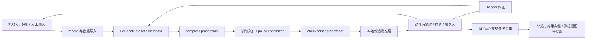

# LeRobot 仓库总体架构

[架构索引](README.md) · [日常流程](../workflows/README.md) · [文档维护](../maintenance/README.md)

LeRobot 以 PyTorch 策略、数据集和硬件接口为核心。CLI 负责把配置、设备、处理器和策略连接起来；本项目的 Piper 数采、远程/本地部署以及 DAgger / RECAP 建立在这些基础模块上。

## 模块职责

下列链接直接指向当前仓库目录；CLI 名称和依赖以 [pyproject.toml](../../pyproject.toml) 为准。

| 模块 | 负责什么 | 建议起点 |
| --- | --- | --- |
| [scripts](../../src/lerobot/scripts) | 数采、训练、评估、校准、回放和数据编辑等 CLI | `lerobot_record.py`、`lerobot_train.py`、`lerobot_eval.py` |
| [configs](../../src/lerobot/configs) | draccus 解析的 dataclass 配置，训练顶层参数和策略配置基类 | `train.py` 的 `TrainPipelineConfig`、`policies.py` 的 `PreTrainedConfig` |
| [policies](../../src/lerobot/policies) | 各策略的配置、模型、训练 loss 和动作预测 | `pretrained.py` 的 `PreTrainedPolicy`、延迟导入的 `factory.py`、`pi05/` |
| [processor](../../src/lerobot/processor) | 观测/动作重命名、归一化和前后处理步骤及流水线 | `pipeline.py` 的 `ProcessorStep` / `DataProcessorPipeline`、`normalize_processor.py` |
| [datasets](../../src/lerobot/datasets) | episode 数据、元数据、视频读取、采样和数据集合并 | `lerobot_dataset.py`、`dataset_metadata.py`、`sampler.py` |
| [robots](../../src/lerobot/robots) | 机器人观测读取、动作下发和具体硬件实现 | `piper_follower/` |
| [teleoperators](../../src/lerobot/teleoperators) | 主臂、键盘等人工输入设备和遥操作配置 | `piper_leader/` |
| [motors](../../src/lerobot/motors) | 电机总线、驱动协议与底层控制 | `piper/`、`feetech/` |
| [cameras](../../src/lerobot/cameras) | 相机配置、采集及 OpenCV / RealSense / ZMQ 等后端 | `configs.py` 和对应后端目录 |
| [envs](../../src/lerobot/envs) | Gymnasium 环境配置和创建工厂 | `configs.py` 的 `EnvConfig`、`factory.py` |
| [optim](../../src/lerobot/optim)、[distributed](../../src/lerobot/distributed) | 优化器、学习率调度与分布式训练支持 | 对应配置/工厂；训练入口负责组合 |
| [transport](../../src/lerobot/transport) | gRPC 协议定义、生成绑定与传输辅助 | `services.proto`、`utils.py` |
| [async_inference](../../src/lerobot/async_inference) | 远端部署、DAgger / RECAP，分为 client/server/shared | [目录边界](async-inference.md)、[部署架构](deployment.md) |
| [async_inference_local](../../src/lerobot/async_inference_local) | 同一机器内的 PI05 推理、控制与 DAgger 采集 | [本地架构](local-inference.md)；独立于远端模块 |
| [rollout](../../src/lerobot/rollout) | rollout 配置、策略与推理组织 | `configs.py`、`strategies/`、`inference/` |
| [rl](../../src/lerobot/rl)、[rewards](../../src/lerobot/rewards) | 强化学习算法与奖励模型 | `rl/algorithms/`、`rewards/factory.py`；[RLT 数据与实现](rlt.md) |
| [annotations](../../src/lerobot/annotations)、[data_processing](../../src/lerobot/data_processing)、[jobs](../../src/lerobot/jobs) | 标注、数据处理和任务封装 | 对应标注流程、dataset/HF job |
| [utils](../../src/lerobot/utils)、[common](../../src/lerobot/common)、[transforms](../../src/lerobot/transforms) | 共享工具、训练/控制辅助及数据变换 | 导入工具、日志、动作插值等按调用处追踪 |
| [model](../../src/lerobot/model) | 运动学 | `kinematics.py` |
| [light](../../src/lerobot/light) | 可选 USB 指示灯、语义状态与降级 | [指示灯架构](status-indicator.md) |
| [yzh](../../src/lerobot/yzh) | 本项目设备绑定、数据 GUI、远端监控及配套工具 | [数据工具结构](dataset-tools.md)、[工具流程](../workflows/tools/README.md)、[WN-A100 结构](wn-a100.md) |

核心类型另见 [lerobot_types.py](../../src/lerobot/lerobot_types.py) 和 [configs/types.py](../../src/lerobot/configs/types.py)。新增策略通常通过 `PreTrainedPolicy` 与注册配置接入；新增机器人、相机或环境从对应基类/配置和工厂接入。可选组件的依赖按 `pyproject.toml` extra 准备，模块导入仍遵循现有可选依赖保护。

## 按“数采 → 数据集 → 训练 → 部署”阅读

1. **数采**：从 [lerobot_record.py](../../src/lerobot/scripts/lerobot_record.py) 追踪机器人、相机和 teleoperator；按设备模块确认输入观测和专家动作的单位、名称与顺序。实际命令见 [普通数采](../workflows/recording/README.md)。
2. **数据集**：看 [LeRobotDataset](../../src/lerobot/datasets/lerobot_dataset.py)、[元数据](../../src/lerobot/datasets/dataset_metadata.py) 和 [sampler](../../src/lerobot/datasets/sampler.py)，区分 episode、起点帧和 action chunk；采后审查、Qt 合并与编辑后端的分工见[数据工具结构](dataset-tools.md)，命令见[数据处理](../workflows/datasets/README.md)。
3. **训练**：从 [lerobot_train.py](../../src/lerobot/scripts/lerobot_train.py) 进入配置、数据读取、processors、policy 与 optimizer。统计量、干预比例和 padding 的关系见 [训练架构](training.md)。
4. **部署**：完整 checkpoint 同时包含模型与 processor 状态。先选择 [远程部署](deployment.md) 或 [本地推理](local-inference.md)，再看观测快照、RTC、动作下发和复位边界；实际启动见 [部署流程](../workflows/deployment/README.md)。
5. **纠正闭环**：DAgger 人工段可按[数据约定](dagger.md)整理后训练，仍需核对标签和采样规则；[RECAP](recap.md)保存完整轨迹、来源与任务结果，其训练适配尚未实现，不能直接交给普通训练器或当作 RLT replay。

## 仓库其余入口

| 位置 | 用途 |
| --- | --- |
| [tests](../../tests) | 按模块组织的 pytest、fixtures、mocks 与硬件/端到端测试 |
| [examples](../../examples) | 面向使用者的示例；Piper MuJoCo 插件见[仿真架构](simulation.md)，操作见[仿真流程](../workflows/simulation/README.md) |
| [docs/source](../source) | LeRobot 上游/通用 API、策略和硬件文档 |
| [.github/workflows](../../.github/workflows) | 质量、测试、安全和发布 CI |
| [Makefile](../../Makefile)、[uv.lock](../../uv.lock) | 端到端测试入口及锁定依赖 |

查调用关系优先从流程入口追踪，不需要从每个模型实现顺序读起。问题现象和历史修订统一在 [排错索引](../troubleshooting/README.md)，论文方案与未实现建议在 [研究索引](../research/README.md)。
