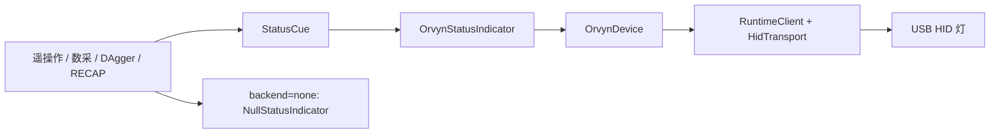

# 状态指示灯实现

[架构目录](README.md) · [使用与灯效速查](../workflows/tools/status-indicator.md) · [排错](../troubleshooting/status-indicator.md)

正式接口位于 [`src/lerobot/light`](../../src/lerobot/light)。应用发布 `StatusCue` 阶段事件，适配器将其转换为 Orvyn 灯效；控制流程不直接拼 HID 报文。颜色与操作步骤统一维护在[状态速查](../workflows/tools/status-indicator.md)，本页说明调用层次与失败边界。

## 模块职责

| 文件 | 职责 |
| --- | --- |
| [`__init__.py`](../../src/lerobot/light/__init__.py) | 导出 `StatusCue`、`StatusIndicatorConfig`、协议、空实现、Orvyn 实现及工厂 |
| [`status_indicator.py`](../../src/lerobot/light/status_indicator.py) | 三方法接口 `start()` / `show(cue)` / `close()`；配置校验、颜色映射、同步、失败降级 |
| [`light_api.py`](../../src/lerobot/light/light_api.py) | `OrvynDevice`：连接、灯状态查询、灯色 / 模式 / 基础配置、休眠和应用通道响应解析 |
| [`orvyn_device.py`](../../src/lerobot/light/orvyn_device.py) | USB HID 传输、Runtime 协议、设备枚举及维护 CLI |



`light_api.py` 还提供蜂鸣器、自动休眠配置、屏幕旋转、配额显示，以及温湿度 / 光照 / 屏幕状态解析；这些是低层设备能力，当前机器人状态适配器只使用灯和立即休眠功能。不要把这些能力误写成所有采集流程已经启用的提示。

灯控代码统一维护在 `lerobot.light`，`light_api.py` 通过包内导入使用同目录的 Runtime 协议实现。独立设备查询和灯效检查沿用[单灯检查命令](../workflows/tools/status-indicator.md#单独检查灯)，不再维护另一套设备脚本副本。

## 生命周期与配置

`make_status_indicator()` 只构造对象。`backend=none` 返回 `NullStatusIndicator`，三方法均为空操作；`auto` / `orvyn` 都返回 `OrvynStatusIndicator`。构造和导入公共接口不打开硬件，`hid` 模块在建立 HID 传输时才导入。

`start()` 在 `RLock` 内创建设备并连接，然后写入 `base_brightness` 和模式亮度。若 `show()` 发生在 `start()` 之前，它会先尝试启动。每次 `show()` 先写三个 RGB 槽位，再写模式、亮度和周期；操作是同步的，不使用独立灯线程。锁串行化流程线程与温度回调的更新，但不提供事件队列、故障锁存或告警优先级：后来的有效 cue 会覆盖先前灯效。

映射使用第一 RGB 槽位为红 `(255, 0, 0)`、第二槽位为橙 `(255, 127, 0)`、第三槽位为绿 `(0, 255, 0)`，未选槽位写 `(0, 0, 0)`。语义层只用 `static` / `blink`，低层虽然支持 `breath`，现有 cue 不使用呼吸灯。闪烁周期写入低层两字节字段。

正常 `close()` 会调用 `sleep_now()`，并关闭由适配器自行创建的设备；注入的测试 / 外部设备会休眠但不由适配器关闭。关闭后对象置为禁用，不能作为可重新启动对象复用。`set_led_config()` 属于设备持久化基础配置，适配器启动时会修改底色亮度；它没有在结束后恢复旧配置。

## 接入位置

| 入口 / 配置 | 发出 cue 的位置 |
| --- | --- |
| [`lerobot_teleoperate.py`](../../src/lerobot/scripts/lerobot_teleoperate.py) 的 `TeleoperateConfig` | 连接后、可选温度回调、退出清理 |
| [`lerobot_record.py`](../../src/lerobot/scripts/lerobot_record.py) 的 `RecordConfig` | 每条演示的倒计时、录制、回零、场景复位、完成和断连；可选温度回调 |
| [`robot_client_dagger.py`](../../src/lerobot/async_inference/client/robot_client_dagger.py) 的 `RobotClientDaggerConfig` | 准备、自主、暂停、人工纠正、复位、故障和退出 |
| [`robot_client_recap.py`](../../src/lerobot/async_inference/client/robot_client_recap.py) 的 `RobotClientRecapConfig` | 继承远端 DAgger 的适配器；额外在接管结束和结果提交保存时显示暂停 |
| [`dagger_configs.py`](../../src/lerobot/async_inference_local/shared/dagger_configs.py) / [`runtime/dagger.py`](../../src/lerobot/async_inference_local/runtime/dagger.py) | 本地 DAgger 独立状态机；初始 / 复位后为 PAUSED，达到目标发 COMPLETE，可恢复故障发 FAULT |

灯效由入口显式发送，状态机中存在某个状态并不意味着必然发出对应 cue。例如本地 DAgger 普通退出不发 `EXIT`，终止性故障路径也没有统一的红闪事件；普通远端部署、本地部署与 `lerobot-rollout` 没有此配置字段和调用。各流程差异详见[实际灯序](../workflows/tools/status-indicator.md#各流程的实际灯序)。

## 故障语义

初始化异常会把适配器设为禁用并清理自己持有的设备。默认 `required=false` 记录 warning 后继续；`required=true` 在此阶段抛出 `RuntimeError`。远端 DAgger 的 `start()` 捕获该异常、执行停止并返回失败；RECAP 启动会传播异常；本地 DAgger 由启动失败清理路径停止再抛出。不同入口的灯初始化先后不同，`required=true` 不表示检查一定发生在机器人连接之前。

已经启动后的灯色 / 模式更新异常同样禁用适配器，但不再按 `required` 抛出。远端和本地 DAgger 的显示包装还会记录其他显示异常；关闭异常通常记录日志。禁用后不轮询、不自动重连，下一次需要重新启动流程或创建新对象。异常日志的固定文本可能仍包含 `robot control will continue without it`，是否真的继续要结合 `required` 与调用入口判断。

这套机制用于阶段提示。灯故障本身不触发急停，灯状态也不证明数据已保存、机械臂已断电或软件状态已完整切换。

## 设备协议与维护边界

目标 USB VID / PID 为 `0x36B7` / `0x2030`，HID report 为 64 字节，请求 / 响应 report ID 为 `0x11` / `0x12`。`OrvynDevice` 经 `RuntimeClient` 的应用通道发送 LED 命令，等待 `command | 0x80` 的响应后解析状态。

维护 CLI 的 `devices` 枚举设备；`info` / `hardware-info` / `list` 查询 Runtime 和应用。CLI 的 **`status` 查询安装状态**，不是 LED 当前状态；查灯色应调用 `OrvynDevice.get_status()`。低层支持显式 HID `path`，但 `StatusIndicatorConfig` 没有设备路径字段，多灯选择未暴露给采集 CLI。

CLI 另含应用安装、启动、停用、删除和重启操作；这些属于设备维护，不是数采启动步骤。固件 / 应用需要支持当前 LED 应用协议，能枚举到 USB 设备不等于应用响应正常。

## 无硬件回归验证

现有 [`tests/test_status_indicator.py`](../../tests/test_status_indicator.py) 使用假设备检查空实现、语义映射、默认配置、初始化降级、必需设备失败和休眠关闭，不访问 USB。准备好 test extra 后可运行：

```bash
uv run --no-sync python -m pytest tests/test_status_indicator.py -q
```

远端客户端另有 [`tests/async_inference/test_robot_client_dagger.py`](../../tests/async_inference/test_robot_client_dagger.py) 的阶段灯效断言；本地和 RECAP 测试可注入 `NullStatusIndicator`，避免把测试连接到现场灯。真实灯效与固件响应另按[单灯检查](../workflows/tools/status-indicator.md#单独检查灯)验证。
