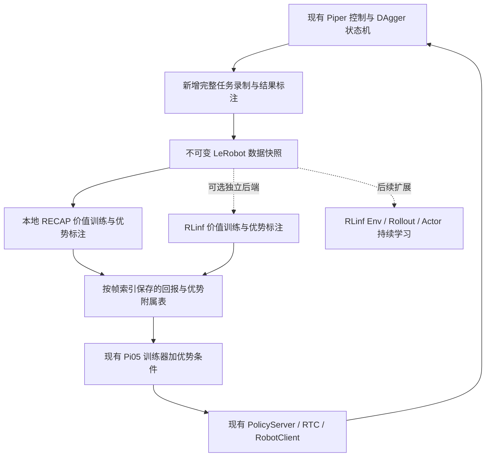

**RECAP 与 RLinf 调研：面向当前 Piper / Pi05 / RTC 项目的集成方案**

调研日期：2026-10-13。结论来自论文、维护者文档、公开源码及本地代码检查；未运行外部训练、转换现有数据或连接机器人。下文的接入设计、优先级和工期是针对本项目的工程判断。

本地基线：LeRobot `0.6.2`，HEAD `6ba77ea87e81a375dc70091f617c79007b9dbc24`，并包含当前未提交的 Piper、DAgger、RTC、训练和数据集修改。外部源码检查固定于 RLinf `abdc6f8d52b830db5512bb95725927b20542cfb6`、Evo-RL `2b7d2e095a5de7e039691999a42b6276f7e0f6fb`；文档的 `latest` 与其他仓库的 `main` 后续可能变化。

**建议优先在现有 LeRobot 中实现离线 RECAP，参考 Evo-RL 的模块划分；将 RLinf 作为可独立运行的价值标注后端和后续分布式训练基础设施。** 当前最先需要补齐的是完整任务轨迹及结果标签。现有“纠正片段 + 干预比例采样 + 离线微调”可以作为对照基线，但还不是 RECAP。

**1. RECAP 到底需要实现什么**

这里的 RECAP 指 Physical Intelligence 在 π*0.6 中提出的 **RL with Experience and Corrections via Advantage-conditioned Policies**。完整流程是：收集轨迹与任务结果，训练价值函数，估计动作优势，为策略增加优势条件，部署后继续收集。原论文采用分轮离线更新；人工纠正可以加入，但并非每轮都必须有。因此，第一版无需同时实现机器人在线采集、价值更新和策略更新。论文中的 π0.6 基座与本项目 Pi05 不同，在 Pi05 上实现该训练方法，应称为“Pi05 + RECAP”，不能据此宣称复现了官方 π*0.6 模型。[原论文](https://arxiv.org/html/2511.14759v1)

对本项目可以采用如下算法契约，所有回报和价值必须使用同一尺度：

```text
完整轨迹 + success/failure
  → return-to-go 标签
  → V(image, state 可选, task)
  → A_t = Σ[k=0..N-1] γ^k r_(t+k) + γ^N V(o_(t+N)) - V(o_t)
  → I_t = 1[A_t ≥ 该任务的阈值]
  → π(action_chunk | observation, task, I_t)
```

这是设计表达式；实际实现要截断到有效连续区间，对真实终止状态去掉 bootstrap，单独处理采集截断。策略仍可使用现有 flow-matching loss，但输入需要包含经过训练的优势条件。单纯增加纠正样本权重、筛选成功轨迹或使用奖励加权 BC，均不能替代这条完整链路。

第一版推理可以固定使用正优势条件。条件丢弃让模型同时学会有条件和无条件行为；需要更强引导时再评估 CFG。CFG 与 RTC 分别控制行为偏好和跨动作块的连续执行，集成时要分别配置和验证。[论文的条件推理说明](https://arxiv.org/html/2511.14759v1#A1.SS5)

**2. 本项目已经具备哪些基础**

| 能力 | 本地证据 | 集成含义 |
| --- | --- | --- |
| Piper 驱动、主从控制和人工接管 | [piper_hil_dagger.py](/home/cpy/桌面/yzh/piper/lerobot/src/lerobot/async_inference/client/piper_hil_dagger.py:1151) | 可以复用现有控制权交接、CAN 桥和故障处理 |
| 纠正窗口录制 | 同文件的 `DaggerCorrectionRecorder`，每次 `begin/end` 成为一个 episode | episode 不一定是完整任务；自主段未保存，不能直接生成可信任务回报 |
| 干预帧字段 | [录制 schema](/home/cpy/桌面/yzh/piper/lerobot/src/lerobot/async_inference/client/piper_hil_dagger.py:1213) | 已有 `intervention: bool[1]`，但没有完整任务结果及优势字段 |
| 演示与纠正混合采样 | [lerobot_train.py](/home/cpy/桌面/yzh/piper/lerobot/src/lerobot/scripts/lerobot_train.py:360) | 可复用 `intervention_sampling_ratio`，新增自主轨迹后需能区分三种数据来源 |
| 预训练归一化统计量沿用 | [训练处理器构建](/home/cpy/桌面/yzh/piper/lerobot/src/lerobot/scripts/lerobot_train.py:127) | 可减少迭代微调时动作尺度变化 |
| Pi05 的文本/状态预处理 | [processor_pi05.py](/home/cpy/桌面/yzh/piper/lerobot/src/lerobot/policies/pi05/processor_pi05.py:48) | 优势条件可以在 tokenizer 前注入，第一版可保留模型结构 |
| Guided / trained RTC | [modeling_pi05.py](/home/cpy/桌面/yzh/piper/lerobot/src/lerobot/policies/pi05/modeling_pi05.py:769) | 本地已有自定义 hard-prefix 推理和训练 loss mask，外部模型不能假定兼容 |
| RL 算法入口 | [rl/algorithms/factory.py](/home/cpy/桌面/yzh/piper/lerobot/src/lerobot/rl/algorithms/factory.py:46) | 当前工厂只实现 SAC，不能靠修改算法名称启用 RECAP |
| 奖励模型与样本权重 | [rewards](/home/cpy/桌面/yzh/piper/lerobot/src/lerobot/rewards/factory.py)、[训练样本权重](/home/cpy/桌面/yzh/piper/lerobot/src/lerobot/scripts/lerobot_train.py:241) | 可用于结果辅助标注或对照实验；奖励/进度模型不是经过当前回报定义训练的价值函数 |
| LeRobot v3 数据格式 | [dataset_metadata.py](/home/cpy/桌面/yzh/piper/lerobot/src/lerobot/datasets/dataset_metadata.py:61) | 外部 v2.1 路径、跨文件 episode 和 metadata 布局需要适配 |

本地全局检索中，RECAP 只出现在 HIL 文档的论文介绍，没有找到对应训练算法。现有 DAgger 的工作边界也明确写在 [README_DAGGER.md](/home/cpy/桌面/yzh/piper/lerobot/src/lerobot/yzh/README_DAGGER.md:5)。

**3. 开源实现的实际状态与取舍**

| 项目 | 核实到的实现状态 | 对本项目的价值与限制 |
| --- | --- | --- |
| LeRobot 官方 | 官方 RL-11 路线图仍列出完成 RECAP 集成；PR #2923 已关闭且未合并 | 不能认为升级或设置一个参数就能使用；当前 HIL-SERL/SAC 不是 Pi05 RECAP。参见 [路线图](https://github.com/huggingface/lerobot/issues/3832)、[PR #2923](https://github.com/huggingface/lerobot/pull/2923) |
| Physical Intelligence/openpi | 本次检查未找到官方发布的完整 RECAP 训练链；有对应的公开支持请求 | 可作为 Pi05 模型来源，但社区实现不等同于官方 π*0.6 训练代码。参见 [支持请求](https://github.com/Physical-Intelligence/openpi/issues/857) |
| **MINT-SJTU/Evo-RL** | 基于 LeRobot/PyTorch，包含真机采集、分布式价值预测、N-step 优势和文本条件训练；发布 SO101/Piper 工作流 | **最适合局部移植**。它基于 LeRobot 0.4.4，不能整库覆盖当前 0.6.2。参见 [仓库说明](https://github.com/MINT-SJTU/Evo-RL) |
| **RLinf** | 四阶段离线 RECAP：回报计算、价值模型 SFT、优势标注、CFG 策略训练 | **适合作为独立后端和算法对照**。现成配方主要围绕 LIBERO；需要补充 Piper 数据与部署适配。参见 [RECAP 文档](https://rlinf.readthedocs.io/en/latest/rst_source/examples/embodied/recap.html) |
| ybpy/pistar | OpenPI/JAX 分支，具有 `train_value.py`、VLM 优势标注及优势条件策略闭环，覆盖 Piper 等平台 | 适合参考算法和真机流程；与本项目 PyTorch、处理器和 checkpoint 的集成成本较高。参见 [PiStar](https://github.com/ybpy/pistar) |
| Destiny000621/RECAP | 在 pistar 上扩展 YAM 真机流程，文档列出了价值训练/标注阶段的修补与额外依赖处理 | 可参考采集和迭代流程；YAM 适配及第三方依赖步骤仍需自行验证。参见 [实现说明](https://github.com/Destiny000621/RECAP/blob/main/README.md) |

对以上社区项目，本次核实的是代码存在、输入输出和工作流，没有独立复现其成功率或实时性能。

**Evo-RL 值得移植的部分**

其 [价值模型](https://github.com/MINT-SJTU/Evo-RL/blob/2b7d2e095a5de7e039691999a42b6276f7e0f6fb/src/lerobot/values/pistar06/modeling_pistar06.py) 把视觉与语言特征投影、融合后输出离散价值分布；它是社区的具体实现，不应假设结构与 PI 原模型或 RLinf Critic Expert 完全相同。适合借鉴目标构造、分布式价值输出及模型保存接口。

其 [优势标注脚本](https://github.com/MINT-SJTU/Evo-RL/blob/2b7d2e095a5de7e039691999a42b6276f7e0f6fb/src/lerobot/scripts/lerobot_value_infer.py) 实现 N-step 优势、按任务计算分位数阈值，以及可选的人工干预正标签覆盖；[ACPPromptHook](https://github.com/MINT-SJTU/Evo-RL/blob/2b7d2e095a5de7e039691999a42b6276f7e0f6fb/src/lerobot/rl/acp_hook.py) 在原始 batch 上添加正/负优势文本并进行 dropout。这几个模块的概念可移植；数据集就地写回、batch 字段形状和旧版训练 hook 需要重新适配。

**RLinf 的实现与 Evo-RL 不应混用默认参数**

RLinf 配方默认 `positive_only_conditional=true`、`unconditional_prob=0.1`；负优势样本走无条件分支。Evo-RL 的 hook 则支持正/负标签并对标签做 dropout。这是两种具体训练路由，必须在实验记录中明确。[RLinf 配置](https://github.com/RLinf/RLinf/blob/abdc6f8d52b830db5512bb95725927b20542cfb6/examples/offline_rl/config/cfg_rl_openpi.yaml)

RLinf 当前优势脚本对所配置的数据集合计算统一阈值；Evo-RL 按任务计算阈值。因此，跨任务混合数据不宜不加检查地交换二值标签。建议保留连续优势，再由本项目按选定协议生成 indicator。[RLinf 优势计算](https://github.com/RLinf/RLinf/blob/abdc6f8d52b830db5512bb95725927b20542cfb6/examples/offline_rl/advantage_labeling/recap/process/compute_advantages.py)

**4. RLinf 基础设施对本项目的具体作用**

RLinf 把执行过程分成可放置在不同节点/GPU 的 Worker，使用 WorkerGroup 管理同类进程、Channel 传递数据，Runner 编排训练流程。机器人应用里通常把 `env` 放在控制节点，`rollout` 负责模型推理，`actor` 负责学习更新。这里的 actor 是训练角色，不是本项目 `RobotClient` 的同义词。[执行流程](https://rlinf.readthedocs.io/en/latest/rst_source/concepts/execution_flow.html)、[真机节点配置](https://rlinf.readthedocs.io/en/latest/rst_source/guides/realworld_robot.html)

它的主要价值是把环境采样、模型推理、参数更新和权重同步分开，支持跨节点部署与扩展。本项目已有“机器人端 + GPU 推理服务器”，但没有在线 learner、replay buffer 和模型版本同步闭环；这些是 RLinf 能补充的部分。单机离线 RECAP 的收益主要来自算法流水线，多机器人持续采集时才更能体现调度基础设施的价值。

RLinf-USER 已展示 Franka 等真机上的 SAC、RLPD、SAC-Flow、HG-DAgger 工作流。其公开 π0 改善案例使用 HG-DAgger，不能把这些结果当作 Piper RECAP 的验证结果。[RLinf-USER](https://rlinf.readthedocs.io/en/latest/rst_source/resources/publications/rlinf_user.html)

**Piper 支持应分三层理解：**

| 层次 | 已核实的内容 | 仍需完成 |
| --- | --- | --- |
| 硬件 | `PiperArm` 通过 pyAgxArm 控制六关节和夹爪 | 与当前主从镜像、接管协议的集成 |
| 基础环境 | 有 `PiperEnv` / `PiperReachEnv` 和 mock SAC 测试配置 | 具体任务的 reward、success、reset、摄像头和遥操作绑定 |
| Pi05 + RECAP 真机闭环 | 未找到可直接运行的本项目对应配方；官方 Piper 文档明确只覆盖硬件检查 | 数据转换、模型部署、RTC 语义、完整任务验证 |

证据：[Piper 硬件文档](https://rlinf.readthedocs.io/en/latest/rst_source/examples/embodied/piper.html)、[PiperEnv 源码](https://github.com/RLinf/RLinf/blob/abdc6f8d52b830db5512bb95725927b20542cfb6/rlinf/envs/real/piper/base.py)、[mock SAC 配置](https://github.com/RLinf/RLinf/blob/abdc6f8d52b830db5512bb95725927b20542cfb6/tests/e2e_tests/embodied/piper_mock_sac_mlp_reach.yaml)。

跨公网接入时还需要处理 Ray 节点间双向可达。当前一个策略服务端口或 SSH 转发能够工作，不表示整个 Ray 集群已经可用；官方云边指南建议通过互通网络或 overlay 解决。[云边部署文档](https://rlinf.readthedocs.io/en/latest/rst_source/guides/cloud_edge.html)

**5. 推荐的接入架构**



**路线 A：LeRobot 内部离线 RECAP，优先推荐。** 借鉴 Evo-RL 的目标、价值模型、优势标注和 prompt hook，在本项目上实现小范围模块。保留 Pi05、模型预处理、checkpoint、RTC 和现有驱动。训练完成后仍沿用当前服务器加载模型的方式。优势是变更边界小、能保留当前的自定义部署能力。

**路线 B：RLinf 只负责价值训练和优势标注。** 把完整数据快照导出到独立 RLinf 环境，取回 sidecar 标签，在本地训练优势条件 Pi05。这样可以使用 RLinf 的分布式计算，同时避免第一阶段转换 Pi05 权重。前提仍是完成 Piper 观测映射、v3 数据读取和标签语义适配。

**路线 C：RLinf 同时负责策略训练及在线闭环。** 适合后续多机器人、多 GPU 或持续在线更新需求。需要额外的模型 backend、环境协议、推理服务器适配和 checkpoint 转换验证，工作量明显大于 A/B。建议先复现一个官方模拟环境配方，再接入录制回放环境，最后接真机任务。

**6. 最先补齐的数据契约**

建议保留已有 LeRobot 标准字段，在新增的完整轨迹数据中约定下表。表中包含后续训练所需的目标字段，已实现的采集字段以 [RECAP 采集说明](../../src/lerobot/yzh/README_RECAP.md) 为准。

| 信息 | 推荐语义 |
| --- | --- |
| `episode_index`、`frame_index`、`timestamp` | 任务内可追溯帧位置；附属标签以数据集版本 + episode + frame 联合定位 |
| `observation.*`、`task` | 复用当前相机、关节及任务输入 |
| `action` | 与该时间步一致、确实进入执行链的动作标签；明确是高层 endpoint 还是下发命令 |
| `intervention` | 保留现有 bool 字段，表示当前帧由人工接管 |
| `source` | 单独区分 `demo` / `autonomous` / `correction`；`intervention=false` 无法区分前两种 |
| `policy_action`、`commanded_action` | 分别保存模型候选与执行链命令，便于核对插值/EMA/接管后的差异 |
| `policy_id`、`request_id`、`policy_step` | 关联模型版本、推理请求和实际执行进度，排除未执行的 chunk 后缀 |
| episode outcome | `success` / `failure`；保留是否依赖人工纠正完成；未确认保存的中断片段丢弃 |
| 任务结束原因 | 记录已确认结果的结束原因；RECAP 首版不保留采集中断样本，也不需要额外结果状态 |
| `segment_id`、continuity mask | 表示暂停/复位/丢帧导致的非连续区间，避免 N-step 跨越不相关状态 |
| 回报、value、advantage、indicator | 写入版本化附属表，并记录价值 checkpoint、reward 配方和阈值配置 |

已有纠正片段可以继续用于 BC 或经过审核的专家正条件样本。没有完整后续轨迹及结果的片段，不应伪造成功终止、回报或价值标签。现有合并工具将缺失 `intervention` 补为 false，只表示来源标记缺失时的处理，不能证明数据是自主成功轨迹。

完整录制应从任务开始到任务结果确认持续工作，并保留控制来源切换。人工纠正后复位的当前行为，也要给出该任务本次尝试的明确结果；不能把“保存纠正窗口”直接解释为“任务成功”。程序复位动作不进入任务动作监督；操作者在停止录制前手动回 home 的动作仍会被记录，需要在任务定义或后续裁剪中明确其归属。

根据实际采集流程，第一阶段已采用独立 `_recap` 入口，见 [采集说明](../../src/lerobot/yzh/README_RECAP.md)。只按明确的成功/失败保存，`/reset` 和退出丢弃未确认保存的本轮，不额外采集停止后的末帧。之前提议的 `unknown/aborted` 属于工程扩展，并非论文定义，现已取消；RECAP 的 Monte Carlo 回报需要已知任务结局，论文未明确要求保留无结局的中断前缀。[RECAP §IV-A、§V-C](https://arxiv.org/html/2511.14759v2)

**RTC 时间对齐是独立验收项。** 当前 30 Hz policy step 与插值后 60 Hz 下发是两个时间尺度。N-step 的 N、reward 的每步代价以及终止位置应基于同一时间尺度。必须保留原始目标、过滤后命令和实测状态的区别，不能用整个模型预测块替代实际轨迹；未被接纳、暂停后作废和未执行的动作都不能当作真实转移。

原始数据应做成快照，标注写到附属表。例如 `meta/recap/<label_version>.parquet`，训练时严格按联合索引关联，不覆盖现有数据。RLinf 的回报脚本虽然把回报放在 sidecar，但仍更新 `meta/stats.json` 和 `meta/info.json`，所以也应对副本运行。[RLinf 回报脚本](https://github.com/RLinf/RLinf/blob/abdc6f8d52b830db5512bb95725927b20542cfb6/examples/offline_rl/advantage_labeling/recap/process/compute_returns.py)

**7. 路线 A 的具体代码落点**

| 位置 | 建议改动 |
| --- | --- |
| `async_inference/client/robot_client_recap.py` | 独立的任务级开始、结束、success/failure 事件；引用 DAgger 控制能力，维持原 DAgger 采集语义 |
| `async_inference/client/piper_hil_recap.py` | 加入自主段与人工段完整记录；共享观测锁，避免多个线程同时读取相机 |
| 新增 `rl/recap/` | 放置回报构造、价值模型、连续区间处理、优势标注、附属表加载与配置 |
| 新增价值训练/标注脚本 | 训练分布式价值模型、导出标签；复用现有 accelerator/保存工具，避免硬塞入 SAC 的 update 语义 |
| `configs/train.py` | 新增默认关闭的 RECAP/ACP 配置，记录 indicator 来源、条件路由、dropout 和推理模式 |
| `scripts/lerobot_train.py` | 在 `_preprocess_dataset_batch()` 的 tokenization 前插入优势条件；训练与验证统一处理输入语义 |
| `policies/pi05/processor_pi05.py` | 可序列化的优势条件处理，保证推理时正条件与训练时的 prompt 格式一致 |
| `policies/pi05/modeling_pi05.py` | 首版保留 flow loss；若后续增加 CFG，才扩展采样器并测试与 trained RTC 的组合 |
| `datasets/sampler.py` | 按需拓展三种来源混合比例；“来源配比”与“优势正例比例”是两个独立参数 |
| 现有 deployment server | 加载已保存的优势条件配置；按评测通过的模型版本切换 |

独立采集入口与 recorder 已实现；价值训练、优势标注、策略训练及 RLinf 对接仍是后续计划。

第一版不需要同时引入新 VLA、在线 PPO 或任务专用自动奖励模型。可以先人工标注任务结果，用分布式价值模型学习回报，再基于当前 Pi05 做条件微调。若先用状态或冻结图像特征的小模型验证数据链，应把它记为工程验证版，避免与完整视觉语言价值模型的效果混为一谈。

保留现有 trained RTC 时，需要验证优势条件不会改变 action prefix 的归一化和坐标系；前缀仍应被固定，loss 仍只作用于后缀。后续使用双分支 CFG 时，两分支必须共享同一动作噪声及前缀约束，并重新测量 chunk 延迟和队列空转率。

**8. 路线 B/C 接入 RLinf 必须解决的兼容问题**

| 问题 | 源码事实 / 对本项目的影响 | 建议处理 |
| --- | --- | --- |
| Piper 观测映射 | RECAP value loader 当前 `_REPACK_KEYS` 列出 LIBERO/Franka 变体，没有 Piper | 为价值训练、优势推理、策略训练分别补充 Piper 映射，不能只改 YAML 的 robot_type |
| 相机与动作语义 | 本项目是六关节绝对角度 + 夹爪；Franka 示例可能采用末端位姿 | 配置相机名称、RGB/layout、关节顺序、绝对/相对动作和 mask，禁止直接套末端动作模板 |
| 夹爪单位 | 本地 `gripper.pos` 为米；RLinf Piper 环境为开合比例 0～1 | 在适配器按实测行程换算，并验证开合方向；例如 `fraction = metres / stroke_metres` |
| 标签名称 | Evo-RL 用 `complementary_info.*`；RLinf 的 sidecar `advantage` 是布尔值，连续值是 `advantage_continuous` | 明确内部连续 advantage 与 indicator，做字段映射和类型/shape 校验 |
| 成功标签 | RLinf 回报脚本对 `type=sft` 默认成功；非 SFT 要求帧表有 `is_success` | 将经过确认的 success/failure 映射到预期字段；无任务结果的外部或旧版数据应排除 |
| v3 文件布局 | 回报脚本逐个 Parquet 按局部 episode 计算；部分任务读取路径仍直接使用 tasks.jsonl | 如果 episode 跨文件，则需全局按 episode 聚合后计算；兼容 tasks.parquet，核对 MP4 路径及帧时间 |
| 运行环境 | 当前项目 transformers extra 要求 5.4～5.6；RLinf embodied 要求 4.51～4.57.6，Evo-RL 要求 4.57.1～5.0 | 使用独立环境/容器；移植模块时针对当前依赖适配，不直接合并完整 requirements |
| checkpoint | RLinf CFG 模型、LeRobot Pi05、OpenPI JAX 有不同加载/预处理路径 | 先采用标签交换；若转换权重，要验证 key、shape、tokenizer、norm stats、动作输出和 RTC 行为 |
| 推理 API | 当前 RLinf CFG `sample_actions` 没有本地 trained RTC 的 hard-prefix 接口 | 全栈接入需要新增 backend 适配；普通 checkpoint 加载成功不代表能替换现有 server |
| 硬件连接所有权 | 两套驱动同时连接同一 Piper/CAN 会争用；本地另有主从影子控制 | 保持一个进程/服务负责设备所有权；RLinf 通过其协议访问，或整体切换设备所有者 |

对应证据：[RECAP value loader](https://github.com/RLinf/RLinf/blob/abdc6f8d52b830db5512bb95725927b20542cfb6/rlinf/data/datasets/recap/value_dataset.py)、[优势字段加载](https://github.com/RLinf/RLinf/blob/abdc6f8d52b830db5512bb95725927b20542cfb6/rlinf/data/datasets/recap/cfg_model.py)、[CFG 模型及 sampler](https://github.com/RLinf/RLinf/blob/abdc6f8d52b830db5512bb95725927b20542cfb6/rlinf/models/embodiment/openpi_cfg/openpi_cfg_action_model.py)、[RLinf 依赖](https://github.com/RLinf/RLinf/blob/abdc6f8d52b830db5512bb95725927b20542cfb6/pyproject.toml)、[Evo-RL 依赖](https://github.com/MINT-SJTU/Evo-RL/blob/2b7d2e095a5de7e039691999a42b6276f7e0f6fb/pyproject.toml)、[本地夹爪单位](/home/cpy/桌面/yzh/piper/lerobot/src/lerobot/motors/piper/piper_PyAgxArm.py:28)。

v3 跨文件问题是基于代码执行路径的条件性判断：是否会影响当前数据，需要检查实际 episode/shard 布局，不能仅凭版本号断言所有数据都会出错。

此外，RLinf CFG sampler 在启用 guidance 时显式执行有条件/无条件两个分支；当前代码在 scale=1 时也仍计算两分支。接入异步 RTC 时必须测量实际延迟；可以先在本地实现等价的正条件单分支推理，再比较需要强化引导时的收益与开销。

**RLinf 离线验证的入口已经存在。** 完成上述适配并修改配置后，可在独立 RLinf checkout 中运行其四个官方阶段：

```bash
# 这些是 RLinf 的现有入口；不是在当前 LeRobot 中可直接运行的命令。
# 先将配置中的数据、模型、Piper transform、输出路径和资源设置改为实际值。
bash examples/offline_rl/advantage_labeling/recap/process/run_compute_returns.sh recap_compute_returns
bash examples/offline_rl/advantage_labeling/recap/run_value_sft.sh recap_value_model_sft
bash examples/offline_rl/advantage_labeling/recap/process/run_compute_advantages.sh recap_compute_advantages
bash examples/offline_rl/policy_optimization/cfg_rl/run_cfg_rl.sh cfg_rl_openpi
```

路线 B 只需要前面三个阶段，第四阶段由本项目 Pi05 训练器承担。RLinf 文档给出的 LIBERO-10 Task 0 示例从 48.8% 提升至 66.5%，可作为软件复现实验的参考，不能外推为 Piper 上的预期改善。[官方配方与实验](https://rlinf.readthedocs.io/en/latest/rst_source/examples/embodied/recap.html)

**路线 C 的环境设计建议**：新增一个针对本项目任务的 Gymnasium 环境或远程 bridge，以 `reset/step` 返回观测、reward、terminated、truncated、info，复用本地控制器维护接管、复位和超时状态。固定 `env` 位于机器人端，推理及训练位于 GPU 端，先单环境运行。跨回合切换模型版本时清空旧动作队列和请求 generation，避免同一个待执行 chunk 混入两个模型版本。若算法使用行为策略概率，人工干预和过期轨迹必须按该算法的离策略规则处理。

**9. 分阶段交付与验收**

| 阶段 | 交付 | 验收重点 |
| --- | --- | --- |
| P0：数据闭环 | 全轨迹 recorder、结果标注、来源/版本字段、数据审计 | 自主成功、自主失败、人工纠正、采集取消均可追溯；复位及失效动作不混入任务 |
| P1：离线最小版本 | 回报构造、价值训练、优势附属表、Pi05 条件训练与推理 | 已知小轨迹的回报/优势正确；tokenizer 前后条件可见；原有 RTC 与 DAgger 不回归 |
| P2：效果对照 | 固定任务/场景的对照评测、误差与资源分析 | 比较当前 SFT、DAgger 微调、成功数据 BC、RECAP；记录自主成功率及人为干预 |
| P3：RLinf 扩展 | 先外部价值后端，按需要进一步接入在线 workers | 录制回放环境通过后再验证真机；权重版本、环境 reset、断连恢复和回报一致 |

工期粗估：P0 约 3～5 个工作日，P1 约 1～2 周，P2 主要取决于采集与评测数量；RLinf 价值后端适配再预留约一周，完整在线接入通常还需数周。这里假设一名熟悉当前代码的工程师、机械臂与训练资源可用；不含收集足够数据或达到目标成功率的时间，也不构成进度保证。

建议先收集约 20～50 个带明确结果的完整 episode 验证链路，再按任务难度扩大成功/失败覆盖。这是工程启动规模建议，不是“达到该数量即可训练好价值函数”的算法结论。

验收应覆盖：

1. **数据正确性**：帧索引唯一，图像、状态、命令对齐；episode 和连续区间边界正确；人工/自主来源以及真实结果可追溯。
2. **标签正确性**：手算轨迹验证 N-step、终止、截断和 reward/value 缩放；附属表与数据快照严格匹配；阈值按选定协议计算。
3. **泛化与泄漏**：按 episode/采集轮次切分训练与验证；价值模型不能通过 frame_index、最终结果字段直接读取答案。
4. **训练/部署一致性**：prompt 条件不被覆盖或截断；checkpoint 保存并恢复同一条件和归一化设置；推理默认选择已训练的条件。
5. **RTC 一致性**：前缀坐标系和单位不变，hard-prefix 不漂移，loss mask 正确；比较延迟、队列空转和动作不连续情况。
6. **任务效果**：分别报告无人接管成功率、人工辅助成功率、每回合干预次数、成功耗时、失败类型；固定场景分布并给出样本数/置信区间。

资源方面，第一版可在同一训练 GPU 上顺序运行价值训练与策略微调，价值网络不必部署到机器人端。先使用较小 batch、梯度累积及可选冻结/LoRA 实测显存，避免直接照搬外部多卡配置。当前硬件的显存余量、训练吞吐和端到端延迟尚未测量，因此本报告不提供每轮训练耗时承诺。

**建议的首个实现任务**是“完整 Piper rollout 记录 + 显式任务结果 + 可审计数据快照”。它同时服务于 Evo-RL 风格的本地 RECAP、RLinf 离线后端以及未来在线 RL，完成之后再选择价值模型后端，集成决策会更可靠。
