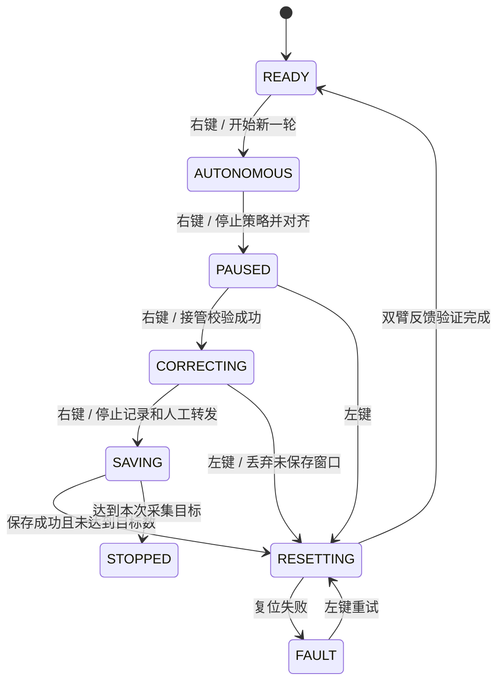
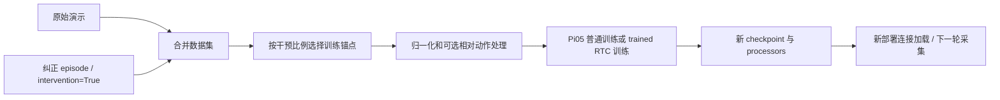

# DAgger：自主执行、人工接管、纠正记录与再训练

> 日常操作统一从 [docs/README.md](../../../docs/README.md) 进入。本文保留 DAgger 控制权交接、双臂 CAN、纠正标签、保存边界和状态机细节；共用调度与训练机制分别查阅 Deployment 和训练专题。

当前入口分别位于 `async_inference/server/` 和 `async_inference/client/`，双端文件完整保留在 `shared/`。目录调整后的启动路径与迁移说明见 [异步推理目录说明](../async_inference/README.md)。

本文按 **2026-10-04 当前工作区代码**说明 Piper DAgger。共用的请求调度、guided/trained RTC 和插值算法详见 [Deployment 代码导读](README_DEPLOYMENT.md)；本文重点解释它们如何与人工接管、CAN 控制权、数据采集和训练连接起来。

## 1. 先确定当前 DAgger 的边界

这套实现是一种**人工干预式、只记录纠正片段的 DAgger 工作流**：

```text
已有模型自主执行
  → 人判断需要纠正
  → 暂停模型输出
  → 人工主臂接管从臂
  → 保存纠正 episode
  → 机器人复位，人工恢复任务环境
  → 再开始自主 rollout
  → 收集完成后合并数据并离线微调
  → 重新连接、加载新 checkpoint，开始下一轮采集
```

当前客户端不自动判断成功/失败，不在线更新模型权重，也不对每个自主执行状态都请求专家标签。自主段不写入这个纠正数据集；只有人工接管窗口写入专家动作。这里的 `episode` 是一次保存的纠正窗口，未必对应从任务起点到成功的完整演示。

DAgger 和 trained RTC 是两个独立维度：

| 机制 | 改变什么 |
| --- | --- |
| DAgger 采集与重训 | 增加模型容易出错状态附近的专家纠正样本 |
| 干预比例采样 | 控制训练 batch 中原始演示和纠正帧的占比 |
| Trained RTC | 改变 Pi05 的训练条件：给出干净动作前缀，只学习生成后缀 |
| Guided RTC / 异步执行 / 插值 | 部署时生成、调度和下发动作的方式 |

可以用 guided 或 trained 模型收集 DAgger 数据；也可以在原始演示与纠正数据的混合数据集上训练 trained RTC。

## 2. 文件关系和职责

| 文件 | 主要职责 / 推荐定位符 |
| --- | --- |
| [robot_client_dagger.py](../async_inference/client/robot_client_dagger.py) | `RobotClientDagger`、两套状态、键盘/踏板事件、暂停/接管/保存/复位、故障处理 |
| [piper_hil_dagger.py](../async_inference/client/piper_hil_dagger.py) | `PiperDaggerController` 控制双臂；`PiperCANBridgeDagger` 转发；`PiperDaggerRobotProxy` 接入 deployment；`DaggerCorrectionRecorder` 记录 |
| [policy_server_dagger.py](../async_inference/server/policy_server_dagger.py) | 复用 deployment server，仅改变跨连接模型复用的默认值 |
| [robot_client_deployment.py](../async_inference/client/robot_client_deployment.py) | 异步线程、请求门控、guided 调度、插值与复位基础逻辑 |
| [rtc_trained.py](../async_inference/shared/rtc_trained.py) | 独立 trained 前缀、固定预算与接纳规则 |
| [lerobot_edit_dataset.py](../scripts/lerobot_edit_dataset.py) / [aggregate.py](../datasets/aggregate.py) | 合并原始演示和纠正数据，补齐干预标记 |
| [lerobot_train.py](../scripts/lerobot_train.py) / [sampler.py](../datasets/sampler.py) | 保留预训练统计量、构建干预比例 sampler、离线微调 |
| [modeling_pi05.py](../policies/pi05/modeling_pi05.py) | trained RTC 的训练 loss 与推理硬前缀 |

```text
RobotClientDeployment
  └─ RobotClientDagger
       ├─ PiperDaggerRobotProxy
       │    ├─ 观测 → 原来的 follower robot
       │    └─ 命令 → PiperDaggerController → 双臂
       ├─ PiperCANBridgeDagger
       └─ DaggerCorrectionRecorder

PolicyServerDeployment
  └─ PolicyServerDagger
```

DAgger 服务器不处理按键、不操作 CAN、不保存纠正数据。这些均由机器人端负责。当前两个 DAgger 入口都不导入历史 `*_rtc_*_dagger` 实现。

## 3. 两套软件状态与一套硬件状态

### 3.1 为什么状态名称看起来不止一套

`RolloutState` 来自 deployment，管理一轮运行能否执行；`DAggerPhase` 管理当前由策略还是人控制。`PiperControlMode` 管理双臂硬件输出路径。它们不是三个互相替代的枚举。

| 对操作者的含义 | `RolloutState` | `DAggerPhase` | 主要输出路径 |
| --- | --- | --- | --- |
| 等待新一轮 | `READY` | `PAUSED` | 启动后的等待，或复位完成后的等待 |
| 策略自主执行 | `RUNNING` | `AUTONOMOUS` | 策略 → 插值 → 双臂共用命令 |
| 自主已暂停 | `RUNNING` | `PAUSED` | 停止自主命令；暂停转换会对齐主从臂 |
| 人工纠正 | `RUNNING` | `CORRECTING` | 物理主臂控制帧 → CAN 桥 → 从臂 |
| 复位中 | `RESETTING` | 通常为 `PAUSED` | 复位动作，普通事件不进入 |
| 复位失败 | `RESET_FAILED` | `FAULT` | 禁止直接开始下一轮 |
| 其他可处理故障 | 视发生位置而定 | `FAULT` | 策略请求/接纳/下发被阶段检查阻止 |
| 已退出 | `STOPPED` | 不再用于控制 | CAN、机械臂、记录器清理 |

因此，日志出现 `rollout=running, phase=paused` 不矛盾：这轮还没结束，但策略输出已停止。

### 3.2 默认按键顺序



图中的 `SAVING`、`READY` 是工作流节点；`SAVING` 实际由 `_save_in_progress` 表示，`READY` 来自 `RolloutState`。实际代码没有名为 `DAggerPhase.SAVING` 或 `DAggerPhase.READY` 的枚举项。Esc 在所有阶段均可请求退出，图中省略了这些边。

| 操作 | 行为 |
| --- | --- |
| READY 时右键 | 开始干净的自主 rollout |
| AUTONOMOUS 时右键 | 暂停策略，不立即开放人工桥接 |
| PAUSED 时右键 | 验证并开放人工接管，开始记录 |
| CORRECTING 时右键 | 保存纠正，再复位；最后一个目标 episode 则退出 |
| PAUSED / CORRECTING 时左键 | 丢弃当前未保存纠正并复位 |
| FAULT 时左键 | 尝试复位恢复 |
| AUTONOMOUS 时左键 | 当前按键状态机不会直接复位；先右键暂停 |
| Esc | 设置带外退出信号；保存期间仍可请求停止硬件 |

暂停后的右键是“进入人工纠正”，不是“恢复原策略轨迹”。当前流程要求纠正/放弃后复位，再从新 rollout 开始。

## 4. 一次自主执行如何开始

`RobotClientDagger.start_rollout()`：

1. 非阻塞获取 `_dagger_transition_lock`；如果另一转换尚未完成，立即拒绝开始。
2. 确认 `READY`、无停止信号、非 `FAULT`，且本次采集目标尚未完成。
3. `prepare_autonomy()` 关闭 CAN 桥，重新要求物理主臂处于可接收计算机命令的 follower 模式，等待新反馈。
4. 读取当前从臂姿态，播种共用 EMA，向双臂发送同一个 hold 目标。
5. 父类开始新 generation，清空旧 RTC 状态。
6. `_seed_interpolator_locked()` 用当前姿态播种插值器，进入 `AUTONOMOUS`。

这里物理“主臂”在自主阶段也接受计算机命令，与从臂作 shadow 运动；“主臂”是设备角色，不意味着它始终处于 leader 控制模式。

模型输入仍来自从臂观测，策略输出一组机器人动作，由控制器镜像给双臂；它不是一次同时预测两套独立动作的双臂策略。

## 5. 自主阶段的异步与 RTC 路径

自主时沿用 deployment 的三个工作线程：

```text
控制线程：执行旧计划、插值下发、判断是否补充
观测线程：采集从臂观测，构造当前动作前缀，上传
接收线程：取回 chunk，验证并接纳
服务器：单个推理线程串行生成下一块
```

DAgger 还增加了几条独立执行路径：

| 执行者 | 作用 |
| --- | --- |
| 键盘/踏板监听器 | 把物理输入转换成逻辑事件，不在回调中执行耗时接管/保存 |
| `PiperDaggerOperator` | 顺序处理普通事件，执行暂停、接管、保存和复位转换 |
| `PiperDaggerCANBridge` | 持续接收物理 CAN 帧，仅在允许的阶段转发 |
| `PiperDaggerRecorder` | 按数据集 FPS 读取从臂观测、专家命令并记录 |
| `DAggerCollectionProgress` | 刷新采集进度显示，不决定控制权 |

Prompt 模式不启动上述普通操作事件线程，命令由 prompt 路径直接调用转换函数。

DAgger 在以下入口增加 `AUTONOMOUS` 阶段检查：

```text
_request_observation_if_ready()  是否允许触发新请求
send_observation()              是否允许上传
_handle_action_chunk()          是否允许接纳结果
control_loop_action()           是否允许下发策略命令
```

这是多层防护。只停止发新请求不够，因为旧采集、旧上传和旧结果仍可能返回。

| 共用机制 | 在 DAgger 中的意义 |
| --- | --- |
| 单请求在途 | 正常情况下一个仍有效的请求贯穿采集、上传、推理和返回 |
| guided 自适应触发 | 仅自主 guided 路径根据延迟调整补充时机 |
| trained 重规划 | 默认 `trained.replan_on_result=true`，接纳结果后允许下一个控制 tick 请求；固定 `trained.queue_threshold` 用于启动/回退，关闭该选项后仅按固定阈值触发 |
| 前缀快照 | guided 发动作来源引用；trained 发绝对动作张量 |
| 实际执行进度检查 | 不把墙钟等待直接当作已经执行的动作数量 |
| 新快照重试 | 失败/迟到后重新读观测和前缀，不反复使用旧输入 |
| generation 隔离 | 暂停、复位后，旧结果不能重新驱动机械臂 |
| 线性插值 | 可用于 guided 和 trained；增大命令频率，不增加推理频率 |

进入人工纠正后，RTC 接收线程可能仍在长轮询，旧服务器计算也可能尚未结束；阶段检查和 generation 使其结果失效。并非必须等 GPU 完成才能暂停控制。

## 6. 插值与双臂命令下发

`PiperDaggerRobotProxy.send_action()` 把 deployment 下发的动作交给 `PiperDaggerController.send_same_action()`：

```text
策略 endpoint
  → ActionInterpolator 生成中间命令
  → 控制器只计算一次共用 EMA
  → 同一结果依次写入 follower 和 master
```

默认 `dagger_follower_first=true`。两个 CAN 写入是顺序操作，不是硬件同步广播；代码记录两次下发的时间跨度。计算一次 EMA 可以避免双臂各自维护不同低通状态导致目标分歧。

`fps=30, interpolation_multiplier=2` 时，自主段常规命令频率为 60 Hz，RTC 延迟和队列仍按 30 Hz policy step 计算。启动时插值器已经由真实当前姿态播种，因此可以从该姿态向首个策略 endpoint 插值。

共用 EMA 仍使用 Piper 的 `teleop_joint_alpha` / `teleop_gripper_alpha`，当前默认 0.25 / 0.5；trained 模式不会自动关闭它。线性插值与 EMA 是不同层；分摊跨块偏差的拼接桥接已删除，双臂 CAN 通信桥仍保留。应分别观察策略目标、实际下发命令及实体反馈，不能把“完成 endpoint 命令下发”等同于实体已经到位。

人工 `CORRECTING` 时，主臂物理控制帧直接经过 CAN 桥转发，从臂不经过上面的策略插值/EMA 命令链；计算机策略命令被禁止。

## 7. 暂停和接管：控制权如何交接

### 7.1 暂停先作废 RTC，再处理硬件

`pause_autonomy()` 的顺序是：

```text
phase = PAUSED
  → generation 前进
  → 清 action schedule、插值器、请求槽、延迟和本轮历史
  → 等待已经开始的最后一次计算机下发完成
  → pause_computer_output()：关闭桥、将主臂置 follower、对齐实际从臂
```

这里清的是执行/推理历史，调试用的有界队列曲线仍保留。先失效请求，再获取命令锁，是为了避免在等待硬件转换时继续放入旧模型动作。

### 7.2 人工接管前验证绝对位置

`start_correction()` 调用 `enter_correction()`：

1. 保持 CAN 桥关闭，清理等待转发的旧帧。
2. 以从臂实际反馈为目标对齐主臂。
3. 切换主臂到 leader 模式，在切换后重新检查物理主臂的绝对关节/夹爪位置。
4. 确认专家控制缓存完整、与接管姿态相符；清理模式切换产生的旧流量。
5. 开启物理帧桥接，进入 `CORRECTING`。
6. 客户端调用 `correction_recorder.begin(task)` 开始记录。

默认接管容差是关节 0.035 rad、夹爪 0.001 m；切换后的绝对对齐需要持续满足 settle 条件。不会通过加一个坐标偏移把不一致的主从姿态“解释为一致”，也不会修改专家标签以掩盖该误差。

一次切换失败会自动重新对齐并重试一次。若持续不对齐，但已成功恢复 follower 模式并验证对齐，抛出可恢复的 `PiperHandoverAlignmentError`，客户端保持 `PAUSED`、不记录数据；若恢复本身失败或有其他硬件异常，则进入 `FAULT`。

### 7.3 CAN 桥为何单独有线程和代际保护

`PiperCANBridgeDagger` 只允许**物理接收的标准控制帧**：

- 必须显式满足 `is_rx is True`，排除本机 SocketCAN 发送回显。
- 当前允许 ID 为 `0x151`～`0x159`，由 `PIPER_CONTROL_IDS` 定义。
- 排除 error、extended、remote、CAN FD 帧。
- 仅从 `can_master` 转发到 `can_follower`，不做反向转发。

`disable()` 与发送共用 `_forward_lock`，返回时已等待正在进行的发送完成；`enable()` 增加 `_forward_generation`，并在接收/转发锁下清队列后开门。工作线程对收到的帧附带接收时的 generation 检查，防止“已从队列取出、尚未发送”的旧帧跨过一次关门/开门。

这层 generation 与 RTC 的 rollout generation 不同：前者保护 CAN 帧生命周期，后者保护推理请求/动作生命周期。

CAN 收发异常会关闭桥、保存错误并停止桥线程。纠正期间控制循环调用 `assert_correction_healthy()`，发现故障就进入 `FAULT` 并停止/丢弃当前纠正记录，避免界面看起来还在采集而从臂已经不再跟随。

## 8. 纠正数据到底记录了什么

### 8.1 记录线程与专家动作来源

`DaggerCorrectionRecorder` 有独立后台线程。仅在纠正窗口 active 时，按 `dagger_dataset_fps` 采样；默认值 0 表示继承 policy `fps`。这个频率独立于 CAN 转发频率，也不乘 `interpolation_multiplier`。

每条记录的来源是：

| 字段 | 来源 |
| --- | --- |
| 关节状态、图像等 `observation.*` | 从臂 `get_observation()` |
| `action` | `read_expert_action()` 读取完整、未改写的主臂 leader 控制命令 |
| `task` | 当前纠正窗口启动时的任务文本 |
| `intervention` | 标量布尔特征，shape `(1,)`，本记录器始终写 `True` |

专家 action 是主臂的控制目标，不是从臂测量到的位置，也不是暂停前的模型预测。数据记录的是绝对机器人动作；模型训练若使用相对动作/归一化，在 processor 中转换。

观测读取与专家命令读取是顺序执行，CAN 则持续异步运行。因此它们是同一采样循环中的配对，不是同一硬件时间戳锁存的原子测量。采集延迟和缓存年龄仍可能影响标签对齐。

`_observation_capture_lock` 由推理采集和纠正采集共享，避免两个线程同时调用摄像头读取。正式人工纠正时，推理路径的阶段检查本身也会阻止新观测请求。

### 8.2 保存、丢弃与最后一个 episode

人工纠正时按右键：

```text
停止新采样并等当前一帧结束
  → 关闭 CAN 桥，切回 follower 模式，建立双臂 hold
  → 标记保存中，丢弃重复普通输入事件
  → finish_window(save=True)
  → 有帧且无记录错误才 save_episode()
  → 未到采集目标：执行复位，等待新一轮
  → 已到采集目标：请求退出，进入硬件归位/断开流程
```

保存阶段不长期持有 DAgger transition 锁，主线程可响应带外 Esc。`save_episode(parallel_encoding=False)` 避免在持有 Piper CAN 线程的进程里为多相机编码创建 fork 进程池；视频编码仍有耗时，不是实时控制的一部分。

按左键复位会丢弃当前未保存窗口，已保存 episode 保留。空窗口或记录失败的窗口不会增加成功保存计数。

`dagger_num_episodes` 统计**本次客户端运行**成功保存的纠正数，不等于 resume 数据集的累计 episode 数。最后一条保存完成后不先走普通下一轮复位再重复归位，而是直接进入退出清理；主臂经 controller 受控归位，从臂按自身断开流程处理。

### 8.3 记录器失败不是静默停录

记录线程异常先设置 `last_error` 并停采。纠正控制循环发现该错误后进入 `FAULT`，关闭人工输出路径、丢弃失败窗口，要求复位后再开始。否则会出现“操作者以为已经录下纠正，文件却没有继续增长”的状态错配。

保存异常也会设置 `last_error`、丢弃当前缓冲区，且不增加成功保存数；退出时仍会执行 `finalize()`，不会把失败窗口再当作未完成窗口重试保存或上传。默认即时编码路径先完成所有相机的临时视频编码，再追加正式视频、Parquet 和 episode 元数据。因此某个相机编码失败时，已保存的数据保持原样，临时编码结果会被清理。

正式文件开始写入后，跨视频、Parquet 和元数据的保存仍不是原子事务。如果这一阶段中断，根目录会保留 `.episode_save_in_progress.json`；当前 writer、续录和合并会拒绝继续，避免重复使用 episode/index。此时应先备份并核对 Parquet 行数、episode 范围和视频时间范围，完成修复后才能移除标记；不要只删除标记就继续采集。旧版本遗留的异常数据即使没有标记，续录和合并也会检查行数及逐行 index、episode_index、frame_index 是否与元数据一致。

## 9. 复位与按键防误触

这一层专门防止“还在复位就按右键，复位完成后自动开始”的情况。

普通按键先封装成 `_OperatorEvent`，绑定提交时的：

```text
rollout_generation + RolloutState + DAggerPhase
```

复位、保存或其他状态转换正在进行时，普通输入会被忽略并提示；即使某事件已经进入容量为 8 的操作队列，执行前仍要验证上述三项与当前状态一致。状态已变化的事件不会稍后变成新一轮开始命令。

`start_rollout()` 也使用非阻塞 transition 锁，拒绝等待复位结束后再偷偷启动。**右键被忽略后必须等完成提示，再重新按。**

Esc 不进入普通操作队列，直接设置 `operator_stop_event`。主线程据此走清理，停止硬件优先于可能较慢的视频 finalize / 可选 Hub 上传。

复位本身继承 deployment 的位置反馈验证，并通过 `read_reset_feedback()` 从两个 CAN 口读取**主臂、从臂的新鲜物理反馈**。不能只确认命令发送成功，也不能拿旧控制目标缓存充当到位反馈。

默认先用 3 秒、50 Hz 插值复位，再在额外 5 秒内验证所有关节/夹爪持续满足容差 0.1 秒；关节容差 0.02 rad、夹爪 0.001 m。失败保持 `FAULT` / `RESET_FAILED`，右键不能开始下一轮，需左键成功复位。

复位成功后软件是 `READY + PAUSED`；还需人工恢复物块、夹具等任务环境，再按右键。代码验证的是机器人姿态，不会检查任务环境已恢复。

## 10. 服务器权重为何默认不跨连接复用

`PolicyServerDagger` 复用全部 deployment server 行为，唯一 DAgger 专用配置默认差异是：

| 行为 | 普通 deployment | DAgger |
| --- | --- | --- |
| `reuse_last_policy` 默认 | `true` | `false` |
| 同一个连接内多次暂停/复位 | 清 episode 状态，保持权重加载 | 相同 |
| 新客户端连接请求同路径 checkpoint | 可复用匹配权重 | 默认重新加载 |

原因是 DAgger 迭代中可能把新权重写入同一个路径，路径相同不代表文件内容相同。禁用跨连接复用避免沿用旧权重。

这不是文件监控或在线热更新。训练完成后，应让新会话重新请求加载新 checkpoint；当前连接内继续 `/reset` 不会自动读取磁盘上的新权重。

## 11. 纠正数据如何变成训练改进

### 11.1 合并原始演示与纠正数据



`lerobot_edit_dataset` 的 merge 操作支持 `operation.fill_missing_intervention=true`：保留纠正数据中的 `True`，对缺少该特征的原始数据补 `False`。本项目 [merge_datasets_gui.py](merge_datasets_gui.py) 的合并选择器已接入该行为。其他特征、FPS 和机器人类型仍需要兼容，不能靠这个开关合并任意不匹配的数据集。

合并会先检查所有源数据的完整性，再创建输出目录。出现 `Parquet has ... rows but metadata declares ... frames` 或 `interrupted episode save` 时，应先处理异常源数据；修改采样比例或补 intervention 标记不能修复这些索引问题。

### 11.2 干预比例采样

训练设置 `intervention_sampling_ratio=p` 后，`InterventionBalancedSampler` 将可用锚点帧分成 `True` 和 `False` 两组：

| 每设备 batch / 比例 | 实际行为 |
| --- | --- |
| batch=8，p=0.5 | 每 batch 固定 4 个非干预 + 4 个干预样本 |
| batch=10，p=0.3 | 固定 7 + 3 |
| batch=8，p=0.3 | 每样本以 30% 概率选干预组，单 batch 数量会变化 |

组内打乱后无放回取样，用尽一轮再洗牌；未用完的组内轮次跨虚拟 epoch 继续。小纠正集可以被重复使用，这是采样策略，不是把磁盘文件复制很多份。

比例作用于**每设备 batch 的样本锚点**，不是整个动作 chunk 每一行的独立比例，也不是给纠正 loss 乘一个权重。需要两组都非空、布尔干预标记正确、非 streaming 数据集；只拿全 `True` 的纠正集不能直接开启这种两组混合采样。

### 11.3 保留 checkpoint 归一化统计

`use_pretrained_stats=true` 使 `_make_processor_kwargs()` 采用 checkpoint 保存的 preprocessor/postprocessor 统计量，避免少量纠正数据的分布改变输入、输出坐标缩放。

它需要完整保存的 processor 配置和状态。`resume=false` 的新微调仍使用新的优化器状态；保留统计量不等于从旧优化器完整恢复。默认 `false` 的新微调会采用当前数据集统计，`resume` 则已有保存统计的恢复语义。

### 11.4 同时训练 trained RTC

加上 `policy.rtc_training_max_delay=D`，Pi05 在每个样本中随机选 `0..D` 步真值动作作为干净前缀，将前缀 flow timestep 置 0，仅计算后缀 flow loss。干预比例决定**取哪些样本**，trained RTC 决定**怎样构造这些样本的训练任务**，两者可以一起使用。

一个配置示例，路径需要替换为实际的 Pi05 checkpoint 和合并后数据集：

```bash
uv run --locked --extra pi05-training lerobot-train \
  --policy.path=/path/to/pi05_checkpoint/pretrained_model \
  --dataset.repo_id=your_name/merged_demonstrations_and_corrections \
  --use_pretrained_stats=true \
  --intervention_sampling_ratio=0.5 \
  --batch_size=8 \
  --policy.rtc_training_max_delay=10 \
  --resume=false \
  --policy.push_to_hub=false \
  --output_dir=outputs/train/dagger_trained_rtc
```

训练步数、学习率、相机配置和输出目录等仍按实际实验设置。若沿用不需要 trained RTC 的 guided 方案，就不必开启这个训练目标。

`intervention=True` 不会自动改变模型 loss，也不会自动开启 trained RTC；只有训练配置启用采样/RTC 分支时才产生相应效果。checkpoint 有 `rtc_training_max_delay>0` 也应来自真实训练过程，不能只改配置值。

## 12. Trained 模式在 DAgger 中如何保持隔离

自主 trained 路径和 deployment 相同：

- 客户端发送显式绝对动作 `trained_prefix`，不使用 guided 缓存引用。
- 服务器固定 `trained.delay_steps=B`，客户端用 `trained.queue_threshold=Q` 校验预算并处理启动/回退；默认 `trained.replan_on_result=true`，接纳结果后允许尽快请求下一块，硬前缀预算保持不变。
- checkpoint 训练最大值为 `D`，必须满足 `0 < B <= D`、`2*B <= C <= policy.chunk_size`、`B <= Q < C`。
- 模型每一步去噪都硬保持前缀，不叠加 guided VJP。
- 返回时验证硬前缀和真实消耗；成功后整体替换可变后缀，保留正在插值的 endpoint。
- 不引入 guided 自适应触发、逐动作 LWW 或 guided 的迟到容忍。

人工接管期间不会继续运行这些策略接纳逻辑。暂停已经使旧请求失效，下一轮自主开始时从空计划/新 generation 起步。

需要区分两种已知前缀：训练时是数据集中同一动作块的真值前缀；远程推理时是客户端当前计划中的未来动作。模型训练学会条件生成，运行期负责确保提供的条件与即将执行的计划一致。

线性插值、generation、运行期超时、硬件控制和复位属于共用基础设施，trained 仍使用它们。trained 不会自动关闭机器人 EMA，也不会绕过接管/复位检查。

## 13. 关键配置与入口

共用 RTC 参数和默认值见 [Deployment 参数表](README_DEPLOYMENT.md)。两端模式必须一致，服务器使用 `rtc.mode`，客户端使用 `rtc_mode`。

| DAgger 参数 | 默认 | 作用 |
| --- | --- | --- |
| `dagger_master_can_name` / `dagger_follower_can_name` | `can_master` / `can_follower` | 物理主臂与从臂的独立 CAN 口 |
| `dagger_input_device` | `keyboard` | `keyboard` / `pedal` / `prompt` |
| `dagger_advance_key` / `dagger_reset_key` / `dagger_stop_key` | `right` / `left` / `esc` | 键盘状态转换 |
| `dagger_bridge_receive_timeout_s` | 0.01 秒 | CAN 接收/发送等待 |
| `dagger_feedback_timeout_s` | 1 秒 | 新鲜反馈等待 |
| `dagger_minimum_firmware` | `1.8.9` | 当前代码要求的最低固件版本 |
| `dagger_require_safe_firmware` / `dagger_require_matching_firmware` | 均为 `true` | 验证固件可识别、主从版本一致 |
| `dagger_require_master_enabled` | `true` | 验证主臂可在 follower 模式执行镜像命令 |
| `dagger_follower_first` | `true` | 同一计算机命令先写从臂 |
| `dagger_handover_alignment_timeout_s` | 2 秒 | 接管对齐超时 |
| `dagger_handover_joint_tolerance` / `dagger_handover_gripper_tolerance` | 0.035 rad / 0.001 m | 接管容差，与 reset 容差是不同配置 |
| `dagger_handover_gripper_settle_s` | 0.05 秒 | 切换后绝对对齐需保持的时间 |
| `dagger_dataset_repo_id` | `None` | 不设置时保留接管流程，但不记录纠正 |
| `dagger_dataset_root` | `None` | 数据存储目录，resume 时需显式指定 |
| `dagger_dataset_fps` | 0 | 0 继承 policy fps；不乘插值倍数 |
| `dagger_dataset_video` / `dagger_dataset_resume` | `true` / `false` | 图像存储方式与是否继续已有数据集 |
| `dagger_num_episodes` | 0 | 0/None 不限；正数为本次成功保存目标 |
| `dagger_save_partial_correction_on_stop` | `false` | 退出时默认不保存未完成纠正窗口 |
| `dagger_dataset_push_to_hub` | `false` | 退出 finalize 后才按配置上传 |
| `dagger_dataset_image_writer_processes` / `dagger_dataset_image_writer_threads_per_camera` | 0 / 4 | 数据集图像写入配置 |

当前模式入口：

```bash
uv run --locked --extra pi05-server python -m lerobot.async_inference.server.policy_server_dagger --help
uv run --locked --extra piper-client python -m lerobot.async_inference.client.robot_client_dagger --help
```

Guided 服务器示例：

```bash
uv run --locked --extra pi05-server python -m lerobot.async_inference.server.policy_server_dagger \
  --host=0.0.0.0 --port=8080 --fps=30 \
  --rtc.mode=guided --rtc.execution_horizon=20
```

客户端在已有硬件、相机、模型路径和地址参数上添加这些片段：

```bash
--rtc_mode=guided --fps=30 --actions_per_chunk=50 \
--interpolation_multiplier=2 \
--dagger_master_can_name=can_master --dagger_follower_can_name=can_follower \
--dagger_input_device=keyboard \
--dagger_dataset_repo_id=your_name/piper_corrections \
--dagger_dataset_root=/path/to/piper_corrections \
--dagger_num_episodes=20
```

实际 CAN 接口必须与机器人底层总线配置对应。这里是参数片段，不是包含完整相机/机器人配置的启动命令。

切换 trained 时，加载真正的 trained Pi05 checkpoint，服务器改为 `--rtc.mode=trained --trained.delay_steps=10`，客户端改为 `--policy_type=pi05 --rtc_mode=trained --trained.queue_threshold=25`；示例假设训练 `D>=10`、`C=50` 且实际延迟能被预算覆盖。DAgger 的接管和记录状态机无需因此变化。

Prompt 模式提供 `/start [task]`、`/pause`、`/correct`、`/reset`、`/task`、`/status`、`/stop`。`/correct` 在暂停时开启纠正，在纠正时保存并复位。慢保存期间的 Esc 带外响应由键盘入口绑定；当前踏板只绑定前进和复位两个事件，没有独立停止踏键。Prompt 的 `input()` 命令路径也不能在同步保存期间继续读取下一条 `/stop`。三种输入方式的停止入口不能混为一谈。

## 14. 调试与代码阅读路线

| 现象 | 对应函数 / 状态 |
| --- | --- |
| 右键不启动 | `start_rollout()`：必须 READY、非 FAULT、无保存/复位/停止信号 |
| 右键“丢了” | `submit_operator_event()` 的 busy 拒绝，或 `_handle_operator_event()` 的 generation/状态失配 |
| 暂停后旧动作仍返回 | 返回允许发生，检查 `pause_autonomy()` 的 generation 失效和结果接纳阶段检查 |
| 接管夹爪不对齐 | `enter_correction()`、`wait_for_master_alignment()`，区分可恢复拒绝与恢复失败 |
| 人在动主臂但从臂不跟 | CAN 桥 enabled/health、物理 `is_rx`、控制帧过滤及当前 `PiperControlMode` |
| 纠正动作有了但没数据 | `dagger_dataset_repo_id`、recorder active、`last_error`、窗口是否实际保存 |
| 模型似乎没学到纠正 | 合并标记、干预比例、实际训练步数、保存统计量、加载的 checkpoint 会话 |
| trained 连续拒绝 | `rtc_trained.py` 的预算和实际消耗，不调 guided 自适应参数 |
| 保存时很久没反应 | 视频编码/数据 finalize；先区分硬件是否已停，不等于 GPU 推理卡住 |
| 复位失败后无法开始 | `read_reset_feedback()` 双臂物理反馈、reset 容差和 settle 条件 |

建议沿一次完整操作阅读：

```text
async_client()
  → start_rollout()
  → deployment 的 control_loop / observation_sender / receive_actions
  → pause_autonomy()
  → start_correction() → controller.enter_correction()
  → recorder._record_one()
  → stop_correction() → _finish_correction()
  → reset_rollout() → 双臂反馈验证
  → READY，等待人工恢复环境和新的右键
```

相关回归测试可以帮助理解边界：

- [DAgger 状态、接管与保存](../../../tests/async_inference/test_robot_client_dagger.py)
- [CAN 桥、主从对齐与纠正记录](../../../tests/async_inference/test_piper_hil_dagger.py)
- [DAgger 模型复用默认值](../../../tests/async_inference/test_policy_server_dagger.py)
- [复位、输入失效和异常处理](../../../tests/async_inference/test_deployment_p2_regressions.py)
- [trained RTC 的独立接纳逻辑](../../../tests/async_inference/test_trained_rtc_deployment.py)
- [干预比例训练采样](../../../tests/scripts/test_lerobot_train_intervention_sampling.py)
- [保留预训练统计量](../../../tests/scripts/test_lerobot_train_pretrained_stats.py)
- [合并时补齐干预标记](../../../tests/datasets/test_merge_intervention.py)

这条工作流把控制权交接、数据采集和模型训练分成可追踪的阶段。排查效果时，应分别检查“执行了什么命令”“保存了什么标签”“训练实际采样了什么”“部署加载了哪个 checkpoint”。
