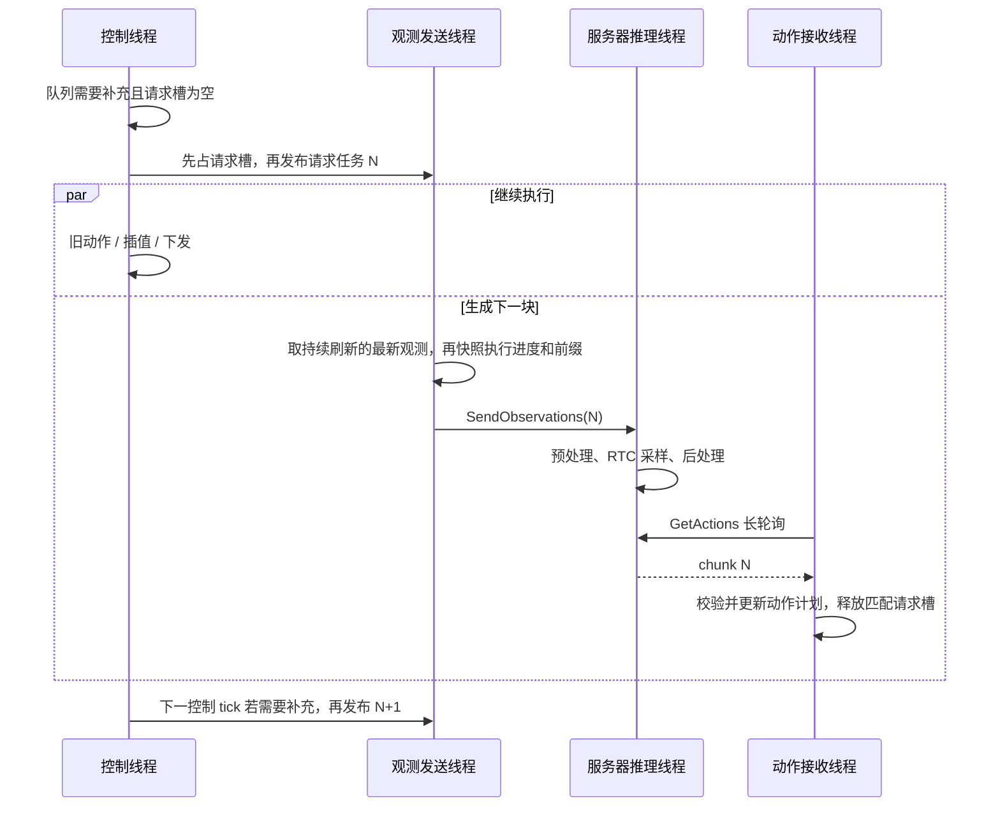
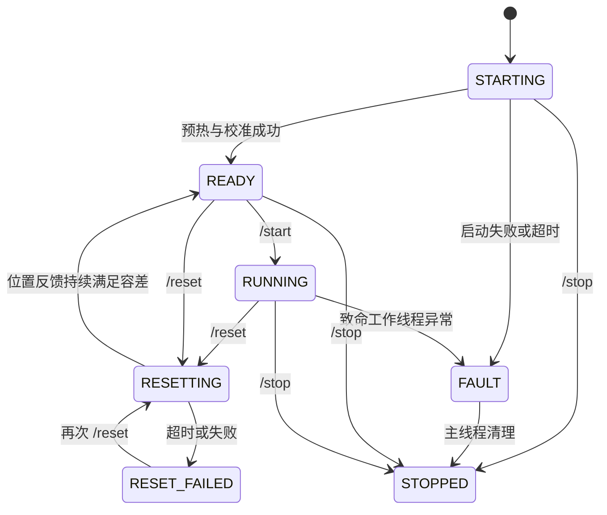

# Deployment：远程 RTC 部署代码导读

> 日常操作统一从 [docs/README.md](../../../docs/README.md) 进入。本文保留请求调度、guided/trained RTC、图像传输、精度与编译、复位和故障诊断的实现细节；下面的参数片段用于定位代码，不替代完整启动配置。

2026-10-17 起按 `shared/`（双端）、`server/`（服务端）、`client/`（客户端）归类。启动模块路径和源码链接已更新；此次目录调整需要双端同步升级，迁移步骤见 [异步推理目录说明](../async_inference/README.md)。

本文按 **2026-10-15 当前工作区代码**梳理普通 deployment 的执行逻辑，包含本地扩展，不将所有行为都称为 LeRobot 上游或论文原版行为。配套文档：[DAgger 代码导读](README_DAGGER.md)。

阅读顺序：先看第 1～4 节理解一次请求如何产生和执行，再看第 5～8 节区分 guided/trained RTC，最后看复位、参数和诊断。文中的“动作步”默认都是 **policy step**，不是插值后的电机命令 tick。

## 1. 系统解决什么问题

模型一次预测 `actions_per_chunk` 个未来动作。机器人执行旧动作时，后台采集观测、上传到服务器、生成下一块动作，再将仍有效的部分接入执行计划。

四件事分工不同：

| 机制 | 解决的问题 | 发生位置 |
| --- | --- | --- |
| 异步客户端/服务器 | 采集、网络和推理较慢时，控制线程仍能执行已有动作 | deployment 基础设施 |
| Guided RTC | 生成下一块时参考旧轨迹，改善跨块衔接 | 服务器的去噪过程 |
| Trained RTC | 训练模型在已知干净动作前缀下预测后续动作，推理时固定前缀 | Pi05 训练代码 + 独立部署 runtime |
| 线性插值 | 在两个 policy endpoint 之间增加下发命令 | 客户端 `ActionInterpolator` |

单请求在途和异步执行可以同时成立：**只有一个仍有效的推理请求，但机器人与该请求的采集、传输、推理并行工作。** `SendObservations` 上传成功仅表示服务器收到了请求，不表示动作已生成。

## 2. 从哪些文件读起

| 文件 | 主要职责 / 推荐定位符 |
| --- | --- |
| [robot_client_deployment.py](../async_inference/client/robot_client_deployment.py) | `RobotClientDeployment` 生命周期、单请求门控、观测快照；`_InterpolatedClient` 插值下发；`_InterpolatedActionSchedule` guided 动作计划 |
| [policy_server_deployment.py](../async_inference/server/policy_server_deployment.py) | `PolicyServerDeployment` 握手/模型缓存/代际切换；`_RTCServer` 推理工作线程和 guided RTC |
| [rtc_trained.py](../async_inference/shared/rtc_trained.py) | `TrainedRTCClientRuntime`、`TrainedRTCServerRuntime`、`TrainedActionSchedule` |
| [rtc_remote.py](../async_inference/shared/rtc_remote.py) | 请求、动作块、重试响应、动作引用、协议版本，以及 rollout generation / 请求序号的编解码 |
| [configs.py](../async_inference/shared/configs.py) | 公共配置与旧异步入口专用配置的拆分 |
| [action_interpolator.py](../utils/action_interpolator.py) / [cycle_timer.py](../utils/cycle_timer.py) | 线性插值与控制节拍 |
| [modeling_rtc.py](../policies/rtc/modeling_rtc.py) / [relative.py](../policies/rtc/relative.py) | guided 权重、引导修正，以及相对动作前缀重新锚定 |
| [modeling_pi05.py](../policies/pi05/modeling_pi05.py) / [flow_matching.py](../policies/common/flow_matching.py) | trained RTC 的训练输入、loss、硬前缀去噪 |

实际客户端继承关系为：

```text
_RTCClient
  └─ _InterpolatedClient
       └─ RobotClientDeployment
```

实际服务器继承关系为：

```text
_BasePolicyServer
  └─ _RTCServer
       └─ PolicyServerDeployment
```

入口没有继承历史 `robot_client_rtc*` / `policy_server_rtc*` 文件。旧实现已删除，研究当前行为时应沿上面的类层次阅读。

## 3. 线程、队列与一次正常请求

### 3.1 谁在并行运行

| 执行者 | 主要工作 | 等待/通信对象 |
| --- | --- | --- |
| 客户端主线程及 prompt 辅助线程 | `/start`、`/reset`、`/stop`，监控退出并清理硬件 | 生命周期条件变量、退出事件 |
| `control_loop` | 消耗动作、插值、下发命令，并判断是否需要新观测 | 本地 action schedule |
| `rtc-observation-collector` | 自主运行期间持续采集，只保留最新完整观测 | 单份 `_latest_observation`，与 RPC 独立 |
| `observation_sender` | 收到请求任务后取最新有效观测、构造当前前缀、上传请求 | 单槽 `_request_mailbox` |
| `receive_actions` | 持续调用 `GetActions` 长轮询，接收动作或 retry | 服务器 `_action_mailbox` |
| 服务器 gRPC 处理线程 | 接收完整观测，校验 ID，发布到单槽邮箱 | `_observation_mailbox` |
| 服务器 `RemoteRTCInference` 线程 | 串行处理最新待推理观测，运行预处理/模型/后处理 | 模型和 processor |

三个原有客户端工作线程通过 barrier 启动，发送线程负责启动独立采集线程；连接完成后处于 `READY`，需要 `/start` 才采集 rollout 观测。gRPC 可以有多个处理线程，但正常模型推理由一个后台工作线程串行执行。



图中箭头简化了 gRPC 接收线程和服务端邮箱，模型不会在上传 RPC 里同步完成。

### 3.2 请求槽为何要在发布请求任务之前占用

`RobotClientDeployment._request_observation_if_ready()` 按以下顺序执行：

1. 确认当前为 `RUNNING`，处理已有请求超时。
2. 如果 `_inflight_request_id` 非空，直接返回，连队列扫描都跳过。
3. 查询剩余连续动作数和触发阈值；无需补充时返回。
4. 构造 ID，设置 `_inflight_request_id`、请求起始时间，再写入请求邮箱。

请求槽覆盖 **邮箱等待 → 选择/等待新鲜观测 → 序列化 → 上传 → 推理 → 动作返回及处理**。采集线程可在此期间持续更新缓存，但不会自行发请求。邮箱只有一个位置本身不足以实现这个约束；真正的约束是请求槽。

正常情况下，下一次请求基于上一结果处理后的计划产生。这避免“上一请求未返回，队列已接近耗尽，又用极短旧前缀发出另一请求；随后前一个结果改写了实际执行路径”的时序问题。它不保证网络足够快，也不保证永不缺动作。

### 3.3 触发时刻和采集快照时刻不同

控制线程发布请求任务时，并没有立即固定 action prefix。默认发送线程选择后台最新完成、满足新鲜度要求的观测，然后取得当前执行快照。关闭 `continuous_observation` 时，才恢复请求触发后调用 `robot.get_observation()` 的方式：

```text
触发时 executed = 100
等待发送线程/新鲜观测期间机器人继续执行
快照时 executed = 103
请求的 chunk_start / observation.timestep = 104
前缀也从快照时的实际剩余计划取
```

`_snapshot_execution_state()` 将动作进度和动作前缀配对，缓存只保存传感器值。相机调用和上传 RPC 放在 lifecycle 锁之外，采集前后重新检查 generation，避免慢相机/网络阻塞动作下发和代际切换；实际复位运动仍与正在进行的硬件采集互斥。

这是**调度元数据的一致快照**，不代表关节、各相机曝光、网络时钟具备硬件级同步。缓存存在有限的传感器滞后，通过 `observation_max_age_s` 限制并单独记录；详见第 16 节。

## 4. 动作步、插值占用与请求 ID

有两个不同的 “in-flight”，不能混淆：

| 状态 | 含义 | 何时释放 |
| --- | --- | --- |
| `_inflight_request_id` | 一个仍有效的观测/推理请求 | 结果处理、失败、超时或生命周期失效 |
| `action_schedule._inflight` | 插值器已经取走、正在向其运动的 policy endpoint | 该 endpoint 的最后一个插值命令成功下发 |

guided schedule 把“可替换未来动作”和“插值器占用的 endpoint”分开。`consume_next()` 将下一个 endpoint 从未来字典移入 `_inflight`；后来的 chunk 不能修改它。`qsize()` 和 prefix 快照仍包含这个 endpoint，因为它还没下发完。

`latest_action` 表示最后一个完成命令下发的 policy endpoint 索引，不是已由位置传感器验证到位的索引。`first_mutable_step()` 越过已下发和正在插值的 endpoint，给出真正允许新 chunk 改写的第一步。

请求 ID 使用：

```text
observation_id = (rollout_generation << 32) | request_sequence
```

开始新 rollout、复位、停止，以及 DAgger 暂停都会更新 generation。旧请求即使晚到，也不能修改新一轮计划。同一 generation 内的超时请求另有 `_retired_request_id` 防止其晚到结果生效。

## 5. Guided RTC：什么时候请求、如何生成、如何合并

### 5.1 客户端触发阈值

记 `C = actions_per_chunk`，`q = 剩余连续 policy endpoint 数`，`m = rtt_trigger_margin_steps`。

固定阈值为 `q0 = floor(C * chunk_size_threshold)`。默认 `chunk_size_threshold=0.5`。

当 `adaptive_rtt_trigger=true` 且已有请求延迟估计时：

```text
R = ceil(平滑后的“触发请求到动作返回”延迟步数)
latency_guard    = R + m
continuous_refill = C - R + m
threshold = min(C - 1, max(q0, latency_guard, continuous_refill))
```

`q <= threshold` 且请求槽为空时允许补充；`_force_fresh_snapshot` 可跳过队列阈值，但仍不能越过请求槽。

默认自适应模式在匹配请求的结果到达后，会设置 `_force_fresh_snapshot`，在**下一个控制 tick** 允许采集新的观测。即使这次返回比历史估计快、队列仍很长，也不会为了等到阈值而延后重规划。关闭 `adaptive_rtt_trigger` 可恢复 guided 固定阈值触发。

`latency_guard` 为下一次等待保留动作；`continuous_refill` 让已返回的块在剩余动作不多时能尽快接续下一请求。较慢延迟样本立即抬高估计，较快样本以 `0.2` 的比例逐步降低估计。请求槽占用期间，阈值再高也不会发出第二个有效请求。

这一估计使用单调时钟，包含采集前的邮箱等待及采集时间。它和服务器用于去噪的 delay buffer 是两套用途不同的量。代码还会对 `2 * 本次延迟步数 + m >= C` 的持续容量不足给出警告；警告不会自动增大 chunk 或降低 fps。

### 5.2 前缀用引用传输

guided 请求主要包含：

```text
RemoteRTCObservation
  observation                  观测、任务、时间戳、起始步
  observation_id               generation + 请求序号
  executed_action_step         已消耗到的 policy step
  action_refs                  未来连续动作的来源引用
  latency_feedback_*           上一有效结果的延迟反馈
```

普通引用 `RTCActionRef(source_observation_id, action_index)` 指向服务器缓存中某块的某一行。服务器同时缓存模型空间动作和后处理后的可执行动作，默认保留 10 块。

`_reconstruct_prefix()` 最多重建 `rtc.execution_horizon` 步。若引用丢失，返回 `prefix_unavailable` 重试响应，要求客户端重新采集；不会静默把“无法重建前缀”解释为“可以不使用动作前缀”。

若 checkpoint 使用相对动作，旧块相对的是旧观测状态。服务器用缓存的**绝对动作**和**本次观测状态**重新做相对化、归一化，避免直接沿用旧坐标原点。

### 5.3 服务器生成下一块

主调用链是：

```text
_predict_remote_chunk()
  → raw_observation_to_observation()
  → preprocessor：观测预处理，并保存本次相对动作参考状态
  → _reconstruct_prefix() / reanchor_relative_rtc_prefix()
  → 计算 conditioned_delay
  → policy.predict_action_chunk(...)
  → 对整块调用 postprocessor
  → 缓存原始/可执行动作，返回 RemoteRTCActionChunk
```

服务器默认保留最近 10 个不同请求的客户端 RTT，使用 nearest-rank P90，再加 1 个 policy step 的余量。RTT 用客户端单调时钟计算，起点为执行前缀快照，终点为结果到达。服务端自身处理耗时存入独立窗口，仅在尚无客户端 RTT 时作为启动估计；同一请求不再以“服务器耗时 + 客户端 RTT”计入两次。

`rtc_delay_quantile=1.0` 可选择窗口最大值。P90 在不足 10 个样本时仍取最大值，满 10 个样本后可以排除一个尾部值。预算还取 P90 与快升慢降保护值的较大者：真实慢样本立即抬高估计，较快样本以 0.2 系数逐步降低。保护值不超过当前窗口的最大 RTT，旧尖峰退出窗口后不再留下额外拖尾。只排除明确标记的启动预热，不丢弃正常请求的慢样本；迟到接纳检查仍然必要。

例如，保护值原为 400 ms，收到 800 ms 的真实请求后立即变为 800 ms；随后连续收到 400 ms，保护值依次降到 720、656、604.8 ms。guided 预算取 `max(P90, 保护值)`，换算为步数后再加 margin，并受前缀/执行窗口约束。两者不相加，也不会让服务器额外等待；代价是短期内更保守、更多沿用旧动作前缀。客户端另有包含采集/等待时间的触发估计，用于提前发起下一次请求，不能把它与服务器 RTT 直接累加。

设真实重建长度为 `P`，估计延迟为 `d_est`，实际引导起始长度为：

```text
P > 0：d = min(d_est + rtc_delay_margin_steps, P, C - 1)
P = 0：d = 0，无旧动作引导
有效 mask 终点 E = min(rtc.execution_horizon, 传入的真实前缀长度)
```

默认 deployment 使用指数衰减权重：前 `d` 步权重为 1，`d` 到 `E` 之间逐渐衰减，`E` 之后为 0。**guided 的权重 1 也不等于硬拷贝这些动作。** 它是去噪修正，与 trained 的硬前缀不同。

服务器保留真实前缀长度；`RTCProcessor` 先裁定有效引导范围，再为张量形状补零。不能先把短前缀补成长前缀，再把补的值当真实轨迹施加非零 guidance。

部署使用轻量 guided 引导，不在模型 forward 前开启输入梯度。2026-10-16 已移除本地完整 VJP 扩展及其开关；旧启动命令中的 `--rtc_full_vjp=...` 和离线脚本的 `--rtc-full-vjp` 都应删除。轻量路径保留前缀约束及权重，不应描述为与论文完整 VJP 数值等价。

### 5.4 返回时检查真实执行进度

客户端先处理 generation、废弃请求、模式以及重复/乱序块，再计算：

```text
execution_delay = max(0, first_mutable_step - chunk_start_step)
wall_delay      = ceil(观测到结果的墙钟时间 * fps)
```

接纳依据使用动作进度。队列耗尽时墙钟继续走，但 policy step 不会凭空前进。

guided 默认仍使用本地的 `execution_delay > conditioned_delay + 3` 拒收规则。配置 `guided_late_action_tolerances` 后，超出这 3 步的结果会进入轨迹相容性检查，而不是直接丢弃：

- 按绝对步号比较本次块起点至已冻结 endpoint 的**每一行**，包含已执行的目标和正在插值的目标，防止中途走了不同轨迹、最后又碰巧回到同一锚点。guided 的强约束区也接受检查，因为它不是硬拷贝。
- 比较第一个可执行新动作与同一步的旧目标；队列耗尽时，与最后一个已承诺目标比较。
- 所有特征误差均在各自容差内才立即合并。历史缺失、没有可执行后缀或误差超限仍拒收并重新采集。

容差字典必须完整覆盖机器人 `action_features`，单位与动作一致，例如 Piper 的关节为弧度、夹爪为米。空字典保留原规则。检查使用的是已承诺的**目标轨迹**，并不验证 EMA 后的实发命令、真实关节状态、接触状态或任务语义；不能将通过检查等同于消除了回退。`RTC GUIDED LATE` 会记录接纳原因和最大归一化误差，`max_error_ratio <= 1` 表示满足容差。

有效块按**绝对动作步**合并：

- 已下发或正在插值的 endpoint 保持不变。
- 可变未来区域内，较新请求 ID 的动作覆盖较旧动作，即逐步 LWW。
- 不把 `conditioned_delay` 当成客户端必须保留旧队列的硬所有权边界。
- 被跳过的旧行保留为合并过程的上下文，日志区分 `stale / inserted / replaced`。

## 6. 线性插值与 Piper EMA

### 6.1 线性插值

`interpolation_multiplier=N` 时，对相邻 endpoint `A`、`B` 下发：

```text
A + (B - A) / N, A + 2(B - A) / N, ..., B
```

例如 `fps=30, N=2`：policy/RTC 仍按 30 Hz、50 步等单位工作，常规命令按 60 Hz 下发。RTC 延迟、前缀长度和队列阈值都不乘 2。最后一项直接拷贝 `B`，避免浮点插值误差改变 endpoint。

普通 deployment 第一项没有前一动作作插值起点，会直接下发第一项；之后开始 N 倍插值。DAgger 在启动时显式用当前姿态播种插值器，细节见其文档。

只有 `emitted_policy_action=true` 且命令已成功下发后，才 `commit_inflight()` 并更新 `latest_action`。提高插值倍数不会提高模型推理频率，也不会自动缩小模型生成的跨块跳变。

### 6.2 动作插值与驱动平滑

| 层 | 是否改动 policy endpoint | 作用范围 / 默认值 |
| --- | --- | --- |
| `ActionInterpolator` | 保留 endpoint，插入中间命令 | guided 和 trained；倍数默认 1 |
| Piper EMA | 改变实际发给驱动的命令目标 | 取决于机器人/控制器配置；不属于 RTC 算法 |

将跨块偏差分摊到后续若干 endpoint 的拼接桥接已经删除。未来动作保留新模型输出，已进入插值的 endpoint 保持不可改写；`RTCActionRef` 只记录动作来源与行号。旧命令必须移除 `--active_splice_bridge_steps`，即使其值为 0。正常线性插值与双臂 CAN 通信桥保留。

普通 Piper `send_action()` 还可能执行 `cmd = alpha * target + (1-alpha) * previous_cmd`。当前配置默认关节 `alpha=0.25`、夹爪 `alpha=0.5`；`alpha=1` 跳过该低通。这可能使实际下发值落后于插值目标。开启 `--debug_rtc_diagnostics=true` 后，命令日志会记录 requested/sent 的差异；`latest_action` 仍是序列进度，不代表测量位置已到位。相关代码：[Piper 驱动](../robots/piper_follower/piper_follower_PyAgxArm.py)。

命令跳变、反向和跟踪误差阈值仅在 `debug_rtc_diagnostics=true` 时用于**诊断告警**，不自动限速、裁剪或改变模型动作。

## 7. Trained RTC：训练端到底改变了什么

当前独立 deployment trained 路径限定 Pi05。训练算法在 `PI05Policy.forward()` 内，部署文件本身不执行训练。

设训练动作块为 `A`，长度 `H=policy.chunk_size`，最大训练前缀长度为 `D=policy.rtc_training_max_delay`：

1. 每个样本独立均匀采样 `d ∈ {0, 1, ..., D}`；`D=0` 时关闭此训练分支。
2. 前 `d` 个动作直接使用数据集中的干净真值，对应 flow timestep 设为 0。
3. 后缀按普通 flow matching 加噪：`x_t = t * noise + (1-t) * A`，目标速度为 `noise - A`。
4. 模型接收每个动作位置的 timestep，学习根据观测和已知动作前缀生成后缀。
5. flow MSE 只对后缀求平均，排除已知前缀；loss 先截到真实动作维度，避免模型补齐维度进入实际动作 loss。

```text
训练样本： [A0 A1 A2 A3 A4 A5 ...]
采样 d=3： [干净前缀   ][加噪后缀 ...]
时间输入： [0  0  0   ][t  t  t  ...]
loss：     [不计入     ][预测误差 ...]
```

约束为 `0 <= D < H`。训练前缀来自数据集，不是在线 deployment 上传的远程前缀。两者的联系是：训练让模型学会这一条件形式，部署时用当前已经计划好的动作替换干净前缀。

训练配置片段（加入你已有的 Pi05 训练命令）：

```bash
--policy.rtc_training_max_delay=10
```

需要在这个配置下实际训练/微调并保存 checkpoint。给一个普通 checkpoint 手改同名配置值，并不等于已经学会 trained RTC。

推理时 `PI05Pytorch.sample_actions()` 准备硬前缀，`euler_integrate()` 在**每次去噪前后**恢复该前缀，并把前缀位置的时间保持为 0；后缀正常去噪。该分支不执行 guided VJP。

## 8. Trained RTC：远程部署的独立路径

### 8.1 显式动作前缀与固定预算

`rtc_trained.py` 不导入 deployment 或历史 guided 客户端类。deployment 只提供共用的采集、RPC、代际隔离、插值下发和复位。

客户端通过 `TrainedActionSchedule.snapshot_prefix()` 发送显式的 **CPU 绝对动作张量** `trained_prefix`，包含正在插值的 endpoint 和连续未来动作。此时 `action_refs` 为空。空张量表示队列确实为空；`None` 表示缺少必要传输状态，不能当作“无需动作前缀”。无论是否有动作前缀，模型仍使用当前观测和任务条件。

服务器先处理本次观测，再把绝对动作转换到该 checkpoint 的模型空间：有相对动作时按本次 state 重新锚定，然后应用保存的归一化。

设固定预算 `B=trained.delay_steps`，训练最大值 `D`，客户端固定触发阈值 `Q=trained.queue_threshold`，请求块长 `C`：

```text
B 默认使用 checkpoint 的 D
Q 默认 floor(C / 2)
0 < B <= D
2 * B <= C <= policy.chunk_size
B <= Q < C
本次硬前缀长度 d = min(B, 本次真实前缀长度 P)
```

这些是当前部署 runtime 的固定调度选择。`B`、`Q` 不从 guided RTT 历史或自适应阈值计算。

`trained.replan_on_result=true` 为默认值：接纳本次结果后，下一个控制 tick 即允许新的观测采集，保持单请求在途。它不改变硬前缀 `B`，也不延后早到结果的合并。设为 `false` 可恢复仅按固定 `Q` 触发；`Q` 仍作为启动/回退阈值及握手预算校验的一部分。

### 8.2 结果接纳

服务器 `predict()` 的耗时若满足 `d > 0` 且 `ceil(服务端本次处理秒数 * fps) > d`，返回 `delay_exceeded`，让客户端采集新快照。

客户端 `accept()` 还会校验：请求存在、模式/起始步/块长/步号/维度匹配，动作有限，返回的前 `d` 步与请求的绝对前缀在容差内相等。然后计算包含冻结 endpoint 的实际消耗：

```text
consumed = max(0, first_mutable_step - chunk_start_step)
P > 0 且 consumed > d → 拒绝
consumed >= 返回块长度 → 拒绝
否则 → 保留冻结 endpoint，整体替换可变后缀
```

服务器检查自身处理时间，客户端检查实际执行进度，二者覆盖不同风险。连续 RTC 接纳拒绝达到默认 5 次会使客户端停止；普通 RPC 超时走传输恢复，不计入这个硬前缀拒绝计数。

### 8.3 模式差异

| 行为 | Guided | Trained |
| --- | --- | --- |
| checkpoint 要求 | 模型支持 RTC 去噪接口 | 当前限实际完成 trained RTC 训练的 Pi05 |
| 前缀传输 | 缓存引用 `action_refs` | 显式绝对张量 `trained_prefix` |
| 模型约束 | 加权去噪修正 | 每步去噪固定前 `d` 步 |
| 请求触发 | 默认结果到达即允许下一次采集，另有自适应阈值 | 默认结果到达即允许下一次采集，可退回固定 `Q` |
| 延迟预算 | 滚动延迟估计 | 固定 `B`，本次再受 `P` 限制 |
| 返回计划 | 逐步 LWW 合并 | 整体替换可变后缀 |
| 迟到容忍 | 默认 `conditioned_delay + 3`；可配置逐特征轨迹相容性检查 | `consumed <= d`，无 guided 的 3 步容忍 |
| 完整 VJP | 不使用，本地扩展已移除 | 不使用 |
| 单请求、generation、插值、复位 | 共用 | 共用 |

因此，**trained RTC 可以与异步远程执行、线性插值同时使用；当前 `rtc.mode` 选择 guided/trained 之一，不会在同一次采样里叠加两套 RTC 算法。**

## 9. 模型与传输层的性能处理

| 实现 | 实际收益及边界 |
| --- | --- |
| 一次请求传整个 chunk | 控制 tick 不发逐动作 RPC；服务端整块后处理 |
| 动作块的紧凑序列化 | 动作块将动作打包为一个稠密张量，并保存时间戳/步号，避免逐行 view 重复序列化大块底层 storage；不是网络压缩或零拷贝 |
| 单槽 latest 邮箱 | 避免堆积等待中的旧任务；运行中的模型计算不会被新邮箱内容自动取消 |
| 模型保持加载 | 普通 rollout 复位只清缓存/历史，不反复加载权重 |
| `reuse_last_policy=true` | deployment 默认跨客户端重连复用匹配的模型；键含模型类型、checkpoint 引用、device，不是文件内容哈希 |
| processor 单独缓存 | 特征/rename map 改变时可重建处理器，同时复用匹配权重 |
| Pi05 观测 token KV cache | 同一次动作生成中，观测/语言前缀编码结果供各去噪步复用；不要与 RTC 的动作前缀混淆 |
| `num_inference_steps` / `compile_model` / dtype | 属于 checkpoint/模型配置；影响采样成本或计算方式，不是 deployment 自动延迟调节器 |
| 默认关闭 verbose 诊断 | 跳过不需要的 guided tensor 快照、合并前后扫描；RTC 日志尽量在释放控制/生命周期锁后输出 |
| 可选有界队列历史 | 只有开启 `debug_visualize_queue_size` 才逐 tick 采集；最多 100,000 条，跨复位保存并在退出断开硬件后绘图 |

`inference_latency` 是服务端每次处理的最短目标时长，当前 deployment / DAgger / RECAP 默认 `0`，不增加人为等待；显式设为正值时，处理较快的请求会 sleep 补足，较慢时不额外等待。它不是 measured RTT，也不是超时阈值。

客户端默认 `log_rtc_timing=false`。需要分析时开启 `--log_rtc_timing=true`：每次动作块返回在 INFO 输出一条 `RTC RPC PHASES`，不需要打开逐 tick 的 verbose 诊断。它包含接纳结果、采集/上传阶段、`server_inference_ms`、`snapshot_to_result_ms`、实际消耗及剩余步数。`outside_server_ms` 是快照到返回减去服务端处理时间，包含序列化、传输、排队及交付等待，不能直接当成纯网络延迟；各阶段可能重叠，不能全部相加。`live_steps` 是接纳后还可执行的返回行数，不等于这些行已经完全脱离旧前缀的影响。

Pi05 另有训练侧的 `gradient_checkpointing`（显存与重计算交换）、`freeze_vision_encoder`、`train_expert_only` 等选项。这些控制训练资源/可训练参数范围，与 `rtc_training_max_delay` 所改变的条件生成任务不同。相关定义在 [configuration_pi05.py](../policies/pi05/configuration_pi05.py)，不应把它们当成 deployment 顶层参数传给服务器。

## 10. 重试、复位和故障

### 10.1 重试必须重新采集

服务器缓存引用缺失、推理错误或 trained 处理超预算时，返回 `RemoteRTCRetry` 并结束本次请求。客户端只释放匹配 ID 的请求槽，并标记强制新快照。下一控制 tick 重新读传感器和剩余计划，不复用旧 observation/prefix 原地循环推理。

运行期上传和取动作 RPC 使用 `request_timeout_s`，客户端也用它限制从请求创建开始的生命周期。超时会作废旧请求并允许新请求；旧上传、旧采集、旧结果即使后来完成，也不能清除或覆盖新请求的状态。这里保证一个**有效逻辑请求**，不声称旧网络流量或 GPU 工作已被立即取消。

服务器连续普通推理异常达到 10 次会标记 worker 失败并停止。客户端本地控制线程逃出的致命异常会进入 `FAULT`，通知主线程断开硬件，入口最终以非零错误退出。

### 10.2 复位有位置反馈门槛



复位先推进 generation、停止 rollout 动作并清理执行历史，再按 `reset_duration_s` / `reset_fps` 插值到目标，随后持续下发目标并读取位置反馈。Piper 默认分两阶段复位：回位时保持 reset 开始时**实测的夹爪开度**，手臂到位并稳定后才张开夹爪。开始回位前也会用实测姿态重置底层命令平滑状态，避免上一次闭合指令继续夹紧物体。

默认回到启动时采集的关节姿态，也可用 `reset_pose` 指定。Piper 默认 `reset_open_gripper=true`、`reset_gripper_open_position=0.07`（70 毫米）；启用释放时，夹爪不使用启动姿态或 `reset_pose` 中的闭合目标。可用 `--reset_gripper_open_position=0.05` 等值调整最终开度，应按实际夹爪行程和物体尺寸设置。其他机器人只有显式设置 `reset_gripper_open_position` 才启用此流程，数值使用各自的动作单位。`--reset_open_gripper=false` 恢复原来的夹爪复位行为。

若 `reset_to_initial_position=false` 且没有显式目标，则先保持当前关节姿态并验证稳定，再按上述配置释放夹爪。启动姿态获取失败时，不会假装已回到一个未知目标。启用分阶段释放时，**回位阶段仅以手臂关节到位为准**，仍持续下发原来的夹爪保持目标，但夹持物体造成的夹爪位置偏差不阻止后续张开；夹爪反馈仍必须存在且为有限值。**张开阶段同时检查关节和夹爪到位**，夹爪仍使用 `reset_gripper_tolerance`（默认 1 毫米）。两个阶段各自要求相应位置在容差内保持 `reset_settle_s`，各自受 `reset_verify_timeout_s` 限制。回位失败不会提前释放物体；夹爪张开失败也会进入 `RESET_FAILED`，错误会标明 `reset gripper release`，修复原因后可再次 `/reset`。未启用分阶段释放时，仍检查复位目标中的所有关节和夹爪。

`STARTING`、`RESETTING`、`RESET_FAILED` 都不能 `/start`。复位完成只表示机器人位置条件满足，任务环境中的物块等仍需操作者恢复。`/reset` 保留进程和连接，`/stop` 才结束进程并断开硬件。

服务器直到收到新 generation 的观测，才在**推理工作线程**上执行 `_begin_rollout_generation()`：清动作缓存和 processor/policy 的 episode 状态，保留权重及仍有效的延迟统计。客户端同样清除动作、请求和反馈 ID，保留有效的补充请求预算；两端默认 `latency_history_ttl_s=300`，统计空闲超时则失效，重连也会清空。旧 generation 的观测、反馈及动作仍被拒绝。不会在 RPC 接收线程并发清理正在推理的模型状态。

## 11. 参数应放在哪一端

| 参数 | 配置位置 | 当前默认 / 含义 |
| --- | --- | --- |
| `rtc_mode` | 客户端 | `guided`；必须与服务器一致 |
| `rtc.mode` | 服务器 | `guided` |
| `fps` | 两端 | 30，必须一致；单位是 policy endpoint/s |
| `actions_per_chunk` | 客户端，握手传给服务器 | 必填，实际请求块长 |
| `chunk_size_threshold` | 客户端 | 0.5，仅 guided 触发下限 |
| `adaptive_rtt_trigger` / `rtt_trigger_margin_steps` | 客户端 | `true` / 5，仅 guided |
| `rtc.execution_horizon` | 服务器 | 10；guided 前缀重建与权重终点上限，需小于 `actions_per_chunk` |
| `rtc.prefix_attention_schedule` / `rtc.max_guidance_weight` | 服务器 | deployment 覆盖为 `EXP` / 5.0；共享 `RTCConfig` 自身默认值不同 |
| `rtc_delay_buffer_size` / `action_cache_size` | 服务器 | 10 / 10，主要服务 guided |
| `rtc_delay_quantile` / `rtc_delay_margin_steps` | 服务器 | 0.9 / 1，仅 guided；1.0 / 0 可使用窗口最大 RTT、无额外余量 |
| `guided_late_action_tolerances` | 客户端 | `{}`；完整逐特征容差开启 guided 迟到相容性检查 |
| `trained.delay_steps` | 服务器 | `None`，实际取训练最大值 |
| `trained.queue_threshold` | 客户端 | `None`，实际取 `actions_per_chunk // 2` |
| `trained.replan_on_result` | 客户端 | `true`；返回后尽快重新采集，硬前缀预算保持不变 |
| `trained.max_consecutive_rejections` | 客户端 | 5 |
| `interpolation_multiplier` | 客户端 | 1 |
| `request_timeout_s` | 客户端 | 30 秒，运行期 RPC 与请求生命周期 |
| `action_wait_timeout` | 服务器 | 5 秒，动作长轮询等待，不是整次推理超时 |
| `debug_rtc_diagnostics` | 两端分别设置 | `false`；详细日志为 DEBUG 级别 |
| `log_rtc_timing` | 客户端 | `false`；开启后收集请求细分耗时、图像上传大小并输出 INFO 时序摘要 |
| `resize_images_on_client` | 客户端 | `true`；协商 π0.5 本地图像处理；关闭后上传原图 |
| `image_transport_mode` | 客户端 | `lerobot_float32`；可选 `openpi_uint8`，见第 15 节 |
| `continuous_observation` | 客户端 | `true`；自主运行期间持续采集，上传/推理期间继续更新最新快照 |
| `observation_capture_fps` | 客户端 | `None`，跟随策略 `fps`；独立于插值下发频率 |
| `observation_max_age_s` | 客户端 | 0.1 秒；选择观测时允许的最大采集/本地相机帧年龄 |
| `debug_visualize_queue_size` | 客户端 | `false`；图横轴实际为已保存的控制 tick 样本序号 |
| `reset_duration_s` / `reset_fps` | 客户端 | 3 秒 / 50 Hz |
| `reset_open_gripper` / `reset_gripper_open_position` | 客户端 | `true` / Piper 默认 0.07 米；回位时保持实测开度，到位后张开 |
| `reset_verify_timeout_s` / `reset_settle_s` | 客户端 | 5 秒 / 0.1 秒 |
| `reset_joint_tolerance` / `reset_gripper_tolerance` | 客户端 | 0.02 / 0.001；Piper 对应弧度/米 |
| `policy.rtc_training_max_delay` | **训练配置** | 0 关闭；部署读取保存到 checkpoint 的值 |

以下选项已从当前 deployment / DAgger 入口删除：客户端 `observation_similarity_atol`、`cooldown_margin_steps`、`aggregate_fn_name`；服务器 `obs_queue_timeout`。旧命令/配置必须移除它们。当前单请求路径没有相似度筛选和额外 cooldown；历史普通异步入口的有效聚合/观测队列配置仍单独保留。

## 12. 用命令片段对应代码路径

下面只展示模式和调度参数；客户端保留你实际使用的 `robot`、相机、任务、地址、模型路径等完整参数。`pretrained_name_or_path` 由客户端发送，**模型权重在服务器端加载**。

Guided 服务器示例（这里显式选 20 步，不是默认值）：

```bash
uv run --locked --extra pi05-server python -m lerobot.async_inference.server.policy_server_deployment \
  --host=0.0.0.0 --port=8080 --fps=30 \
  --rtc.mode=guided --rtc.execution_horizon=20
```

对应客户端模式片段：

```bash
--rtc_mode=guided --fps=30 --actions_per_chunk=50 \
--interpolation_multiplier=2
```

Trained 服务器示例，假设 checkpoint 确实以 `D=10, H=50` 训练：

```bash
uv run --locked --extra pi05-server python -m lerobot.async_inference.server.policy_server_deployment \
  --host=0.0.0.0 --port=8080 --fps=30 \
  --rtc.mode=trained --trained.delay_steps=10
```

对应客户端模式片段：

```bash
--policy_type=pi05 --rtc_mode=trained --fps=30 \
--actions_per_chunk=50 --trained.queue_threshold=25 \
--interpolation_multiplier=2
```

`10 / 30 ≈ 0.333` 秒只说明 10 个 policy step 的时间预算；例子不保证覆盖你的实际远程延迟。若服务器经常处理超过该预算或返回时消耗过多，当前代码会拒绝/重试，不能靠调大 guided `execution_horizon` 修复 trained 的预算问题。

两端使用同一部署协议版本，当前为 **5**；新增独立的启动校准消息，需要一起更新并重启客户端和服务端。历史 `*_rtc*` 入口使用独立协议，不能与 deployment 入口混用。

## 13. 从现象定位代码

| 现象 / 问题 | 先看哪里 |
| --- | --- |
| 为什么暂时不发新请求 | `rollout_state` → 请求槽 → `_request_observation_if_ready()` 的队列阈值 |
| 图像采集比预期慢 | `RTC OBS SNAPSHOT` 的 sensor/camera/cache age，以及 `RTC RPC PHASES` 的 observation wait/capture 时间 |
| 收到结果却没执行 | generation/retired ID → `_handle_action_chunk()` → guided 迟到检查或 trained `accept()` |
| 队列经常空 | RTT、`actions_per_chunk`、触发阈值、被丢弃原因；`RTC STARVATION` 是诊断，不会补造动作 |
| chunk 衔接跳变 | `RTC ALIGN`（服务端生成对齐）、`RTC MERGE LIVE` / splice、`RTC COMMAND ANOMALY` 三层分开看 |
| 原始动作连续但实体落后 | 插值目标、`send_action()` 返回值、实际关节反馈、EMA 分别比较 |
| 复位后不能开始 | `/status`、`reset_error`、位置反馈和 settle 条件 |
| 修改 checkpoint 文件却仍用旧模型 | deployment 的 `reuse_last_policy` 以引用/路径匹配；关闭复用并重连或使用新 checkpoint 路径 |

代码阅读可配合现有回归测试：

- [客户端生命周期与调度](../../../tests/async_inference/test_robot_client_deployment.py)
- [服务器缓存、前缀及重试](../../../tests/async_inference/test_policy_server_deployment.py)
- [trained 隔离、硬前缀和拒绝规则](../../../tests/async_inference/test_trained_rtc_deployment.py)
- [请求生命周期、历史绘图、废弃配置](../../../tests/async_inference/test_deployment_request_lifecycle.py)
- [复位、异常和传输回归](../../../tests/async_inference/test_deployment_p2_regressions.py)

这些测试帮助理解实现的行为边界，不能替代在目标模型、网络和机器人上的延迟及轨迹验证。

## 14. 云端延迟抖动的试验设置

保持 `actions_per_chunk=50`、`fps=30` 及原有 `rtc.execution_horizon`，先比较本次调度和延迟统计改动。新版本默认立即允许下一次采集、使用 P90 + 1 步的 guided 估计；请求时序按需通过 `--log_rtc_timing=true` 开启。合格结果仍在收到时合并，不等待某个固定接管步；没有为掩盖抖动扩大 chunk 或延长旧轨迹执行。

按现有启动命令追加或显式核对：

```bash
# guided 服务器
--rtc_delay_buffer_size=10 --rtc_delay_quantile=0.9 --rtc_delay_margin_steps=1

# guided 客户端
--adaptive_rtt_trigger=true --log_rtc_timing=true

# trained 客户端（保持已经验证过的 trained.delay_steps 预算）
--trained.replan_on_result=true --log_rtc_timing=true
```

需要试验 guided 迟到接纳时，再配置独立的逐特征容差。下面是**Piper 小容差起点示例**，不是通用安全阈值；应按动作尺度、速度和实际衔接误差核对。键名必须与客户端启动时打印的 `RTC diagnostic action order` 一致：

```bash
--guided_late_action_tolerances='{"joint_1.pos":0.02,"joint_2.pos":0.02,"joint_3.pos":0.02,"joint_4.pos":0.02,"joint_5.pos":0.02,"joint_6.pos":0.02,"gripper.pos":0.001}'
```

对照时同时比较服务器耗时、完整请求 RTT 的 P50/P90/P99、迟到块接纳/拒收、`RTC STARVATION` 时长，以及相同任务的成功率和回退。新日志用于确定优化下一步应放在模型推理、排队还是传输。这里的修改改善重规划调度与抖动处理，并未降低 π0.5 本身的计算成本；单请求模式的新观测闭环速度仍受实际端到端延迟限制。trained 的固定预算不足仍会拒收，不能用 guided 容差绕过。

## 15. π0.5 图像上传：float32 无损压缩 / OpenPI uint8 可选

OpenPI 的[远程推理文档](https://github.com/Physical-Intelligence/openpi/blob/main/docs/remote_inference.md)明确建议客户端提前缩放图像以减少带宽和延迟，示例使用 224×224；其 [PyTorch 预处理](https://github.com/Physical-Intelligence/openpi/blob/main/src/openpi/models_pytorch/preprocessing_pytorch.py)与 LeRobot 的 [π0.5 配置](https://github.com/huggingface/lerobot/blob/main/src/lerobot/policies/pi05/configuration_pi05.py)也默认采用 224×224。这是模型已有的输入尺寸，不是将模型输入继续降分辨率。

Deployment、DAgger、RECAP 客户端共用该选项，guided、trained 和启动延迟校准都适用。默认保持原有 float32 流程，在客户端命令后添加以下参数即可显式选择：

```bash
--resize_images_on_client=true --image_transport_mode=lerobot_float32
```

选择 OpenPI 的图像处理和 uint8 上传：

```bash
--resize_images_on_client=true --image_transport_mode=openpi_uint8
```

| 模式 | 客户端处理 | 上传图像格式 | 服务端处理 |
| --- | --- | --- | --- |
| `lerobot_float32`（默认） | 复现原有两阶段缩放：feature 尺寸插值，再执行 π0.5 等比例缩放和居中补边 | CHW float32 `[0,1]`，字节重排 + zlib 无损压缩；不划算时原图上传 | 解压恢复 float32，跳过已完成的缩放 |
| `openpi_uint8` | 从原始 RGB 图像直接使用 PIL 双线性等比例缩放和居中黑色补边，匹配 `openpi_client.image_tools.resize_with_pad` | HWC RGB uint8 原始字节，不做 zlib / JPEG 编码 | 转为 CHW float32 `[0,1]`，跳过已完成的缩放 |

两种模式都在本地完成图像缩放。客户端不访问服务器上的 checkpoint 文件，也不硬编码 224；服务器加载 checkpoint 后协商实际 `image_features` 和 `image_resolution`。224 模型使用 224×224，384 模型使用 384×384。两张 224×224 RGB uint8 图像的像素载荷固定为 301,056 B，完整请求还包含状态、RTC 前缀和序列化元数据。

`openpi_uint8` 会改变缩放算法及像素数值，**不与原 float32 预处理逐位等价**；模型输入最终仍为浮点张量，不是 INT8 模型推理。float32 模式的“无损”指保留既有缩放后的 float32 像素。相机采集、录制和 DAgger / RECAP 使用的原始图像保持原尺寸；只有后台上传用的字典副本改变。

两端需同步更新 `shared/` 和各自的 `client/`、`server/` 代码并重启；服务端无需新增命令行参数。启动日志应出现 `Client image resize enabled (lossless float32)` 或 `Client image resize enabled (OpenPI uint8)`。开启 `--log_rtc_timing=true` 或 `--debug_rtc_diagnostics=true` 后，每次发送输出：

```text
RTC IMAGE UPLOAD obs=... raw_image_bytes=... image_bytes=... payload_bytes=... prepare_ms=...
```

`payload_bytes` 是完整序列化请求大小；`image_bytes` 是图像载荷合计，不含对象元数据；`prepare_ms` 包括客户端图像处理、所选模式的编码与请求序列化。可结合 `RTC RPC PHASES` 对照两种模式的本地耗时和上传时间。

默认 float32 模式遇到旧服务器未返回能力信息、非 π0.5 策略、视觉 memory、自定义图像处理、视觉归一化或提前低精度转换等无法确认等价的处理链时，保持原图上传。显式选择 `openpi_uint8` 时，若策略或处理链不支持，或服务端未确认该模式，则启动报错，避免参数被静默忽略。uint8 模式始终发送处理后的像素，即使输入小于模型尺寸。

需要与原流程对照时，仅在客户端关闭：

```bash
--resize_images_on_client=false
```

`resize_images_on_client=false` 优先于 `image_transport_mode`，此时不启用任何一种本地处理。

2026-10-15 原有 float32 模式的本地测量：构造两路 640×480 RGB 请求，2 次预热后测量 10 次，CPU 使用 16 个 PyTorch 线程。下表是测试数据，不是实际云端链路的 RTT，也不代表新增 uint8 模式：

| 图像来源 | 原完整请求 | 新完整请求 | 减少 | 客户端处理/序列化中位数 | 解码及观测准备中位数 |
| --- | --- | --- | --- | --- | --- |
| 仓库相机示例图调整到 640×480 | 1,843,809 B | 508,972 B | 72.4% | 8.9 ms | 3.2 ms |
| 随机噪声图 | 1,843,809 B | 738,482 B | 60.0% | 12.4 ms | 3.4 ms |

float32 回归直接调用生产代码 `PI05Policy._preprocess_images()`，检查原有 CPU 视觉输入逐位一致，并保留 CUDA 绝对误差 `2e-6` 的可选测试。uint8 回归使用 OpenPI 实现生成的像素校验值，覆盖横/竖图、奇数边长、已是目标尺寸、224/384 和非方形模型尺寸；两种模式均覆盖 guided/trained 请求及实际 gRPC 启动校准。实际 A100 云端 RTT 和机械臂任务效果仍需部署后比较。

## 16. 持续采集，发请求时选择最新快照

默认已启用，可在原客户端命令中显式写出：

```bash
--continuous_observation=true --observation_capture_fps=30 --observation_max_age_s=0.1
```

`observation_capture_fps` 不填时跟随 `fps`。策略 30 Hz、插值 2 倍时，默认采集 30 Hz，命令下发仍为 60 Hz。采集线程不依赖上传或云端推理完成，也不会增加推理请求数量。每次完成采集覆盖一份缓存，旧快照不排队；上传使用独立持有的图像/状态数据，后续采集不能修改已经选中的内容。

Piper 的新采集接口先读取各相机最新缓冲帧，再读取关节反馈；OpenCV、RealSense RGB、ZMQ 支持将帧与其本地时间戳一起读取，不等待下一帧、不清除录制使用的新帧事件。普通录制接口保持原有行为。其他机器人或不支持时间戳读取的相机回退到后台 `get_observation()`，只能检查本次采集起始时间，无法额外判断相机内部帧的年龄。

发送线程选择最新完成且未用于前一次请求的有效快照，并在同一生命周期锁内重新读取当前执行步、guided 引用或 trained 前缀。**动作前缀不随观测缓存**，因此不会把采集时尚未更新的旧计划带入下一次请求。`observation_max_age_s` 默认 100 ms 是拒用旧观测的上限，不是固定等待；有新鲜数据就立即使用。若数据过旧、相机断流或还未产生首帧，发送线程等待更新，控制线程继续按既有动作队列运行。

复位、人工暂停/接管会清空缓存并切换 generation；跨越边界才完成的采集会丢弃。DAgger / RECAP 的推理采集只在自主阶段运行，人工纠正期间由原有 recorder 负责采集。请求超时或上传失败也使旧缓存失效，下一次请求等待边界后的新观测。进程停止时唤醒并回收采集线程。

开启 `--log_rtc_timing=true` 或 `--debug_rtc_diagnostics=true` 后，每次请求输出日志：

```text
RTC OBS SNAPSHOT obs=... continuous=True sample=... sensor_age_ms=... cache_age_ms=... camera_age_ms=... capture_ms=...
```

- `cache_age_ms`：完整采集完成到构建请求快照的间隔。
- `camera_age_ms`：最旧一路图像从本地相机读取线程发布到请求快照的间隔；无法获取时为 `None`。重复读取同一帧不会刷新这个时间。
- `sensor_age_ms`：从采集开始时间与最旧本地图像时间中较早者计算，用于新鲜度上限；慢采集不会在结束时重新变成“新鲜”。
- `RTC RPC PHASES.mailbox_wait_ms`：任务在请求邮箱中的等待；`observation_wait_ms`：发送线程取有效观测的等待；`capture_ms`：选中观测本身的采集耗时，连续模式下这段工作通常已在请求触发前完成。

相机时间是**本地帧就绪时间**，不是硬件曝光时间；ZMQ 使用本地接收/解码时间，无法据此排除远端相机或网络内部已存在的延迟。`TimedObservation.timestamp` 仍对应执行前缀快照，sensor age 单独记录，不混入 RTC 前缀的时间基准。

对照运行只需改客户端 `--continuous_observation=false`。保持模型、网络、任务和其他 RTC 参数相同，比较 `observation_wait_ms`、`sensor_age_ms`、完整 RTT、缺动作时长和任务成功率。该优化减少请求路径上的采集等待和旧观测排队，不能缩短云端模型计算或消除公网抖动；也没有增加 chunk size、延长旧动作执行区间或引入 A2C2。低帧率相机若频繁触发过期，应先检查实际帧率及上述 age 日志，再设置适合该传感器节拍的上限。

## 17. π0.5 推理加速与延迟稳定：后续优化建议

以下是后续优化的验证方向，尚未在 A100 上测量收益。Pi05 配置已有 `compile_model`（默认 `false`）和 `compile_mode`（默认 `max-autotune`）；普通采样和默认轻量 guided RTC 整段编译，训练 `forward` 仍可编译。现在已增加部署专用的 `--pi05_inference.profile=openpi`、编译覆盖参数和连接阶段预热，详见第 18 节；服务器参数不是裸的 `--compile_model=true`。

`torch.compile` 可以减少 Python 调度和算子开销，但首次编译、输入变化触发的重编译可能造成延迟尖峰。2026-10-16 较早版本的 A100 日志中，guided RTC 的 Python 时间值变化曾触发 8 次重编译上限，预热后每次 RTC 仍耗时约 4.5 秒。当前默认轻量路径先在编译区外准备固定形状的动作前缀及延迟权重，再编译完整采样循环；时间序列在图内展开，不把逐步变化的 Python 时间作为编译函数入参。参考和调试路径保留独立编译的前缀预填充与去噪器。普通与有前缀路径仍分别预热。用相同观测序列检查 `TORCH_LOGS=recompiles,graph_breaks`，不要通过提高重编译上限或延长超时处理稳态延迟。PyTorch 对 [编译守卫与回退](https://docs.pytorch.org/docs/2.11/generated/torch.compile.html)有明确说明。

建议按以下顺序验证：

| 优先方向 | 对当前项目的具体做法 | 需要验证的边界 |
| --- | --- | --- |
| 编译与启动前预热 | 对比 eager、`reduce-overhead`、`max-autotune`；预热真实图像/文本形状、无前缀及有前缀路径，完成后才允许 rollout | 预热结果不发给机械臂、不写入正式动作缓存；报告首次耗时与稳态 P50/P95/P99、最大值、重编译次数 |
| 稳定输入形状 | 固定 batch=1、相机数量、模型原生图像尺寸、文本 padding 与张量布局；RTC 前缀使用固定容量缓冲及有效 mask | 当前 delay 数值仍随观测/执行进度变化，不为减少编译把条件延迟或执行区间拉长 |
| A100 数值精度 | 检查实际 checkpoint dtype；本仓库默认是 float32，支持 bfloat16，可评估 BF16/TF32 | 精度变化需要比较动作误差和任务效果；不能仅凭默认配置判断当前服务器是否已使用 BF16 |
| Attention 内核 | 当前 Pi05 有显式 eager attention 调用，可评估 SDPA 等融合实现 | 不是简单改一个配置就生效；需核对 mask、AdaRMS、缓存，以及 guided RTC 所需梯度 |
| 减少系统干扰 | 推理 GPU 避免同时训练/跑其他模型；检查 CPU 线程竞争、GPU 时钟/温度/功率限制，关闭高频 debug/可视化 | 用 [NVIDIA-SMI](https://docs.nvidia.com/deploy/nvidia-smi/index.html)记录事件和资源数据，确认尖峰来源，不能假设所有云端波动都来自模型 |
| 最后评估减少采样步数 | 保持 50 步预测长度，单独实验降低 `num_inference_steps` | 采样步数与预测/执行长度不同；会影响动作质量，需要任务回归，不直接作为默认改动 |

`reduce-overhead` 会尝试使用 CUDA Graphs 降低 Python/内核调度开销，适合小 batch，但要求计算路径兼容；`max-autotune` 会进行算子选择并在支持时使用 CUDA Graphs，首次编译成本更高。二者需在实际模型上比较，不能把模式名当作性能保证。参见 [PyTorch compile 参数](https://docs.pytorch.org/docs/stable/generated/torch.compile)与[性能调优指南](https://docs.pytorch.org/tutorials/recipes/recipes/tuning_guide.html)。轻量参考路径仍使用 autograd 求 identity 校正，不能把整条共享推理路径直接套上 `torch.inference_mode()`；默认轻量引导的等价优化见第 21 节。

基准同时记录客户端完整 RTT 和服务端处理耗时；分析 GPU 子阶段时使用 CUDA Event 或明确的同步边界，普通 CPU 计时可能只统计到 kernel 提交。现有服务端处理时间包含后处理与输出交付前的 CPU 拷贝，不能把其中的 `predict_ms` 直接等同于纯 GPU 耗时。参见 [CUDA 异步执行与计时](https://docs.pytorch.org/docs/2.7/notes/cuda.html#asynchronous-execution)。这些优化以缩短一次计算、尽早使用新观测为目标，保持长预测、短执行的调度原则。

## 18. LeRobot / OpenPI BF16 与编译部署选项

`--pi05_inference.profile` 控制模型参数的精度方案，`--pi05_inference.compile_model` 独立控制是否使用 `torch.compile` 加速。下面的参数均加在**服务端启动命令**后。

| `profile` | 模型浮点参数的精度 | 不额外指定时的编译行为 |
| --- | --- | --- |
| `checkpoint`（默认） | 按 `config.json` 的 `dtype` 统一：`bfloat16` → 全部 BF16；`float32` → 全部 FP32 | 沿用 checkpoint 的 `compile_model` / `compile_mode` |
| `lerobot` | 强制使用 LeRobot BF16 方案：视觉塔、视觉投影、Gemma 归一化和动作/时间投影等保留 FP32 | 关闭；可用 `compile_model=true` 开启 |
| `openpi` | 强制使用 OpenPI BF16 方案：视觉编码器和视觉投影也用 BF16，视觉嵌入、Gemma 归一化和动作/时间投影等保留 FP32 | 开启，模式为 `max-autotune` |

**2026-10-30 同步官方 LeRobot 视觉推理：** `backend=lerobot` 下，`lerobot` 档位保留 FP32 视觉参数，在 CUDA 单帧推理时使用 BF16 autocast，并合并同尺寸多路相机进行编码。输出恢复图像输入的 dtype，相机顺序与掩码保持对应。训练、CPU、FP32 配置和 MEM 视频不额外启用这项推理 autocast；训练仍逐相机处理。已有服务端只需更新 [modeling_pi05.py](../policies/pi05/modeling_pi05.py) 并重启；开启编译仍需显式传入 `--pi05_inference.compile_model=true`。

**2026-10-20 起，`checkpoint` 的含义调整为“统一采用保存的 dtype”**，会覆盖运行时的 `precision_profile`，不再保留旧 checkpoint 的模块混合精度划分。它不会改动磁盘上的配置或权重；训练入口的默认精度划分仍为 `lerobot`。例如，你的 checkpoint 保存了 `"dtype": "bfloat16"`，使用默认部署选项时，视觉嵌入、归一化参数和动作/时间投影也会转成 BF16。若要保持原来的 LeRobot BF16 混合方案，请显式选择 `lerobot`；两者现在不再等效。

这里的“全部 BF16”指所有模型浮点**参数**。归一化、softmax、位置编码等内部数值计算仍可使用 FP32，Euler/RTC 采样累计和返回给后处理器的动作也保留 FP32。BF16 参数转为 FP32 无法恢复保存时丢失的精度，但后续激活计算和数值稳定性仍会受精度影响；官方保留部分 FP32 并非没有作用。`config.json` 写 BF16 也不代表权重文件中的每个张量原本都是 BF16。

OpenPI 档位还设置 `high` FP32 matmul；两种官方精度方案开启编译时默认使用 `max-autotune`。本项目对齐的是下方说明中固定的官方版本；普通 PI0.5 Gemma 注意力保持 eager，本选项不强制切换 FlashAttention。

对照时可以分别使用：

```bash
--pi05_inference.profile=checkpoint --pi05_inference.compile_model=false
--pi05_inference.profile=checkpoint --pi05_inference.compile_model=true --pi05_inference.compile_mode=max-autotune
--pi05_inference.profile=lerobot --pi05_inference.compile_model=false
--pi05_inference.profile=lerobot --pi05_inference.compile_model=true
--pi05_inference.profile=openpi --pi05_inference.compile_model=false
--pi05_inference.profile=openpi --pi05_inference.compile_model=true
```

每行是独立一组服务器启动参数。`compile_model=false` 表示关闭编译，仍可在 GPU 上进行 BF16 推理；`true` 会增加首次预热时间。比较精度方案时统一编译模式、观测输入和 RTC 参数，并比较预热后的延迟及任务效果。离线分析脚本可用 `--precision-profile checkpoint` 选择统一参数精度，用 `--matmul-precision high` 统一 FP32 matmul 设置。

尚未同步 2026-10-20 部署档位代码的服务端，需要同时更新以下四个文件，然后重启服务端：

- [configuration_pi05.py](../policies/pi05/configuration_pi05.py)
- [modeling_pi05.py](../policies/pi05/modeling_pi05.py)
- [pi05_inference.py](../async_inference/server/pi05_inference.py)
- [policy_server_deployment.py](../async_inference/server/policy_server_deployment.py)

使用离线分析工具时，再同步 [lerobot_profile_pi05.py](../scripts/lerobot_profile_pi05.py)。

eager 和编译模型都在正式推理线程预热，普通/RTC 代表形状默认各三次，包括预处理、后处理和 CPU 输出；握手等待其成功。随后 Pi05 客户端在 `STARTING` 状态完成两次真实往返预热（普通/RTC 各一次）和默认三次 RTC 测量，清理临时状态并确认最后一次 RTT 已反馈后进入 `READY`。校准结果经过独立协议包装，不进入动作队列或录制数据。

配置项可直接附加到现有启动命令：

| 位置 | 参数 | 默认行为 |
| --- | --- | --- |
| 服务端 | `--pi05_inference.warmup_runs=3` | 普通和 RTC 合成预热各三次；0 关闭 |
| 服务端 | `--pi05_inference.warmup_timeout_s=600` | 等待工作线程预热的上限 |
| 客户端 | `--startup_calibration_runs=3` | 两次真实预热之后测量三次往返；0 关闭整个往返校准 |
| 客户端 | `--startup_calibration_timeout_s=600` | 单次校准等待上限 |
| 两端 | `--latency_history_ttl_s=300` | 跨 rollout 保留统计，连续空闲 300 秒后失效 |

日志依次出现 `PI05 warmup`、`RTC calibration warmup`、`RTC calibration measure`、`RTC calibration ready`。每轮合成预热开始前会打印路径、轮次、prefix 和 delay；等待期间每 30 秒报告经过的时间。首次编译可能耗时较长；失败或超时阻止启动，需要解决错误后重新连接。非法内存访问等致命 CUDA 错误必须先重启服务端进程，见第 19 节。已开始的单次 GPU 工作只能等待返回，服务器在旧线程退出前不会启动第二个推理线程。

同一客户端重连时，校准独占动作响应通道，后台接收线程在校准完成后恢复。所有 PI05 档位都在构造模型前应用部署设备，避免先按训练时保存的设备分配显存。权重文件缺失、损坏或严格加载失败会使启动报错；不会继续使用未正确加载的模型。

校准覆盖真实图像编码/传输、预/后处理和结果反序列化；自主控制期间的负载变化仍靠实际请求持续更新预算。guided 的动态 delay/prefix 已移出编译区域；实际模型输入形状变化仍可能产生新图，真实慢请求不会被当作预热丢弃。轻量引导跳过不需要的模型梯度图。trained 的固定 delay 和拒收条件不变。`--pi05_inference.compile_model=false` 可单独关闭编译，`--pi05_inference.compile_mode=reduce-overhead` 可比较其他编译模式。

官方固定版本、精度转换边界、完整命令和验证范围见 [PI0.5 官方对齐说明](../../../docs/research/pi05_official_alignment_2026-10-15.md)。

## 19. 重连时的段错误与 CUDA 非法内存访问

服务端默认将连接、模型加载/复用、线程退出/启动、PI05 预热进度、校准结果和错误写入 `logs/policy_server_deployment_fault_<PID>.log`，路径相对于服务端启动目录，启动时会打印绝对路径。DAgger 和 RECAP 入口使用各自的文件名前缀。日志同时记录 PyTorch/CUDA/gRPC 版本、编译开关和相关环境变量。

详细的 `RTC PHASE begin/end` 跟踪仅在 `--debug_rtc_diagnostics=true` 或 `--debug_cuda_sync=true` 时开启，包含 session 编号、进程/线程 ID、模型对象 ID 和设备；`begin` 后没有对应 `end` 的阶段可帮助缩小崩溃范围。只需要阶段日志时使用 `debug_rtc_diagnostics`；需要额外 CUDA 同步时再使用 `debug_cuda_sync`。两者均关闭时跳过这些阶段的计时和元数据采集，实际失败仍会记录并检查是否需要重启服务端。

该文件还接收 `faulthandler` 在 SIGSEGV、SIGABRT 等致命信号发生时输出的所有 Python 线程堆栈，普通阶段日志逐条刷新。Python 3.12 的这些堆栈用于定位调用位置，不是完整的 C/CUDA 原生堆栈；必要时还需结合 core dump。参见 [Python faulthandler](https://docs.python.org/3.12/library/faulthandler.html)。需要固定文件名时，在原服务端命令后追加 `--fault_log_path=logs/deployment_crash.log`（追加写入；并行运行的服务应使用不同文件）。

排查复现时，在**启动服务端的同一终端**先设置：

```bash
export PYTHONFAULTHANDLER=1
export CUDA_LAUNCH_BLOCKING=1
export TORCH_SHOW_CPP_STACKTRACES=1
```

然后在原服务端启动命令后追加：

```bash
--debug_cuda_sync=true
```

这会在加载、预热、校准、推理等阶段的边界记录并同步 CUDA，额外打印 guided 预处理、预测和后处理的细分阶段。`CUDA_LAUNCH_BLOCKING=1` 让异步错误更接近触发它的操作暴露；`TORCH_SHOW_CPP_STACKTRACES=1` 用于 PyTorch C++ 异常，不能代替段错误堆栈。诊断会改变执行时序并增加延迟，不要用这次运行测稳态 RTT；完成后关闭 `debug_cuda_sync` 并取消这些环境变量。参见 [PyTorch CUDA 异步执行说明](https://docs.pytorch.org/docs/stable/notes/cuda.html#asynchronous-execution)和 [C++ 异常堆栈开关](https://docs.pytorch.org/docs/2.14/debugging_environment_variables.html)。

2026-10-16 提供的旧日志在 guided RTC 预热的编译路径中报告 `CUDA error: an illegal memory access was encountered`，随后 RNG 状态恢复又报告同一错误。CUDA 异步执行意味着 `set_rng_state` 可能只是发现错误的位置，不能据此断言 RNG 恢复是根因，也不能仅凭 `Segmentation fault` 认定两次故障同源。

非法内存访问、device-side assert 等致命 CUDA 错误会让当前进程的 CUDA 状态不可继续使用。服务端现在保留首次错误，停止推理重试，并让新连接收到 `FAILED_PRECONDITION` 和 `restart the server process`；`Ready`、重新加载权重或清空缓存都不会清除该状态。必须重启**服务端进程**后再连接客户端。普通输入错误及 OOM 不被自动归入这类不可恢复错误。参见 [NVIDIA CUDA 错误定义](https://docs.nvidia.com/cuda/cuda-runtime-api/group__CUDART__TYPES.html)。

如果需要缩小编译/重连相关范围，每组实验都从全新的服务端进程开始，一次只改变一项，并比较多次客户端连接：

| 实验 | 修改原服务端参数 | 用途 |
| --- | --- | --- |
| 禁用 CUDA Graphs，保留编译 | `--pi05_inference.compile_model=true --pi05_inference.compile_mode=max-autotune-no-cudagraphs` | 比较 CUDA Graphs 相关路径 |
| 禁用编译 | `--pi05_inference.compile_model=false` | 比较 eager 路径 |
| 禁用重连时的权重复用 | `--reuse_last_policy=false` | 比较保留模型运行时是否与故障相关 |

这些是定位手段，不代表已确认根因或修复段错误。下一次复现时保留 fault 日志、终端 stderr（编译器/原生库输出可能只在这里）、完整启动命令，以及第几次客户端连接触发崩溃。

## 20. 正常推理时关闭诊断开销

以下适用于 canonical deployment 以及继承它的 DAgger / RECAP 入口。正常运行默认关闭逐请求/逐控制周期的可选诊断；旧启动命令若显式传了 `true`，需删除或改为 `false`。

| 开关 | 位置 / 默认值 | 开启的工作；关闭后的行为 |
| --- | --- | --- |
| `debug_rtc_diagnostics` | 两端分别设置 / `false` | 客户端动作差分、反向/时序告警、观测跟踪、缺动作统计、合并对比、控制频率统计；服务端逐块对齐、启动/推理阶段跟踪和传输日志。关闭后跳过这些计算及诊断张量复制；服务端阶段跟踪还需同时关闭 `debug_cuda_sync` |
| `log_rtc_timing` | 客户端 / `false` | 可单独收集/打印 `RTC RPC PHASES`、观测年龄和图像上传统计；关闭它及 `debug_rtc_diagnostics` 后不采集可选子阶段时间，也不逐块打印这些日志 |
| `debug_visualize_queue_size` | 客户端 / `false` | 逐 tick 保存队列长度，退出时画图；关闭后不收集历史 |
| `debug_cuda_sync` | 服务端 / `false` | GPU 阶段边界的诊断同步及日志；关闭后不增加这些同步点 |
| `rtc.debug` | 服务端 / `false` | 模型 RTC 去噪轨迹跟踪，会保存中间张量；平时保持关闭 |
| `enable_fault_handler` | 服务端 / `true` | 保存额外 fault 日志并注册致命信号堆栈处理；不轮询、不逐步复制张量、不调用 CUDA 同步。可用 `false` 关闭这份日志/处理器，不会取消致命 CUDA 错误后的重启要求 |
| `suppress_can_debug_logs` | 客户端 / `true` | 保持开启可抑制 python-can 的原始 CAN 帧 DEBUG 日志 |

两端启动入口默认将进程日志级别设为 INFO，`debug_rtc_diagnostics=true` 才启用 DEBUG 文件记录。相机读帧计时只在相机日志器允许 DEBUG 时计算，DAgger 双臂命令耗时跟随客户端 `debug_rtc_diagnostics`。启停、重连和实际错误的日志仍可用。`PI05 warmup ordinary/rtc ... starting`、每轮预热耗时以及简洁的 `RTC calibration warmup/measure/ready` 结果默认保留；`RTC PHASE begin/end` 和每次接收的 `Starting receiver` 在服务端两个诊断开关均关闭时不再输出，也不采集对应的可选阶段计时、线程元数据和接收分块统计。

明确指定正常配置时，在各自原命令后使用：

```bash
# 服务端
--debug_rtc_diagnostics=false --debug_cuda_sync=false --rtc.debug=false

# 客户端
--debug_rtc_diagnostics=false --log_rtc_timing=false --debug_visualize_queue_size=false --suppress_can_debug_logs=true
```

如果此前按第 19 节开启过环境变量，在**服务端启动终端**取消后再启动新进程：

```bash
unset CUDA_LAUNCH_BLOCKING TORCH_SHOW_CPP_STACKTRACES TORCH_LOGS TORCH_COMPILE_DEBUG
```

`debug_cuda_sync=false` 无法抵消进程外设置的 `CUDA_LAUNCH_BLOCKING=1`。若还希望关闭全部 Python 致命信号处理，除 `--enable_fault_handler=false` 外，也要取消外部设置的 `PYTHONFAULTHANDLER`；通常没有必要为稳态推理速度关闭信号处理。

仍保留请求总耗时、快照单调时钟和服务端推理耗时，因为它们参与 RTC 延迟估计与请求超时；观测时间戳参与过期拒收。动作有限值/形状检查、前缀缓存、输出搬到 CPU 及插值所需复制也属于执行逻辑。RECAP 还需记录实际下发动作、来源和时间，其必要快照会保留，但 debug 关闭时不计算差分、反向或异常指标。

预热与启动校准只在连接阶段运行，其中的同步用于在允许正式执行前确认结果完成和有效，不会插入每个稳态请求。不要为了关闭诊断而取消必要预热；需要调整启动成本时，单独使用已有 `pi05_inference.warmup_runs` / `startup_calibration_runs` 设置。

## 21. BF16 / OpenPI / guided RTC 的部署开销复查

`PI05 warmup ... ms` 从预处理前计时到预测、后处理及 CUDA 完成同步之后。`RTC PHASE` 位于外层，warmup 的开始/结束 INFO 打印也不在这段计时内。因此关日志通常不会让这个数值明显下降。首次 ordinary / RTC 的几十秒或几秒可能包含编译和自动调优；后续约百毫秒主要是模型和数据处理，不能把首轮与稳态平均比较。

2026-10-16 的优化范围集中在本地 deployment / guided RTC 扩展引入的开销。已撤回上一轮对 `flow_matching.py` 的时间张量生成修改，以及 `processor_pi05.py` 的状态复制修改；两者恢复到该轮优化前的版本，保留此前的其他功能改动。

当前保留的优化不改变去噪步数、精度及所选引导公式：

| 项目 | 当前处理 | 影响范围 |
| --- | --- | --- |
| guided 完整采样编译 | 默认轻量路径将 `_prefill_prefix`、全部去噪步及引导修正放进同一编译入口；参考、调试路径分别编译前缀和去噪器 | 补齐前缀覆盖，并减少每个去噪步往返 Python 的调度及小算子启动开销；每个动作块仍处理当前观测 |
| 轻量 RTC 的 identity VJP | 直接计算修正量，省掉每个去噪步的 autograd 遍历；保留输入梯度 dtype 的舍入语义 | 有前缀的轻量 guided 路径，包括 RTC warmup |
| 前缀权重和引导系数 | 复用不变的 mask 和标量系数；mask 缓存只有一个条目，系数最多 128 个 CPU 标量。前缀动作、噪声和模型输出不缓存 | 避免每步重复构造和传输常量 |
| 本地轻量引导中的前缀补齐 | 默认编译路径每个请求在目标设备补齐一次，并把 delay / horizon 转换成固定形状权重张量 | 省掉去噪循环内重复补齐；延迟数值和有效前缀长度变化不再成为完整采样图的 Python 编译守卫 |
| 最短请求耗时 | deployment / DAgger / RECAP 的 `inference_latency` 默认改为 0；显式正值仍可模拟延迟 | 取消继承自旧服务端的约 33 ms 人为下限；原本超过下限的请求不受影响 |

编译直接跟随已有 `compile_model` / `compile_mode`，不增加独立参数。`--pi05_inference.profile=openpi` 默认开启编译；显式设置 `--pi05_inference.compile_model=false` 则整条推理路径使用 eager。普通无动作前缀、trained 及默认轻量 guided 路径都编译整个采样函数。默认 guided 在图外准备动作前缀和权重，保留原生 CPU 标量系数的精度与 BF16 舍入语义；图内覆盖图像/语言预填充、去噪器、引导修正及 Euler 更新。参考、调试路径继续使用独立编译的前缀和去噪器。前缀编译复用的是计算图，不是上一观测的 KV 数据；每个动作块重新计算当前图像、文本及状态对应的前缀。首次 RTC warmup 会包含完整 guided 图的编译/调优成本，可能更慢，稳态延迟需单独比较。

服务端开关 `--rtc_fast_guidance=true` 默认开启，`false` 可切回之前的轻量参考实现作对照。这里的等价只针对既有轻量路径，不表示与 RTC 论文的完整 VJP 等价，也不是官方推荐模式的名称。两种实现都不对去噪器求导；本地完整 VJP 实现和参数已删除。普通无前缀和 trained 路径不会使用轻量引导修正。原有 PI05 warmup 的轮次、开始及耗时日志保留。

完整 VJP 不是为加速设计的。它计算去噪器对当前噪声动作的导数，用于前缀约束的引导修正，每个去噪步因此增加反向计算及中间激活开销。[RTC 作者参考实现](https://github.com/Physical-Intelligence/real-time-chunking-kinetix/blob/main/src/model.py)仍使用 `jax.vjp`；没有证据说明作者因“对推理无用”而舍弃它。当前 [LeRobot RTC](https://github.com/huggingface/lerobot/blob/main/src/lerobot/policies/rtc/modeling_rtc.py) 在计算速度后才启用输入梯度，从代码求导可知这条路径未包含去噪器 Jacobian；[OpenPI 主线 PyTorch 采样器](https://github.com/Physical-Intelligence/openpi/blob/main/src/openpi/models_pytorch/pi0_pytorch.py)未包含这套 guided RTC。此次删除是用户选择精简部署算法，不代表论文方法无效。若原先已使用默认关闭配置，删除这段未执行代码本身不会进一步缩短推理耗时。

同步到服务端时，本次完整 guided 编译涉及 `src/lerobot/policies/pi05/modeling_pi05.py` 与 `src/lerobot/async_inference/server/rtc_guidance.py`。若尚未同步上一轮回退，还需同步恢复后的 `src/lerobot/policies/common/flow_matching.py` 和 `src/lerobot/policies/pi05/processor_pi05.py`，然后重启服务端。

之前报告的 **2.22 ms → 0.65 ms** 来自简单速度函数的 RTC 辅助计算测试，并包含现已撤回的时间张量修改，不作为当前版本的测速结果。它也没有测量完整 PI05、A100、网络或机械臂。当前版本的真实收益应以相同权重、输入、采样步数及编译模式下的稳态 P50/P95 为准。

本轮 **139 项 CPU 回归、40 项 CUDA 数值/编译检查通过**，Ruff 检查通过。CUDA 验证使用本机 RTX 4060 与缩小版 BF16/OpenPI PI05：普通推理、默认轻量引导和参考引导与 eager 输出对照；变更图像、文本、padding、delay 及动作前缀长度后，默认轻量路径复用普通和 guided 两个完整图，参考路径仍复用普通采样、独立前缀和去噪器三个图；KV cache 不被去噪污染。

稳态编译范围对照使用宽度 32、单层的小模型，输入为双 224px 相机、200 tokens、50 步动作及 10 步去噪，保持 BF16/OpenPI、`max-autotune`、相同权重/噪声/轻量引导；每组 9 次预热、90 次测量，包含输入处理和结果复制到 CPU。原分段范围的 P50/P95 为 **2.46/3.26 ms**；完整采样图为 **1.46/1.89 ms**，切回完整图复测为 **1.54/1.88 ms**。这说明缩小模型上的调度开销减少；不是完整 PI05 或 A100 测速，不能把该比例套用于用户百毫秒级的推理。

**重连稳定性检查尚未全部通过。** 两个独立工作线程依次复用同一模型时，`default`、`max-autotune-no-cudagraphs` 的单次检查通过；`max-autotune` 单次可以通过，但重复对照出现线程退出时的 weakref/锁异常、段错误或退出超时。缩回分段编译范围也复现段错误，完整采样范围也有异常；不能据此确定用户此前的 CUDA 非法访问与它同源，也不能宣称本次优化修复了重连问题。离线复现脚本及原始日志保存在本地 `logs/pi05_compile_alignment_2026-10-16/`（该目录被 Git 忽略）；当前结果不足以确认 `max-autotune` 跨工作线程复用的部署稳定性。第 19 节已有关闭 CUDA Graphs 的对照参数，本次没有静默更改默认编译模式。

已核对 [OpenPI 的 PyTorch 采样实现](https://github.com/Physical-Intelligence/openpi/blob/main/src/openpi/models_pytorch/pi0_pytorch.py)和 [LeRobot 的 PI05 实现](https://github.com/huggingface/lerobot/blob/main/src/lerobot/policies/pi05/modeling_pi05.py)：两者都在完整 `sample_actions` 入口调用 `torch.compile`，覆盖前缀及去噪循环；这不代表其任意运行配置都没有 graph break。当前默认轻量 guided 对齐这一编译范围，并验证本地常见输入变化不会重编译。`openpi` 档位的 `max-autotune`、FP32 matmul `high` 已对齐，无需新增开关。注意力后端 `eager` 与 PyTorch 是否编译是不同概念；两家默认 Gemma attention 仍使用 eager 实现，不因开启编译而改成 FlashAttention。LeRobot 主线同样保留每步 KV cache 复制，本地 Transformers 的 Gemma attention 在传入 cache 时会调用 `update`，直接删掉 clone 会污染下一步前缀。

减少 `warmup_runs` 只减少连接阶段的预热次数，不会让每次模型调用更快；设为 0 还会把首次编译带到校准或正式请求中。减少 `num_inference_steps`、图像分辨率或文本长度会改变推理行为，需要任务效果验证，本次没有修改。`torch.compile` 模式的首次成本与稳态延迟应分别比较，见 [PyTorch 编译参数](https://docs.pytorch.org/docs/2.14/generated/torch.compile.html)。

离线脚本原来只测 ordinary，现在支持与 deployment 相同的 guided 处理器。请在服务端环境运行，checkpoint、编译模式、prefix、delay、horizon 和引导参数应匹配实际配置；下面的 20/10/20 是示例：

```bash
PI05_CHECKPOINT='/实际部署的checkpoint/pretrained_model'

# 优化后的轻量 guided RTC；输出逐轮 warmup 和稳态 P50/P95。
python -m lerobot.scripts.lerobot_profile_pi05 "$PI05_CHECKPOINT" \
  --dtype bfloat16 --precision-profile openpi --compile-mode max-autotune \
  --rtc-mode guided --rtc-prefix-length 20 --rtc-delay 10 --rtc-execution-horizon 20 \
  --warmup 5 --runs 50 --phase-runs 0 --output /tmp/pi05_guided_fast.json

# 原轻量引导作对照：前缀/去噪器分段编译，包含 autograd 参考路径的开销。
python -m lerobot.scripts.lerobot_profile_pi05 "$PI05_CHECKPOINT" \
  --dtype bfloat16 --precision-profile openpi --compile-mode max-autotune \
  --rtc-mode guided --rtc-prefix-length 20 --rtc-delay 10 --rtc-execution-horizon 20 \
  --no-rtc-fast-guidance \
  --warmup 5 --runs 50 --phase-runs 0 --output /tmp/pi05_guided_reference.json
```

顺序运行，勿同时争抢 GPU。报告中的输入、固定噪声和 `fixed_input_actions` 可用于数值对照；这些是设备上的合成输入，计时不包含 tokenizer、外部处理器或 RPC。`--trace=/tmp/pi05_guided_trace.json` 单独采集一次详细 trace，只有显式运行离线脚本才生效。若需 eager 阶段分解，另用 `--compile-mode=eager --phase-runs=5`；不要将插桩轮次当作正式延迟。
